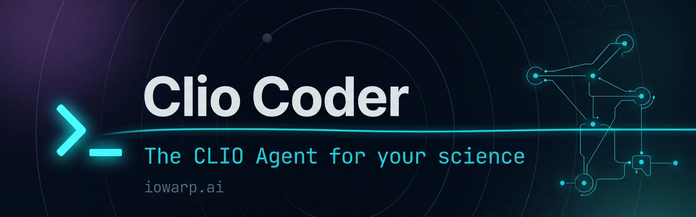

<p align="center">
  
</p>

# Clio Coder

**The meta-harness for scientific software: every model you have, one way of
working, and checks you can inspect.**

<p align="center">
  <a href="https://www.npmjs.com/package/@iowarp/clio-coder"></a>
  <a href="LICENSE"></a>
</p>

You probably reach models in more than one way: Ollama or vLLM on a GPU box,
your lab's gateway, a cloud API key, and a ChatGPT, Claude, or GitHub Copilot
subscription. Each usually comes with its own agent and its own habits.
Clio Coder is one open-source harness over all of them. Your project guidance,
tools, safety rules, sessions, and evidence stay the same whichever model is
answering, and switching models takes one command.

It is built for the code science runs on: simulations, numerical libraries,
data pipelines, and HPC workflows, where a change is done only when the checks
say so.

- **Every model, one workflow.** Chat on one model and send workers to others:
  a local model for searches, a strong one for review. No Clio account.
- **Checks you can inspect.** Clio runs your tests, compares numbers within a
  stated tolerance, and reruns computations from pinned inputs. It records
  what passed, what failed, and what was never checked.
- **Speaks science.** Reads HDF5, NetCDF, and Parquet, drives Slurm through
  MCP, and installs on HPC login nodes without root.
- **You set the authority.** Approvals, read-only runs, OS sandboxing, and
  damage-control rules decide what the agent may touch.

<p align="center">
  <a href="#get-started"><strong>Get started</strong></a> ·
  <a href="#for-ai-agents-installing-clio-coder">For AI agents</a> ·
  <a href="#what-you-can-do">What you can do</a> ·
  <a href="#models">Models</a> ·
  <a href="#interfaces">Interfaces</a> ·
  <a href="#safety-and-control">Safety</a> ·
  <a href="#documentation">Docs</a> ·
  <a href="https://coder.iowarp.ai">Website</a>
</p>

> **Open source, pre-1.0.** The terminal is the primary interface; the desktop
> app is in alpha. Commands and settings can change between minor releases, so
> check the [changelog](CHANGELOG.md) when upgrading.

## Get started

You need a model that supports tool calling. Linux, macOS, and WSL are the
primary platforms; native Windows is best effort.

**1. Install.** The installer brings its own Node.js and needs no root:

```bash
curl -fsSL https://coder.iowarp.ai/install.sh | sh
```

With Node.js 22.19 or newer already installed, npm works too:

```bash
npm install -g @iowarp/clio-coder
```

**2. Start it in a project.**

```bash
cd /path/to/your/project
clio-coder
```

The first launch opens setup. Pick what you already have (an app on this
computer, a model server, a subscription, or an API key), and Clio checks the
connection and lists the models it can reach. Later, `/model` switches models
and `/config` reruns setup.

**3. Ask for something real.** Start read-only:

> Explain how this repository builds and runs its tests, and name its main
> entry points. Do not change files.

Then a focused change with a clear finish line:

> The test in tests/test_solver.py fails. Make the smallest fix, run the
> tests, show me the diff, and tell me anything you could not verify.

Clio asks before commands it cannot sandbox or recognize, and before outward
actions such as `git push`. Ask it about itself too, such as "how do I send
workers to a different model?": it searches its own bundled documentation.
`/help` lists commands, `clio-coder doctor` checks the installation, and
[your first hour](docs/README.md#your-first-hour) walks through the next
steps. If your shell cannot find `clio-coder`, follow the installer's `PATH`
instruction, then run `command -v clio-coder` to see which file the bare name
reaches.

<details>
<summary><strong>Other package managers, and building from source</strong></summary>

```bash
pnpm add -g @iowarp/clio-coder
bun add -g @iowarp/clio-coder         # still runs on Node.js 22.19+ from PATH
npx --yes @iowarp/clio-coder@latest   # no global install
```

The installer skips the optional Claude Agent SDK (about 224 MB); Claude setup
offers it on first use, or install it up front with
`curl -fsSL https://coder.iowarp.ai/install.sh | sh -s -- --include-claude-sdk`.

From source, build the release tag:

```bash
git clone --branch v0.7.0 https://github.com/iowarp/clio-coder.git
cd clio-coder
corepack enable pnpm
pnpm run install:local
export PATH="$HOME/.local/bin:$PATH"
hash -r
"$HOME/.local/bin/clio-coder" --version
command -v clio-coder
```

See the [contributor guide](CONTRIBUTING.md) for development on the version branch.

</details>

<details>
<summary><strong>HPC login nodes, native Windows, and pre-releases</strong></summary>

The native installer supports x64 Linux with glibc 2.17 or newer, including
HPC login nodes, and leaves system Node unchanged. It installs under
`~/.local/share/clio-coder-install` (macOS: `~/Library/Application
Support/clio-coder/install`) with the launcher at `~/.local/bin/clio-coder`.
It checks Node downloads against `SHASUMS256.txt` and verifies release
signatures when `gpgv` or `gpg` is available. If the website is unreachable,
use `https://github.com/iowarp/clio-coder/releases/latest/download/install.sh`.
On Linux it offers the desktop app; `--gui` or `--no-gui` answers up front.
[HPC clusters](docs/guide/hpc-clusters.md) covers proxies, older glibc,
mirrors, and air-gapped sites.

On native Windows, run `irm https://coder.iowarp.ai/install.ps1 | iex` in
PowerShell. It needs no administrator rights and writes the launcher to
`%USERPROFILE%\.local\bin\clio-coder.cmd`. Release checks only boot the
package on Windows, so interactive use there is best effort.

Release candidates ship on the `beta` channel:
`curl -fsSL https://coder.iowarp.ai/install.sh | sh -s -- --channel beta`,
`npm install -g @iowarp/clio-coder@beta`, or `clio-coder upgrade --channel beta`.
Return with `clio-coder upgrade --channel latest`.

</details>

<details>
<summary><strong>Updates, rollback, reset, and uninstall</strong></summary>

| Goal | Command |
| --- | --- |
| Update now | `clio-coder upgrade`, or `/upgrade` in the terminal |
| Restore the previous installer version | `clio-coder upgrade --rollback` |
| Turn off background updates | Install with `--no-auto-update`, or set `CLIO_CODER_AUTO_UPDATE=0` |
| Clear sessions but keep settings | `clio-coder reset --state` |
| Start model setup over | `clio-coder reset --settings` |
| Remove Clio Coder, keeping settings and credentials | `clio-coder uninstall --keep-config` |
| Remove everything | `clio-coder uninstall` |

An installer install checks its channel at most once a day while idle,
installs a newer release beside the current one, and switches over at the
next start; `/resume` picks your conversation back up. npm, pnpm, and Bun
installs show a notice instead. Reset and uninstall preview what they remove
and ask first. See [installation and lifecycle](docs/guide/installation-and-lifecycle.md).

</details>

## For AI agents: installing Clio Coder

If a user asked you to install or set up Clio Coder, follow these steps. Every
command here is non-interactive and was run as written; steps that need the
human are listed at the end.

1. **Install** without root. `--no-gui` skips the desktop-app question:

   ```bash
   curl -fsSL https://coder.iowarp.ai/install.sh | sh -s -- --no-gui
   ```

   With Node.js 22.19 or newer on `PATH`, `npm install -g @iowarp/clio-coder`
   also works. On native Windows: `irm https://coder.iowarp.ai/install.ps1 | iex`.

2. **Verify** the launcher the installer wrote:

   ```bash
   export PATH="$HOME/.local/bin:$PATH"
   "$HOME/.local/bin/clio-coder" --version
   command -v clio-coder
   ```

   The installer does not edit shell profiles unless given `--modify-path`.
   If `command -v` prints nothing or another file, tell the user to add
   `~/.local/bin` to `PATH` in their shell profile, or rerun the installer
   with `--modify-path` if they agree.

3. **Connect a model.** Ask the user what they use, then save it as a
   *target* (a named connection) and make it the chat default:

   ```bash
   clio-coder configure --list    # every runtime id and what it needs

   # A local Ollama server
   clio-coder configure --id local --runtime ollama \
     --url http://127.0.0.1:11434 --model <model> --set-orchestrator

   # A lab gateway (LiteLLM or another OpenAI-compatible server)
   clio-coder configure --id lab --runtime litellm \
     --url https://gateway.example.org --model <model> \
     --api-key-env LAB_API_KEY --set-orchestrator

   # A cloud API key the user already exports
   clio-coder configure --id work --runtime anthropic \
     --model <model> --api-key-env ANTHROPIC_API_KEY --set-orchestrator

   # GitHub Copilot, once the user has signed in (see the end of this list)
   clio-coder tools install copilot-sdk
   clio-coder configure --id copilot --runtime copilot-sdk \
     --model <model> --set-orchestrator
   ```

   `clio-coder models --target <id>` lists the model ids a target offers, and
   `clio-coder targets --probe` checks each connection. Never write a key into
   a file or onto a command line yourself: `--api-key-env` names a variable,
   and Clio reads it at call time.

4. **Check the installation:** `clio-coder doctor` lists problems first, and
   `clio-coder doctor --fix` makes the repairs it can make safely.

5. **Smoke test** in the user's project. `--read-only` guarantees no file
   changes; exit code 0 means the model answered:

   ```bash
   clio-coder run --read-only "Summarize this repository and how to run its tests."
   ```

**Leave these to the human:**

- Subscription sign-ins open a browser or ask for a pasted code:
  `clio-coder auth login openai-codex` (ChatGPT),
  `clio-coder auth login anthropic-max` (Claude), or
  `clio-coder auth login alcf` (Argonne). For GitHub Copilot, the user signs in
  with `copilot login` or `gh auth login`; then you can run the Copilot lines
  in step 3. A headless run cannot see a login kept only in the system
  keychain, and `clio-coder doctor` names the login it sees.
- The interactive terminal (`clio-coder`), the setup wizard
  (`clio-coder configure` with no flags), and approving project trust.

A headless `run` denies anything that would need an approval, so put limits
and decisions in the prompt. For more, use `clio-coder --help`,
`clio-coder <command> --help`, and `clio-coder paths`. The guides in
[docs/](docs/README.md) ship inside the package.

<details>
<summary><strong>Working on this repository instead</strong></summary>

Read [CONTRIBUTING.md](CONTRIBUTING.md) and the
[architecture guide](docs/architecture/architecture.md). A local
`CLIO-CODER.md` gives checkout guidance when present. Contributions target the
current version branch; `main` advances with releases.

</details>

## What you can do

<p align="center">
  <a href="https://raw.githubusercontent.com/iowarp/clio-coder/main/assets/screenshots/tui-boot.png"></a>
</p>

**Change scientific code and prove it.** Say what "done" means: tests, a
numerical comparison with a tolerance, a performance budget. Clio runs the
checks and keeps the results as evidence; `clio-coder evidence list` and
`/view` show them. A `reproduce` check reruns an analysis from sha256-pinned
inputs, and `clio-coder claims` lists what was supported or refuted.

**Climb a metric, compare models.** `clio-coder research` runs Clio's agent
in worktrees to move one measured number, such as wall time, and keeps a change
only when interleaved trials and a bootstrap interval show a real gain and every
gate check passes. `clio-coder arena` runs one prompt on 2 to 4 models, shows
their work blind, and builds standings from your votes. See
[research and arena](docs/guide/research-and-arena.md).

**Read scientific data.** The `data` tool inspects HDF5, NetCDF, and Parquet
files with summary statistics, so the agent reasons about real outputs instead
of guessing.

**Run on clusters.** Install on a login node without root, work on air-gapped
sites, and submit and watch Slurm jobs through MCP. See
[HPC clusters](docs/guide/hpc-clusters.md) and [Slurm](docs/guide/slurm.md).

**Split the work across models.** Workers run on other targets with a fixed
permit for their tools and return a receipt. `/oracle` asks a read-only
advisor to challenge a decision, and `/council` puts one task to a roster of
read-only members. See [fleet dispatch](docs/guide/fleet-dispatch.md).

**Know what it cost.** `/usage` shows spend per target and the cost per
verified outcome. Sessions, evidence, and telemetry stay on your machine.

**Add skills and tools.** Install reviewed packs from the bundled library,
including `hpc`, `science-data`, `literature`, and `life-science`:

```bash
clio-coder library search slurm
clio-coder library install plugin:hpc --with-requirements
```

Clio also loads MCP servers, skills, agents, prompts, and its own
process-isolated extensions. See the [library](docs/guide/resource-library.md)
and [extensions](docs/guide/harness-extensions.md).

## Models

A saved connection is a **target**. Chat and workers can use different
targets, models, and thinking levels, and `/model` switches the conversation.

| Connection | Supported |
| --- | --- |
| Local and self-hosted | Ollama, LM Studio, llama.cpp, vLLM, SGLang, Lemonade |
| Gateways | LiteLLM, any OpenAI-compatible or Anthropic-compatible API |
| Cloud APIs | OpenAI, Anthropic, Google, OpenRouter, Groq, Mistral, DeepSeek, Amazon Bedrock, Inception |
| Subscriptions | ChatGPT (`openai-codex`), Claude (`anthropic-max`), GitHub Copilot (`copilot-sdk`) |
| Institutional | Argonne ALCF Sophia and Metis through Globus |
| Other coding agents, as workers | Claude Code, Codex, OpenCode, Pi, Antigravity |

Start with a model whose tool calling works reliably on your runtime; a
supported protocol does not guarantee every model's quality. The providers
you configure receive the requests sent to them. See
[configuration and targets](docs/guide/configuration-and-targets.md) and the
[model catalog](docs/architecture/model-catalog.md).

## Interfaces

| Surface | Start with | Best for |
| --- | --- | --- |
| **Terminal** (primary) | `clio-coder` | Interactive coding, diffs, approvals, worker activity |
| **Desktop** (alpha) | `clio-coder gui` | A visual workspace with usage, artifacts, evidence, and sessions |
| **Scripts and CI** | `clio-coder run "task"` | Unattended runs; `--json` streams JSONL |
| **Editors** | `clio-coder acp` | Agent Client Protocol clients |

All surfaces share the same connections, project context, and tool policy.
See [commands and modes](docs/guide/commands-and-modes.md),
[the GUI guide](docs/guide/gui.md), and [interoperability](docs/guide/interop.md).

## Safety and control

Clio edits files and runs commands with your permissions. You decide how much
of that it may do on its own.

| Control | What it does |
| --- | --- |
| **Approvals** | Reads, edits, and sandboxed or recognized commands run; other commands and outward actions such as `git push` ask first. |
| **Read-only** | `--read-only` leaves every user file exactly as it was. Clio may still write its own logs and memory. |
| **Sandbox** | Workers and shell commands at default autonomy run in an OS sandbox (bubblewrap on Linux) when one is available. |
| **Damage control** | Hard blocks and protected paths apply even in Yolo mode, which only removes ordinary prompts. |
| **Secrets** | Credentials are masked in command output and approval cards. |
| **Project trust** | Project plugins and extensions wait for your approval before they load. |

Command scanning is static and has limits; the sandbox is the real boundary
where it applies. A passing check proves only what that check exercised. See
the [safety model](docs/architecture/safety-model.md) and
[quality policies](docs/guide/quality-policy.md).

## Documentation

| You want to… | Start here |
| --- | --- |
| Get productive in the first hour | [Your first hour](docs/README.md#your-first-hour) |
| Install, connect, troubleshoot | [Installation](docs/guide/installation-and-lifecycle.md) · [Connect a model](docs/guide/configuration-and-targets.md) · [Troubleshooting](docs/guide/troubleshooting.md) |
| Find a command or setting | [Commands and modes](docs/guide/commands-and-modes.md) · [Configuration reference](docs/guide/configuration-reference.md) |
| Define checks or coordinate workers | [Quality policies](docs/guide/quality-policy.md) · [Fleet dispatch](docs/guide/fleet-dispatch.md) |
| Explore the implementation | [Architecture](docs/architecture/architecture.md) · [Documentation map](docs/README.md) |

The same guides are on the [website](https://coder.iowarp.ai/docs.html).

## Contribute and get help

Good reports describe the task, what you expected, what happened, the Clio and
Node versions, and a reproduction; output from `clio-coder doctor` helps.
Redact credentials and private data first. Experience reports from scientific
projects are especially welcome.

[Issues](https://github.com/iowarp/clio-coder/issues) ·
[Discussions](https://github.com/iowarp/clio-coder/discussions) ·
[Contributor guide](CONTRIBUTING.md) · [Code of Conduct](CODE_OF_CONDUCT.md) ·
[Changelog](CHANGELOG.md) · [Security](SECURITY.md) · coder@iowarp.ai

## Acknowledgements

Clio Coder is developed by the [Gnosis Research Center](https://grc.iit.edu) at
[Illinois Tech](https://www.iit.edu), in collaboration with the
[University of Utah](https://www.utah.edu), as part of [IOWarp](https://iowarp.ai).
The IOWarp CLIO architecture is supported by the National Science Foundation
under collaborative awards
[OAC-2411318](https://www.nsf.gov/awardsearch/showAward?AWD_ID=2411318) and
[OAC-2411319](https://www.nsf.gov/awardsearch/showAward?AWD_ID=2411319), 2024–2029.

Clio builds on the [Pi agent framework](https://github.com/earendil-works/pi),
[ACP](https://agentclientprotocol.com), and [MCP](https://modelcontextprotocol.io).
Its panes are powered by [herdr](https://github.com/herdrdev/herdr) (Apache-2.0),
whose license ships beside the binary Clio installs.
Dependency and component notices are in [NOTICE](NOTICE).

CLIO means **Context Layer for Input/Output**. Related IOWarp projects include
[clio-core](https://github.com/iowarp/clio-core) for data and context storage and
[clio-kit](https://github.com/iowarp/clio-kit) for scientific tool servers.
