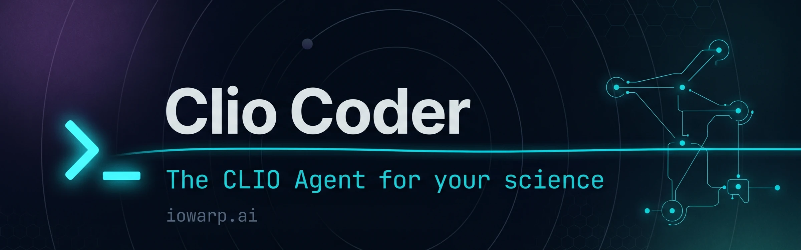
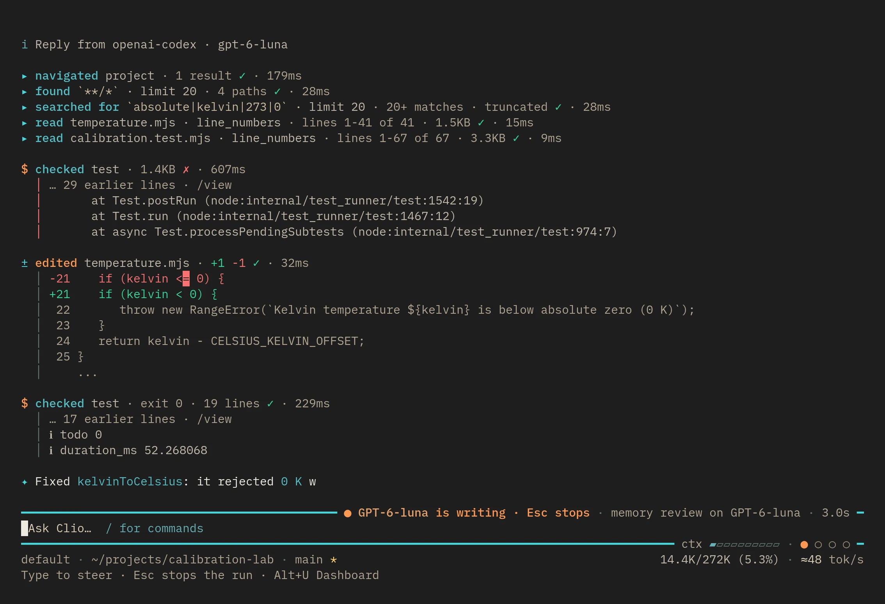
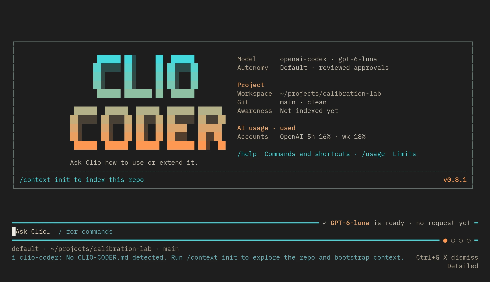
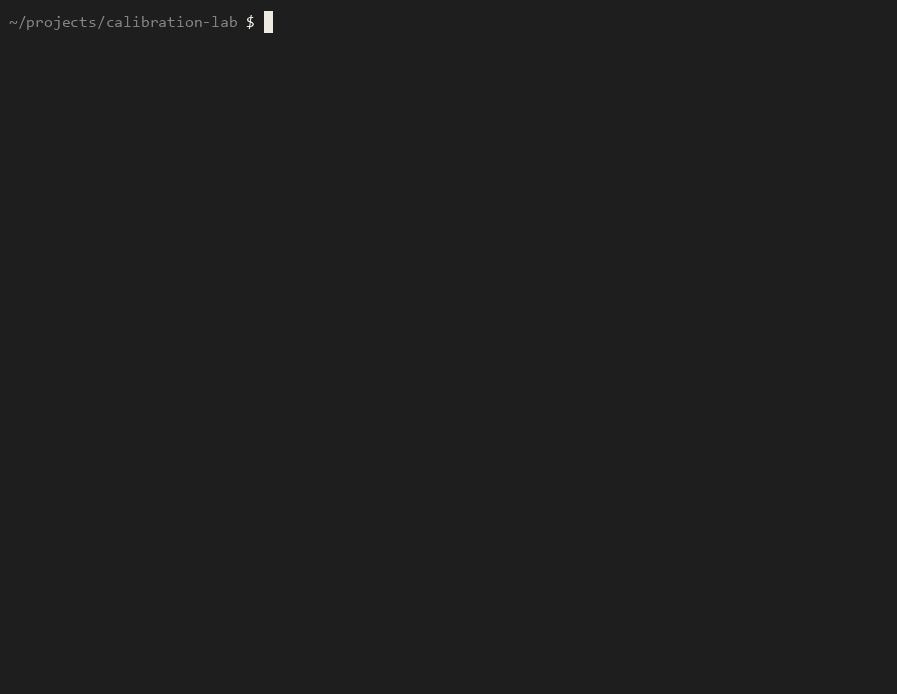

<p align="center">
  
</p>

# CLIO Coder

**The open-source coding agent that works with every model you have, and shows you the checks behind what it says.**

One set of project rules, checks and safety controls sits above any model: a
GPU in your lab, a gateway, a cloud API, or a subscription you already pay
for. Change the model and nothing else changes.

<p align="center">
  <a href="https://www.npmjs.com/package/@iowarp/clio-coder"></a>
  <a href="LICENSE"></a>
</p>

<p align="center">
  <a href="https://raw.githubusercontent.com/iowarp/clio-coder/main/site/assets/tui-verify.png"></a>
</p>

```bash
curl -fsSL https://coder.iowarp.ai/install.sh | sh
clio-coder
```

No root and no account. The first launch connects a model.

<p align="center">
  <a href="#why-clio-coder">Why</a> ·
  <a href="#built-for-science-and-hpc">Science and HPC</a> ·
  <a href="#new-in-083">New in 0.8.3</a> ·
  <a href="#get-started"><strong>Get started</strong></a> ·
  <a href="#models">Models</a> ·
  <a href="#safety-and-control">Safety</a> ·
  <a href="#for-ai-agents-installing-clio-coder">For AI agents</a> ·
  <a href="#documentation">Docs</a> ·
  <a href="https://coder.iowarp.ai">Website</a>
</p>

## Why CLIO Coder

- **Any model you have.** Local GPUs, lab gateways, cloud APIs, and the
  ChatGPT, Claude and GitHub Copilot subscriptions you already pay for.
  `/model` switches the conversation, and your project rules, tools and
  sessions stay the same.
- **Claims tied to checks that ran.** CLIO Coder runs your tests, compares
  numbers within a tolerance you set, and reruns an analysis from pinned
  inputs. It records what passed, what failed and what was never checked,
  and each recorded claim names its commit, platform and command.
- **Yolo that stays contained.** Leave it running with no approval cards. An
  OS sandbox, file snapshots you can `/rewind`, and a safety judge stay on.
- **A fleet of workers.** Chat on one model and send workers to others: a
  local model for searches, a strong one for review. Claude Code, Codex,
  OpenCode and Pi can be workers too, under your project's rules.
- **One agent, four ways in.** The terminal, `clio-coder run` for scripts and
  CI, ACP for editors, and a desktop app in alpha. All of them share the same
  connections, project rules and tool policy.
- **Open source, Apache-2.0.** Project rules and checks live in plain files in
  your repository. There is no CLIO Coder account, and nothing is sent home in
  the background.

## Built for science and HPC

CLIO Coder is made for people who change code that science depends on:
simulations, numerical libraries, I/O and data pipelines, and HPC workflows.
In that work a change is done only when the checks say so.

- **Login nodes, no root.** One command installs under your home directory on
  x64 Linux with glibc 2.17 or newer and leaves the system Node.js unchanged.
  It works behind a proxy and on air-gapped sites.
- **Your site's models.** A model server on a compute node, a lab gateway, or
  Argonne ALCF through Globus. A lab can publish one setup file, and
  `clio-coder configure --import <path-or-https-url>` connects everyone to the
  same gateway.
- **The `hpc` pack.** Skills for Slurm job arrays and sweeps, Lmod and Spack
  environments, parallel HDF5 and MPI-IO, Darshan I/O analysis and ChronoLog
  run records. They drive the cluster's own command-line tools.
- **Scientific data.** The `data` tool reads HDF5, NetCDF and Parquet files
  with summary statistics, so the agent reasons about real outputs instead of
  guessing. A per-project store keeps results outside the working tree and
  records where each file came from.
- **Correctness reviews.** The `hoare` pack reviews C, C++, Python and Fortran
  functions with Hoare logic, one check per proof obligation. Only a prover
  check you declared counts as proof.
- **Shared systems.** Session files are written owner-only, and the sandbox
  hides your credentials, shell history and other tools' logins from the
  commands the agent runs.

```bash
clio-coder library install plugin:hpc --with-requirements
clio-coder library install plugin:hoare
```

Start with [HPC clusters](docs/guide/hpc-clusters.md), which covers installs
without root, older glibc, `module load`, proxies and
[shared login nodes](docs/guide/hpc-clusters.md#shared-login-nodes). Then see
[Slurm](docs/guide/slurm.md) and the [store](docs/guide/store.md).

## New in 0.8.3

- **Extensions can confine every worker.** A desk that adds write roots to a dispatch whose intent declared none now narrows it inside the workspace instead of being refused.
- **Stateful tools are not mistaken for loops.** A repeated call counts as a loop only while its results match, so an extension's `next_step` keeps handing out steps.
- **Yolo stops cleanly.** A token, call or minute cap lets the running tool call finish and stops before the next model request, and a continuation after the tool budget says every tool is available again.
- **Your questions wait for you.** An `operator_only` question stays open however long you are away, at every autonomy level.

0.8.3 changes how `operator_only` questions wait at yolo and where a yolo cap stops. Read the
[Upgrade notes](CHANGELOG.md#upgrade-notes) before upgrading.

> **Pre-1.0.** The terminal is the primary interface, and the desktop app is
> in alpha. Commands and settings can change between minor releases, so read
> the [changelog](CHANGELOG.md) when upgrading.

## Get started

You need a model that supports tool calling. Linux, macOS and WSL are the
primary platforms. Native Windows is best effort.

**1. Install.** The installer brings its own Node.js and needs no root:

```bash
curl -fsSL https://coder.iowarp.ai/install.sh | sh
```

With Node.js 22.19 or newer already installed, npm works too:

```bash
npm install -g @iowarp/clio-coder
```

**2. Start it in a project.**

```bash
cd /path/to/your/project
clio-coder
```

<p align="center">
  <a href="https://raw.githubusercontent.com/iowarp/clio-coder/main/assets/screenshots/tui-boot.png"></a>
</p>

The first launch connects a model. CLIO Coder offers what it found first: a
key in your environment, a stored sign-in, or a model server on this machine.
Otherwise pick what you have: an API key, a subscription, a model server or
gateway, or a setup file from your lab. Setup sends the model one short test
message and saves once it answers. Later, `/model` switches models and
`/config` adds another connection.

**3. Ask for something real.** Start read-only:

> Explain how this repository builds and runs its tests, and name its main
> entry points. Do not change files.

Then a focused change with a clear finish line:

> The test in tests/test_solver.py fails. Make the smallest fix, run the
> tests, show me the diff, and tell me anything you could not verify.

The same kind of request on a small JavaScript project, recorded on GPT-6 Luna:

<p align="center">
  
</p>

CLIO Coder asks before commands it cannot sandbox or recognize, and before
outward actions such as `git push`. You can ask it about itself too, such as
"how do I send workers to a different model?", and it searches its own
bundled documentation. `/help` lists commands, `clio-coder doctor` checks the
installation, and [your first hour](docs/README.md#your-first-hour) walks
through the next steps.

If your shell cannot find `clio-coder`, follow the installer's `PATH`
instruction, then run `command -v clio-coder` to see which file the bare name
reaches.

<details>
<summary><strong>Other package managers, and building from source</strong></summary>

```bash
pnpm add -g @iowarp/clio-coder
bun add -g @iowarp/clio-coder         # still runs on Node.js 22.19+ from PATH
npx --yes @iowarp/clio-coder@latest   # no global install
```

The installer skips the optional Claude Agent SDK (about 224 MB). Claude setup
offers it on first use, or install it up front with
`curl -fsSL https://coder.iowarp.ai/install.sh | sh -s -- --include-claude-sdk`.

From source, build the release tag:

```bash
git clone --branch v0.8.3 https://github.com/iowarp/clio-coder.git
cd clio-coder
corepack enable pnpm
pnpm run install:local
export PATH="$HOME/.local/bin:$PATH"
hash -r
"$HOME/.local/bin/clio-coder" --version
command -v clio-coder
```

See the [contributor guide](CONTRIBUTING.md) for development on the version branch.

</details>

<details>
<summary><strong>HPC login nodes and native Windows</strong></summary>

The installer supports x64 Linux with glibc 2.17 or newer, including HPC login
nodes. It puts the launcher at `~/.local/bin/clio-coder` and checks what it
downloads. If the website is unreachable, use
`https://github.com/iowarp/clio-coder/releases/latest/download/install.sh`.
On Linux the installer offers the desktop app, and `--gui` or `--no-gui`
answers up front. [HPC clusters](docs/guide/hpc-clusters.md) covers proxies,
older glibc, mirrors and air-gapped sites.

On native Windows, run `irm https://coder.iowarp.ai/install.ps1 | iex` in
PowerShell. It needs no administrator rights. Release checks only boot the
package on Windows, so interactive use there is best effort, and WSL is the
recommended route.

</details>

<details>
<summary><strong>Update, roll back, reset, and uninstall</strong></summary>

| Goal | Command |
| --- | --- |
| Update now | `clio-coder upgrade`, or `/upgrade` in the terminal |
| Go back to the version before the last upgrade | `clio-coder upgrade --rollback` |
| Turn off background updates | Install with `--no-auto-update`, or set `CLIO_CODER_AUTO_UPDATE=0` |
| Clear sessions but keep settings | `clio-coder reset --state` |
| Start model setup over | `clio-coder reset --settings` |
| Remove CLIO Coder, keeping settings and credentials | `clio-coder uninstall --keep-config` |
| Remove everything | `clio-coder uninstall` |

An installer install checks for a newer release at most once a day while
idle and switches over at the next start. npm, pnpm and Bun installs show a
notice instead. Reset and uninstall preview what they remove and ask first.
See [installation and lifecycle](docs/guide/installation-and-lifecycle.md).

</details>

## What you can do

**Change code and show that it works.** Say what "done" means: your tests, a
numerical comparison within a tolerance, a performance budget. CLIO Coder runs
the checks and keeps the results as evidence you can open later with `/view`
or `clio-coder evidence list`. See
[quality policies](docs/guide/quality-policy.md).

**Keep a record of what held up.** Each judged numerical or reproduction
check becomes a claim. `clio-coder claims` lists what agreed and what did
not. A later failure at the same commit retires an earlier pass, and claims
from older commits read as stale. A claim never says a result is
scientifically right. It says which check ran and what that check found. See
the [claims ledger](docs/architecture/evidence-and-memory.md#claims-ledger).

**Put several models on one task.** Workers run on other models with a fixed
set of permissions and return a receipt. `/council` puts one task to a group
of read-only members, `/poll 3 <question>` asks independent agents for a
vote, and `/oracle` asks a read-only advisor to challenge a decision. See
[fleet dispatch](docs/guide/fleet-dispatch.md).

**Automate it.** `clio-coder run "<task>"` is one unattended turn for scripts
and CI. Exit codes say what happened, `--max-cost-usd` and `--timeout` bound
the run, and `--read-only` guarantees no file changes. See
[exit codes and output](docs/guide/exit-codes-and-output.md).

**Improve a measured number, or compare models.** `clio-coder research` tries
changes in worktrees to move one number, such as wall time, and keeps a change
only when repeated trials show a real gain and every check passes.
`clio-coder arena` runs one prompt on 2 to 4 models, shows their work blind,
and builds standings from your votes. See
[research and arena](docs/guide/research-and-arena.md).

**Tell it once.** Type `remember that ...` or `from now on ...` and CLIO Coder
saves your words for this project, everywhere, or only this session. See
[memory](docs/guide/proactive-memory.md#tell-clio-coder-what-to-remember).

**Know what it cost.** `/usage` shows spend per model connection and the cost
per verified outcome.

**Add skills and tools.** Install reviewed packs from the bundled library,
including `hpc`, `hoare`, `science-data`, `literature` and `life-science`.
CLIO Coder also loads MCP servers, skills, agents, prompts and its own
process-isolated extensions. See the [library](docs/guide/resource-library.md)
and [extensions](docs/guide/harness-extensions.md).

## Models

A saved connection is called a **target**. Chat and workers can use different
targets, models and thinking levels, and `/model` switches the conversation.

<p align="center">
  
</p>

| Connection | Supported |
| --- | --- |
| Local and self-hosted | Ollama, LM Studio, llama.cpp, vLLM, SGLang, Lemonade |
| Gateways | LiteLLM, any OpenAI-compatible or Anthropic-compatible API |
| Institutional | Argonne ALCF Sophia and Metis through Globus |
| Cloud APIs | OpenAI, Anthropic, Google, OpenRouter, Groq, Mistral, DeepSeek, Amazon Bedrock, Inception |
| Subscriptions | ChatGPT (`openai-codex`), Claude (`anthropic-max`), GitHub Copilot (`copilot-sdk`) |
| Other coding agents, as workers | Claude Code, Codex, OpenCode, Pi, Antigravity |

Start with a model whose tool calling works reliably on your runtime. A
supported protocol does not guarantee every model's quality. The providers
you configure receive the requests sent to them. See
[configuration and targets](docs/guide/configuration-and-targets.md) and the
[model catalog](docs/architecture/model-catalog.md).

## Interfaces

| Surface | Start with | Best for |
| --- | --- | --- |
| **Terminal** (primary) | `clio-coder` | Interactive coding, diffs, approvals, worker activity |
| **Desktop** (alpha) | `clio-coder gui` | A visual workspace with usage, artifacts, evidence and sessions |
| **Scripts and CI** | `clio-coder run "task"` | Unattended runs; `--json` streams JSONL |
| **Editors** | `clio-coder acp` | Agent Client Protocol clients |

See [commands and modes](docs/guide/commands-and-modes.md),
[the GUI guide](docs/guide/gui.md) and [interoperability](docs/guide/interop.md).

## Safety and control

CLIO Coder edits files and runs commands with your permissions. You decide
how much of that it may do on its own.

| Control | What it does |
| --- | --- |
| **Approvals** | Reads, edits, and sandboxed or recognized commands run. Other commands and outward actions such as `git push` ask first. |
| **Read-only** | `--read-only` leaves every user file exactly as it was. CLIO Coder may still write its own logs and memory. |
| **Sandbox** | Workers and shell commands run in an OS sandbox (bubblewrap on Linux) when one is available. It hides credential files, other agents' logins, shell histories, browser profiles and your project's secret files. `safety.sandbox: required` refuses to run them without it. |
| **Yolo** | For work you leave running. Approval cards never wait, while the sandbox, snapshots and safety judge stay on. Questions only you can answer still reach you. |
| **Undo** | `/rewind` restores files from the snapshot taken before a change. |
| **Damage control** | Hard blocks and protected paths apply at every autonomy level. |
| **Secrets** | Credentials are masked in command output and approval cards. |
| **Project trust** | A repository's own CLIO Coder configuration waits for your approval before it loads, and project settings can only tighten safety. |

Command scanning is static and has limits. The sandbox is the real boundary
where it applies, and each release lists its
[known limits](CHANGELOG.md#known-limits). A passing check proves only what
that check exercised. [Sandbox and safety](docs/guide/sandbox-and-safety.md)
explains this in plain terms, and the
[safety model](docs/architecture/safety-model.md) has the exact rules. To
report a vulnerability, follow [SECURITY.md](SECURITY.md).

## No call-home. Sharing is explicit.

CLIO Coder sends nothing home in the background, ever. Sessions, evidence and
telemetry stay on your machine, and the providers you configure receive only
the requests you send them.

When something goes wrong, `/report` (or `clio-coder report`) drafts a report,
masks paths, host names and secrets, and shows you the exact text before
anything is sent. Sharing a diagnostic bundle with the maintainers is a
command you run yourself, one item at a time. Each share is previewed,
encrypted so that only the maintainers can open it, kept as a secret gist in
your own GitHub account, and deletable. Your agent never shares for you. See
[Share with the maintainers](docs/guide/troubleshooting.md#share-with-the-maintainers).

## For AI agents: installing CLIO Coder

If a user asked you to install, set up or drive CLIO Coder, follow the steps
in the block below. Every command there is non-interactive, and the steps
that need the human are listed at the end.

<details>
<summary><strong>Install, connect a model, and drive <code>clio-coder run</code></strong></summary>

1. **Install** without root. `--no-gui` skips the desktop-app question:

   ```bash
   curl -fsSL https://coder.iowarp.ai/install.sh | sh -s -- --no-gui
   ```

   With Node.js 22.19 or newer on `PATH`, `npm install -g @iowarp/clio-coder`
   also works. On native Windows: `irm https://coder.iowarp.ai/install.ps1 | iex`.

2. **Verify** the launcher the installer wrote:

   ```bash
   export PATH="$HOME/.local/bin:$PATH"
   "$HOME/.local/bin/clio-coder" --version
   command -v clio-coder
   ```

   The installer does not edit shell profiles unless given `--modify-path`.
   If `command -v` prints nothing or another file, tell the user to add
   `~/.local/bin` to `PATH` in their shell profile, or rerun the installer
   with `--modify-path` if they agree.

3. **Connect a model.** Ask the user what they use, then save it as a
   *target* (a named connection) and make it the chat default:

   ```bash
   clio-coder configure --list    # every runtime id and what it needs

   # A local Ollama server
   clio-coder configure --id local --runtime ollama \
     --url http://127.0.0.1:11434 --model <model> --set-orchestrator

   # A lab gateway (LiteLLM or another OpenAI-compatible server)
   clio-coder configure --id lab --runtime litellm \
     --url https://gateway.example.org --model <model> \
     --api-key-env LAB_API_KEY --set-orchestrator

   # A cloud API key the user already exports
   clio-coder configure --id work --runtime anthropic \
     --model <model> --api-key-env ANTHROPIC_API_KEY --set-orchestrator

   # A setup file the user's lab or site publishes
   clio-coder configure --import <path-or-https-url> --yes

   # GitHub Copilot, once the user has signed in (see the end of this list)
   clio-coder tools install copilot-sdk
   clio-coder configure --id copilot --runtime copilot-sdk \
     --model <model> --set-orchestrator
   ```

   `clio-coder models --target <id>` lists the model ids a target offers, and
   `clio-coder targets --probe` checks each connection. Add `--verify` to a
   `configure --id` line to send one test request and save only if the model
   answers. Never write a key into a file or onto a command line yourself:
   `--api-key-env` names a variable, and CLIO Coder reads it at call time.

4. **Check the installation:** `clio-coder doctor` lists problems first, and
   `clio-coder doctor --fix` makes the repairs it can make safely. It exits 0
   when nothing needs attention and 1 when a problem remains.

5. **Smoke test** in the user's project. `--read-only` guarantees no file
   changes; exit code 0 means the model answered:

   ```bash
   clio-coder run --read-only "Summarize this repository and how to run its tests."
   ```

**Driving `clio-coder run`.** One call is one headless turn. It denies
anything that would need an approval and has no way to ask a question, so put
limits and decisions in the task text.

| Flag | Effect |
| --- | --- |
| `--read-only` | Deny every write, command and delegation. |
| `--json` | Stream JSONL on stdout: a `session` header first, one `run_end` frame last, carrying `exitCode` and `outcome`. Read the result from `run_end`. |
| `--timeout <seconds>` | Wall-clock limit for the run; exit 124 on expiry. |
| `--max-cost-usd <N>` | Stop when priced spend reaches the cap; exit 4. |
| `--target <id>`, `--model <id>` | One-run connection and model. |
| `--cwd <dir>` | Run as if started in `<dir>`. |
| `--session <id>`, `--continue` | Append the turn to an existing session. |
| `--verify "<cmd>"` | An acceptance check for this run, repeatable. |

| Exit code | Meaning |
| --- | --- |
| 0 | The run settled cleanly. |
| 1 | The run failed: an error, a refused command that left nothing done, a failed verifier verdict, or a worker result that was not merged. |
| 2 | Usage or configuration: an unknown flag, target or model, no usable chat route, or a task piped to bare `clio-coder`. |
| 3 | A dispatched worker was ended by permission refusals, or a yolo run was ended by repeated safety-judge blocks. |
| 4 | The priced spend ceiling, `--max-cost-usd` or a yolo run's autonomous budget stopped the run. |
| 124 | `--timeout` expired. |
| 129, 130, 143 | SIGHUP, SIGINT or SIGTERM ended the run. |
| 141 | The reader of stdout went away. |

The answer goes to stdout. Notices, the `observed:` line (tool calls,
refusals, writes and checks the harness saw) and errors go to stderr.

**Files and where to look.**

- `clio-coder paths --json` prints the resolved config, data, state and cache
  directories. User settings are `settings.yaml` in the config directory.
- A project's own files live in `.clio-coder/` at the repository root, and its
  handbook is `CLIO-CODER.md`. `clio-coder context init` drafts one.
- `clio-coder --help` and `clio-coder <command> --help` are the command
  reference. The guides in [docs/](docs/README.md) ship inside the package;
  start with [exit codes and output](docs/guide/exit-codes-and-output.md),
  [commands and modes](docs/guide/commands-and-modes.md) and
  [troubleshooting](docs/guide/troubleshooting.md), which is indexed by exact
  error message.
- To report a problem you hit, `clio-coder report bug --title "<title>" --dry-run`
  previews the masked report and sends nothing. Sending is the user's decision.

**Leave these to the human:**

- Subscription sign-ins open a browser on a desktop; over SSH or without a
  display they print a link to open on another device, with a code to enter
  there or to paste back:
  `clio-coder auth login openai-codex` (ChatGPT),
  `clio-coder auth login anthropic-max` (Claude), or
  `clio-coder auth login alcf` (Argonne). For GitHub Copilot, the user signs in
  with `copilot login` or `gh auth login`; then you can run the Copilot lines
  in step 3. A headless run cannot see a login kept only in the system
  keychain, and `clio-coder doctor` names the login it sees.
- The interactive terminal (`clio-coder`), the setup wizard
  (`clio-coder configure` with no flags), and approving project trust.
- Sending a report or sharing a diagnostic bundle.

</details>

<details>
<summary><strong>Working on this repository instead</strong></summary>

Read [CONTRIBUTING.md](CONTRIBUTING.md) and the
[architecture guide](docs/architecture/architecture.md). The tracked
`CLIO-DEV.md` gives checkout guidance. Contributions target the
current version branch; `main` advances with releases.

</details>

## Documentation

The README is the short version. The guides carry the detail, and CLIO Coder
can search them for you from inside a session.

| You want to… | Start here |
| --- | --- |
| Get productive in the first hour | [Your first hour](docs/README.md#your-first-hour) |
| Run on a cluster | [HPC clusters](docs/guide/hpc-clusters.md) · [Slurm](docs/guide/slurm.md) · [Store](docs/guide/store.md) |
| Install, connect, troubleshoot | [Installation](docs/guide/installation-and-lifecycle.md) · [Connect a model](docs/guide/configuration-and-targets.md) · [Troubleshooting](docs/guide/troubleshooting.md) |
| Find a command or setting | [Commands and modes](docs/guide/commands-and-modes.md) · [Configuration reference](docs/guide/configuration-reference.md) · [Environment variables](docs/guide/environment-variables.md) |
| Script it | [Exit codes and output](docs/guide/exit-codes-and-output.md) · [Tool usage](docs/guide/tool-usage.md) |
| Define checks or coordinate workers | [Quality policies](docs/guide/quality-policy.md) · [Fleet dispatch](docs/guide/fleet-dispatch.md) |
| Understand what it may touch | [Sandbox and safety](docs/guide/sandbox-and-safety.md) · [Safety model](docs/architecture/safety-model.md) |
| Explore the implementation | [Architecture](docs/architecture/architecture.md) · [Documentation map](docs/README.md) · [Wiki](https://github.com/iowarp/clio-coder/wiki) |

The same guides are on the [website](https://coder.iowarp.ai/docs.html).

## Contribute and get help

Questions are welcome in
[Discussions](https://github.com/iowarp/clio-coder/discussions), and no
question is too basic. To report a bug or ask for a feature, run `/report`
inside CLIO Coder or `clio-coder report` in a shell. It fills in your version
and setup, masks private details, and shows you the text before it is sent.
You can also open an [issue](https://github.com/iowarp/clio-coder/issues) by
hand. Experience reports from scientific projects, local models and clusters
are especially welcome.

[Issues](https://github.com/iowarp/clio-coder/issues) ·
[Discussions](https://github.com/iowarp/clio-coder/discussions) ·
[Contributor guide](CONTRIBUTING.md) · [Code of Conduct](CODE_OF_CONDUCT.md) ·
[Changelog](CHANGELOG.md) · [Security](SECURITY.md)

## Acknowledgements

CLIO Coder is developed by the [Gnosis Research Center](https://grc.iit.edu) at
[Illinois Tech](https://www.iit.edu), in collaboration with the
[University of Utah](https://www.utah.edu), as part of [IOWarp](https://iowarp.ai).
The IOWarp CLIO architecture is supported by the National Science Foundation
under collaborative awards
[OAC-2411318](https://www.nsf.gov/awardsearch/showAward?AWD_ID=2411318) and
[OAC-2411319](https://www.nsf.gov/awardsearch/showAward?AWD_ID=2411319), 2024–2029.

CLIO Coder builds on the [Pi agent framework](https://github.com/earendil-works/pi),
[ACP](https://agentclientprotocol.com), and [MCP](https://modelcontextprotocol.io).
Its panes are powered by [herdr](https://github.com/herdrdev/herdr) (Apache-2.0),
whose license ships beside the installed binary.
Dependency and component notices are in [NOTICE](NOTICE).

CLIO means **Context Layer for Input/Output**. CLIO Coder is the coding agent
of the CLIO family. Related IOWarp projects include
[CLIO Core](https://github.com/iowarp/clio-core) for data and context storage
and [CLIO Kit](https://github.com/iowarp/clio-kit) for scientific tool servers.
