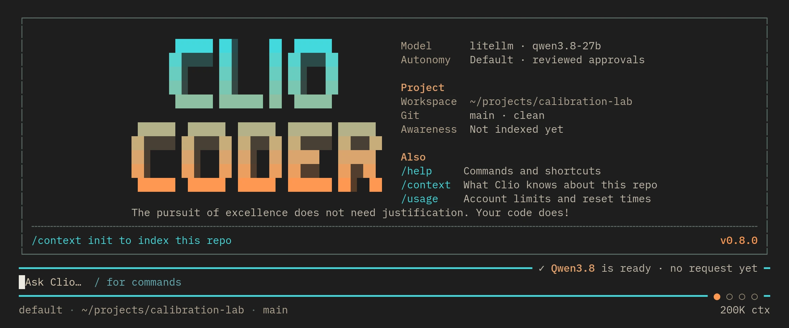
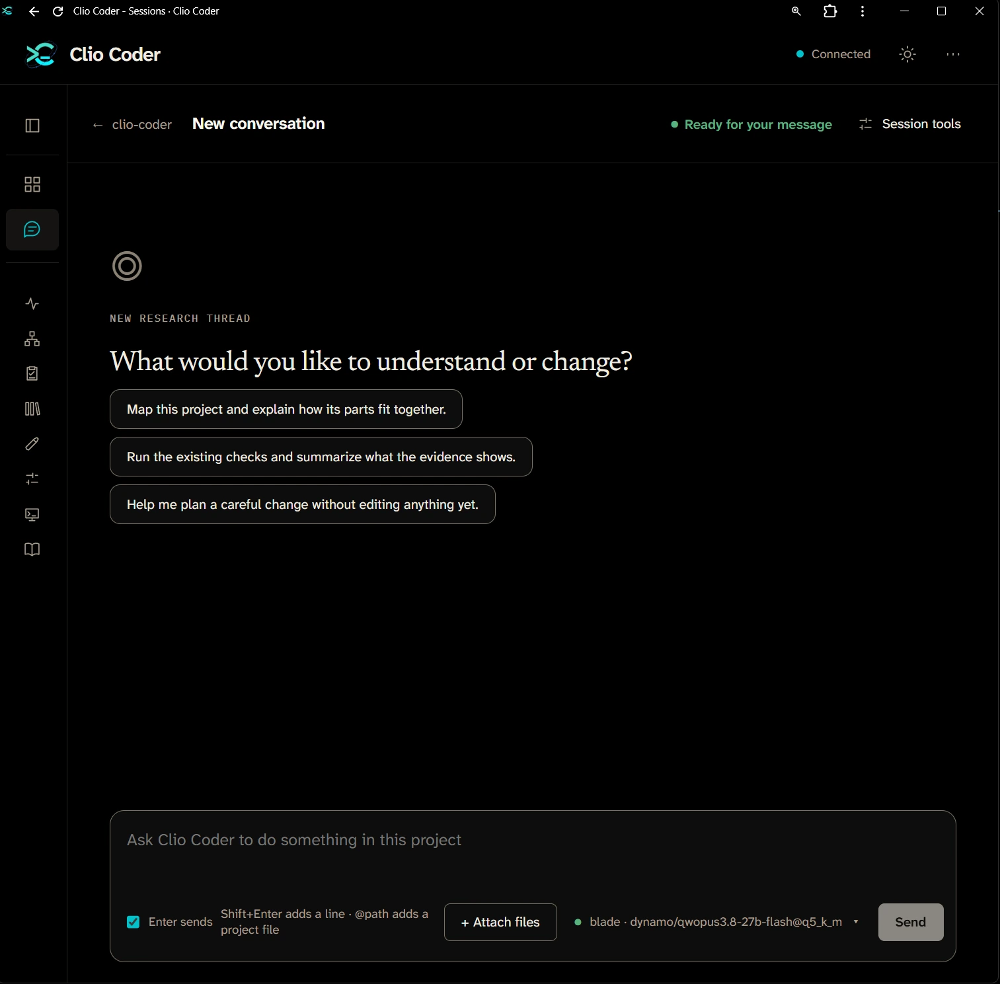

<p align="center">
  
</p>

# Clio Coder

**One coding agent for every model you can reach, built for the code science runs on.**

<p align="center">
  <a href="https://www.npmjs.com/package/@iowarp/clio-coder"></a>
  <a href="LICENSE"></a>
</p>

Your models change every few months. The way you work shouldn't have to.
Clio Coder is an open-source coding agent harness that runs on the model
access you already have: a local server, your lab's inference gateway, a cloud
API key, or the subscriptions you already pay for, such as ChatGPT, Claude, and
GitHub Copilot. Your project guidance, tools, safety rules, and history stay
the same whichever model is answering.

It is built for scientific software: simulation codes, numerical libraries,
data pipelines, and HPC workflows, where a change is done only when the checks
say so.

- **Bring every model.** Chat on one model, send workers to others, and switch
  with `/model`. No Clio account, no lock-in.
- **Check the work, not just the diff.** Clio runs your tests, compares numbers
  within a declared tolerance, and reruns computations from pinned inputs. It
  records every result so you can see what passed, what failed, and what was
  never checked.
- **Speaks science.** Reads HDF5, NetCDF, and Parquet. Drives Slurm through MCP.
  Ships library packs for HPC, science data, literature, and life science.
- **You set the authority.** Approvals, read-only runs, OS sandboxing, and
  damage-control rules decide what the agent may touch.

<p align="center">
  <a href="#get-started"><strong>Get started</strong></a> ·
  <a href="#for-ai-agents-installing-clio-coder">For AI agents</a> ·
  <a href="#what-you-can-do">What you can do</a> ·
  <a href="#models">Models</a> ·
  <a href="#interfaces">Interfaces</a> ·
  <a href="#safety-and-control">Safety</a> ·
  <a href="#documentation">Docs</a> ·
  <a href="https://coder.iowarp.ai">Website</a>
</p>

> **Open source, pre-1.0.** The terminal is the primary interface; the desktop
> app is in alpha. Commands and settings can change between minor releases, so
> check the [changelog](CHANGELOG.md) when upgrading.

## Get started

You need **a model that supports tool calling**. Linux, macOS, and WSL are the
primary platforms; native Windows is best effort.

**1. Install.** The installer brings its own Node.js and needs no root:

```bash
curl -fsSL https://coder.iowarp.ai/install.sh | sh
```

Already have **Node.js 22.19 or newer**? Use npm instead:

```bash
npm install -g @iowarp/clio-coder
```

**2. Open a project and connect a model.**

```bash
cd /path/to/your/project
clio-coder
```

On first launch Clio opens a guided setup. Pick what you have, such as a local
app (Ollama, LM Studio), a model server URL, a subscription sign-in, or an API
key, and choose a model. Use `/model` later to switch and `/config` to rerun setup.

**3. Ask for something useful.** Start by learning the repository:

> Explain how this repository builds and runs its tests, identify the main
> entry points, and suggest one verification task. Do not change files yet.

Then give it a focused change with a clear acceptance criterion:

> Investigate the failing numerical check. Make the smallest fix that keeps
> the public API, run the relevant checks, show me the diff, and tell me
> anything you could not verify.

`/help` lists commands, and `clio-coder doctor` checks the installation and
connections. If your shell cannot find `clio-coder`, follow the installer's
`PATH` instruction, then run `command -v clio-coder` to see which file the
bare name reaches.

<details>
<summary><strong>Other package managers, no-install use, and building from source</strong></summary>

```bash
# pnpm
pnpm add -g @iowarp/clio-coder

# Bun; clio-coder still runs on Node.js 22.19 or newer from PATH
bun add -g @iowarp/clio-coder

# Run without a global install
npx --yes @iowarp/clio-coder@latest

# Include the optional Claude Agent SDK at install time
curl -fsSL https://coder.iowarp.ai/install.sh | sh -s -- --include-claude-sdk
```

The installer skips the Claude Agent SDK, about 224 MB, by default. Interactive
Claude setup can offer it on first use.

From source, build the release tag:

```bash
git clone --branch v0.6.9 https://github.com/iowarp/clio-coder.git
cd clio-coder
corepack enable pnpm
pnpm run install:local
export PATH="$HOME/.local/bin:$PATH"
hash -r
"$HOME/.local/bin/clio-coder" --version
command -v clio-coder
```

See the [contributor guide](CONTRIBUTING.md) for development on the version branch.

</details>

<details>
<summary><strong>HPC hosts, installer locations, and download verification</strong></summary>

The native installer supports x64 Linux with glibc 2.17 or newer, including
HPC login nodes. Its private runtime leaves system Node unchanged.

| Platform | Default install root | Launcher |
| --- | --- | --- |
| Linux | `~/.local/share/clio-coder-install` | `~/.local/bin/clio-coder` |
| macOS | `~/Library/Application Support/clio-coder/install` | `~/.local/bin/clio-coder` |

If the website is unreachable, use the installer attached to the GitHub release:

```bash
curl -fsSL https://github.com/iowarp/clio-coder/releases/latest/download/install.sh | sh
```

The installer checks Node downloads against SHASUMS256.txt and attempts
release-signature verification when `gpgv` or `gpg` is available.

On a Linux terminal, the installer also offers the desktop app. Pass `--gui`
or `--no-gui` to answer up front. See [HPC clusters](docs/guide/hpc-clusters.md)
for proxies, older glibc, mirrors, and airgapped sites, and
[installation and lifecycle](docs/guide/installation-and-lifecycle.md) for
runtime and launcher management.

</details>

<details>
<summary><strong>Native Windows installation — best effort</strong></summary>

WSL uses the Unix installation path. Native Windows has a separate installer:

```powershell
irm https://coder.iowarp.ai/install.ps1 | iex
```

From CMD:

```cmd
curl.exe -fsSL https://coder.iowarp.ai/install.cmd -o install.cmd && install.cmd && del install.cmd
```

The native installers need no administrator rights. They install under
`%LOCALAPPDATA%\clio-coder\install` and write the launcher to
`%USERPROFILE%\.local\bin\clio-coder.cmd`. PowerShell adds that launcher
directory to your user `PATH` unless you pass `-NoModifyPath`.

Use the current stable release. Native installer verification remains limited:
the optional release job boots the packed candidate on Windows, but does not
verify the complete installer lifecycle. Interactive native terminal use is
best effort; see the [installation guide](docs/guide/installation-and-lifecycle.md).

</details>

<details>
<summary><strong>Beta releases, development snapshots, and returning to stable</strong></summary>

`beta` follows release candidates and newer stable releases:

```bash
curl -fsSL https://coder.iowarp.ai/install.sh | sh -s -- --channel beta
npm install -g @iowarp/clio-coder@beta
clio-coder upgrade --channel beta
```

In PowerShell:

```powershell
& ([scriptblock]::Create((irm https://coder.iowarp.ai/install.ps1))) -Channel beta
```

**New dev snapshots are currently disabled** while CI trusted publishing is
unavailable. The `dev` channel may point to an existing published version; it
is not a promise of a fresh snapshot of the development branch. Snapshot
version support remains in the release tooling for when publishing resumes.

Return to stable with `clio-coder upgrade --channel latest`, or rerun the
installer with `--channel latest` (`-Channel latest` in PowerShell). This can
install stable even when its version is lower than the prerelease. The notice
names recorded dated lifecycle migrations; switching binaries does not undo
those migrations.

For managed installs, `clio-coder upgrade --rollback` returns to the previous
supported binary and disables background updates. Global npm, pnpm, and Bun
users can select `@iowarp/clio-coder@latest` through their package manager.

</details>

<details>
<summary><strong>Updates, version pins, rollback, reset, and uninstall</strong></summary>

| Goal | Command or setting |
| --- | --- |
| Update on demand | `clio-coder upgrade`, or `/upgrade` inside the terminal |
| Follow stable | `clio-coder upgrade --channel latest` |
| Restore the previous managed binary | `clio-coder upgrade --rollback` |
| Disable background installation | `--no-auto-update` or `CLIO_CODER_AUTO_UPDATE=0` |
| Pin a managed install | Install an exact version with `--version` |
| Clear session state while keeping the launcher | `clio-coder reset --state` |
| Remove Clio: settings, credentials, data, state, caches, the launcher, and a managed install's runtime and versions | `clio-coder uninstall` |
| Preserve settings and credentials during uninstall | Add `--keep-config` |
| Keep the launcher, runtime, and installed versions during uninstall | Add `--keep-binary` |

An idle interactive session checks a managed install's channel at most once a
day. It installs a newer release beside the current one and switches the
launcher; the running session keeps its loaded version until restart. Resume
your conversation afterward with `/resume`. An exact version pin holds the
install there until you explicitly choose to follow a channel again.

For global npm, pnpm, and Bun installations, the terminal checks for updates
and shows a notice. `clio-coder upgrade` updates an npm install; for pnpm and
Bun it prints the package-manager command. Rollback changes the binary and
disables background updates; it does not undo changes made to your project.

See [installation and lifecycle](docs/guide/installation-and-lifecycle.md)
before removing an installation that contains work you want to retain.

</details>


## For AI agents: installing Clio Coder

If a user asked you to install or set up Clio Coder for them, follow these
steps. Every command is non-interactive unless marked otherwise.

1. **Install** (no root needed; brings its own Node.js):

   ```bash
   curl -fsSL https://coder.iowarp.ai/install.sh | sh
   ```

   If Node.js 22.19 or newer is already on `PATH`, `npm install -g @iowarp/clio-coder`
   also works. On native Windows, use `irm https://coder.iowarp.ai/install.ps1 | iex`.

2. **Verify** the launcher. The installer writes it to `~/.local/bin`:

   ```bash
   export PATH="$HOME/.local/bin:$PATH"
   "$HOME/.local/bin/clio-coder" --version
   command -v clio-coder
   ```

   If `command -v` prints nothing or a different file, tell the user to add
   `~/.local/bin` to their shell profile.

3. **Connect a model.** Ask the user which model access they have, then save a
   target and make it the default:

   ```bash
   clio-coder configure --list                 # runtimes and what each needs
   # A local server, e.g. Ollama:
   clio-coder configure --id local --runtime ollama \
     --url http://127.0.0.1:11434 --model <model> --set-orchestrator
   # A cloud API, with the key in an environment variable:
   clio-coder configure --id work --runtime anthropic \
     --model <model> --api-key-env ANTHROPIC_API_KEY --set-orchestrator
   clio-coder targets --probe                  # check the connection
   ```

   Never write an API key into a file or a command line yourself; use
   `--api-key-env` with a variable the user already exports.

4. **Check the installation:** `clio-coder doctor`. Fix what it reports, or run
   `clio-coder doctor --fix` for the repairs it can make safely.

5. **Smoke test** in the user's project:

   ```bash
   clio-coder run "Summarize this repository's entry points. Do not change files."
   ```

**Leave these to the human:** subscription sign-ins open a browser or ask
for a pasted code. Tell the user to run `clio-coder auth login openai-codex`
(ChatGPT), `clio-coder auth login anthropic-max` (Claude), or `clio-coder auth
login alcf` (Argonne), or `copilot login` then `clio-coder auth login
copilot-sdk` (GitHub Copilot). The interactive terminal (`clio-coder`) and
`/config` setup also need a person at the keyboard.

**Looking something up:** `clio-coder --help`, `clio-coder <command> --help`,
and `clio-coder paths` (where settings and data live). The guides in
[docs/](docs/README.md) ship inside the package. Inside a Clio session, the
offline `clio_docs` capability answers questions about Clio itself.

<details>
<summary><strong>Working on this repository instead</strong></summary>

Read [CONTRIBUTING.md](CONTRIBUTING.md) and the relevant
[architecture guide](docs/architecture/architecture.md). A local
`CLIO-CODER.md` gives checkout guidance when present. Resolve implementation
questions from source, schemas, and focused behavioral checks. Contributions
target the current version branch; `main` advances with releases.

</details>

## What you can do

<p align="center">
  
  
</p>

**Change scientific code and prove it.** Declare what "done" means: tests,
numerical comparisons with a tolerance, performance budgets. Clio runs the
checks, records the results as evidence, and keeps a claims ledger of what was
proposed, tested, supported, or refuted. `reproduce` reruns a computation from
sha256-pinned inputs and compares the output.

**Read scientific data.** The `data` tool inspects HDF5, NetCDF, and Parquet
files with summary statistics, so the agent can reason about real outputs
instead of guessing at them.

**Run on clusters.** Clio installs on HPC login nodes without root, works with
air-gapped sites, and drives Slurm jobs through MCP. See
[HPC clusters](docs/guide/hpc-clusters.md) and [Slurm](docs/guide/slurm.md).

**Split the work across models.** Send workers to other targets: a fast local
model for a search, a strong cloud model for a design review. `/oracle` asks a
model from a different family for a second opinion. Each worker gets a fixed
permit for its tools and returns a receipt. See
[fleet dispatch](docs/guide/fleet-dispatch.md).

**Know what it cost.** `/usage` shows spend per target, including the cost per
verified outcome, and `clio-coder telemetry insights` summarizes where time and
tokens went. All of it stays on your machine.

**Keep long sessions going.** Compaction summarizes old turns inside the cached
prompt prefix, so long sessions stay fast and cheap.

**Add skills and tools.** Install reviewed packages from the library, including
packs for `hpc`, `science-data`, `literature`, and `life-science`:

```bash
clio-coder library search slurm
clio-coder library install plugin:hpc
```

Clio also loads MCP servers, skills, agents, prompts, and its own process-isolated
extensions. See the [library](docs/guide/resource-library.md) and
[harness extensions](docs/guide/harness-extensions.md).

## Models

A saved connection is a **target**. Chat and workers can use different targets,
models, and thinking levels. `/model` switches the conversation.

| Connection | Supported |
| --- | --- |
| Local and self-hosted | Ollama, LM Studio, llama.cpp, vLLM, SGLang, Lemonade |
| Gateways | LiteLLM, any OpenAI-compatible or Anthropic-compatible API |
| Cloud APIs | OpenAI, Anthropic, Google, OpenRouter, Groq, Mistral, DeepSeek, Amazon Bedrock, Inception |
| Subscriptions | ChatGPT (`openai-codex`), Claude (`anthropic-max`), GitHub Copilot (`copilot-sdk`) |
| Institutional | Argonne ALCF Sophia and Metis through Globus |
| Other coding agents | Delegate to Claude Code, Codex, OpenCode, Pi, and Antigravity |

Start with a model whose tool calling works reliably on your runtime. A
supported protocol does not guarantee every model's quality. See
[connections and targets](docs/guide/configuration-and-targets.md) and the
[model catalog](docs/architecture/model-catalog.md).

Sessions, evidence, and telemetry are stored locally. The providers you
configure receive the requests sent to them.

## Interfaces

| Surface | Start with | Best for |
| --- | --- | --- |
| **Terminal** (primary) | `clio-coder` | Interactive coding, diffs, approvals, worker activity |
| **Desktop** (alpha) | `clio-coder gui` | A visual workspace with usage, artifacts, evidence, and sessions |
| **Scripts and CI** | `clio-coder run "task"` | Unattended runs; `--json` streams JSONL |
| **Editors** | `clio-coder acp` | Agent Client Protocol clients |

All surfaces share the same connections, project context, and tool policy.
A headless run has no one to answer questions, so permission asks are denied;
put decisions and limits in the prompt. See
[commands and modes](docs/guide/commands-and-modes.md),
[the GUI guide](docs/guide/gui.md), and [interoperability](docs/guide/interop.md).

## Safety and control

Clio edits files and runs commands with your permissions. You decide how much
of that it may do on its own.

| Control | What it does |
| --- | --- |
| **Approvals** | Reads, edits, and recognized checks run; unfamiliar commands and outward actions ask first. |
| **Read-only** | `--read-only` leaves every user file exactly as it was. Clio may still write its own logs and memory. |
| **Sandbox** | Workers and read-only shell commands run in an OS sandbox (bubblewrap on Linux) when one is available. |
| **Damage control** | Hard blocks and protected paths apply even in Yolo mode, which only removes ordinary prompts. |
| **Secrets** | Credentials are masked in command output and approval cards. |
| **Project trust** | Project plugins and extensions wait for your approval before they load. |

Command scanning is static and has limits; the sandbox is the real boundary
where it applies. A passing check proves only what that check exercised. See
the [safety model](docs/architecture/safety-model.md) and
[quality policies](docs/guide/quality-policy.md).

## Documentation

| You want to… | Start here |
| --- | --- |
| Install, connect, troubleshoot | [Website docs](https://coder.iowarp.ai/docs.html) · [Installation](docs/guide/installation-and-lifecycle.md) · [Troubleshooting](docs/guide/troubleshooting.md) |
| Find a command or setting | [Commands and modes](docs/guide/commands-and-modes.md) · [Configuration reference](docs/guide/configuration-reference.md) |
| Define checks or coordinate workers | [Quality policies](docs/guide/quality-policy.md) · [Fleet dispatch](docs/guide/fleet-dispatch.md) |
| Understand context and memory | [Project context](docs/architecture/project-context.md) · [Context continuity](docs/guide/context-continuity.md) |
| Explore the implementation | [Architecture](docs/architecture/architecture.md) · [Documentation map](docs/README.md) |

## Contribute and get help

Clio Coder is pre-1.0 and moving fast. Good reports describe the task, what you
expected, what happened, Clio and Node versions, and a reproduction; output from
`clio-coder doctor` helps. Redact credentials and private data first.
Experience reports from scientific projects are especially welcome.

[Issues](https://github.com/iowarp/clio-coder/issues) ·
[Discussions](https://github.com/iowarp/clio-coder/discussions) ·
[Contributor guide](CONTRIBUTING.md) · [Code of Conduct](CODE_OF_CONDUCT.md) ·
[Changelog](CHANGELOG.md) · [Security](SECURITY.md) · coder@iowarp.ai

## Acknowledgements

Clio Coder is developed by the [Gnosis Research Center](https://grc.iit.edu) at
[Illinois Tech](https://www.iit.edu), in collaboration with the
[University of Utah](https://www.utah.edu), as part of [IOWarp](https://iowarp.ai).
The IOWarp CLIO architecture is supported by the National Science Foundation
under collaborative awards
[OAC-2411318](https://www.nsf.gov/awardsearch/showAward?AWD_ID=2411318) and
[OAC-2411319](https://www.nsf.gov/awardsearch/showAward?AWD_ID=2411319), 2024–2029.

Clio builds on the [Pi agent framework](https://github.com/earendil-works/pi),
[ACP](https://agentclientprotocol.com), and [MCP](https://modelcontextprotocol.io).
Its panes are powered by [herdr](https://github.com/herdrdev/herdr) (Apache-2.0),
whose license ships beside the binary Clio installs.
Dependency and component notices are in [NOTICE](NOTICE).

CLIO means **Context Layer for Input/Output**. Related IOWarp projects include
[clio-core](https://github.com/iowarp/clio-core) for data and context storage and
[clio-kit](https://github.com/iowarp/clio-kit) for scientific tool servers.
