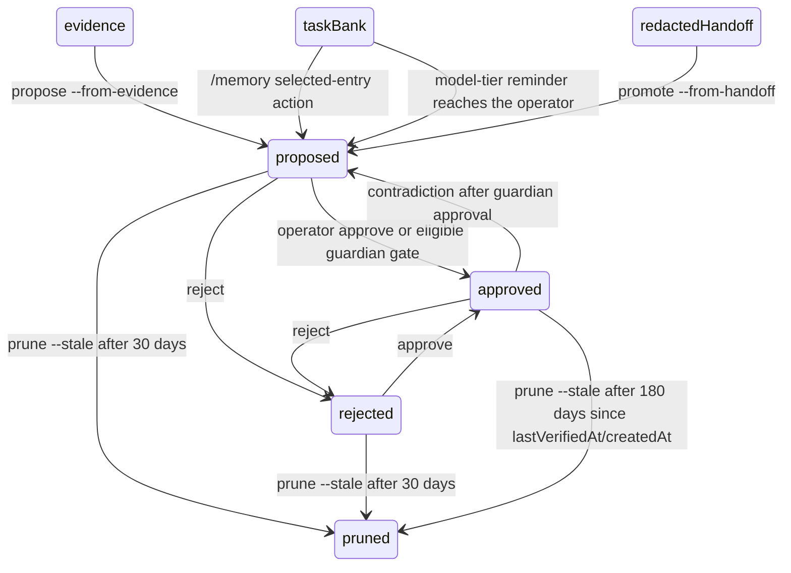

# Evidence Corpus and Long-Term Memory

The [proactive memory guide](../guide/proactive-memory.md) explains when memory is offered and restored.

Clio Coder treats run claims and agent lessons as structured artifacts to support reproducibility and scientific provenance. A finished run's evidence is its sealed telemetry scope: when a dispatched run settles, the run's journal owner assesses it and journals an `evidence.assessed` record after `run.settled` and before `run.sealed`, so the seal covers the assessment. There is no evidence directory to build and no evidence index; every reader reads the read model's run DTO. Long-term memory records are local and evidence-linked, and only an approved record reaches prompt selection. Approval comes from the operator or the narrow repository-knowledge gate described below. Proactive task memory is a separate tier that runs by default on session task banks, and its model-tier reminders can propose durable records whose approval remains governed separately. Use the TUI [`/view`](observability.md#view) command for interactive inspection of runs, dispatch output, durable tool output, compaction summaries, and session accountability before citing evidence.

Source of truth: `src/domains/evidence/`, `src/domains/memory/`, `src/domains/evolution/`, [evidence.ts](../../src/cli/evidence.ts), [memory.ts](../../src/cli/memory.ts), and [evolve.ts](../../src/cli/evolve.ts). The journal, seal and bundle format are specified in [Telemetry](telemetry.md#evidence).

---

## Evidence CLI

```bash
clio-coder evidence inspect <runId> [--json]
clio-coder evidence list
```

| Command | Behavior |
| --- | --- |
| `inspect <runId>` | Prints the run id, the seal verdict, when the run was assessed, its outcome and exit code, tool-call and blocked-tool counts, token and cost totals, first-pass success, tags, one `trust:` summary and its axis line, one `gate <decisionId>:` line per verdict, a `provenance:` block when the seal verifies, and every finding with its severity, tag and sentence. Exit 1 when the run has no settled record, or when its seal was checked and rejected (the record is still printed). |
| `inspect <runId> --json` | Prints a fixed record: `version`, `generatedAt`, `runId`, `assessed`, `integrity` (`verified`, `unsealed` or `failed`), the verdict tier, and every axis by its canonical state. It carries no task text, paths or finding prose. |
| `list` | Prints `N runs`, then one row per run scope on this host, newest settlement first: run id, outcome (or `unsettled`), state (`assessed`, `unassessed`, `unsealed` or `failed`) and tags. |

Exit codes are 0 on success, 1 for a runtime failure, and 2 for a usage error or an invalid run id (usage text goes to stderr). A run with no settled record prints the reason and a remedy on separate lines:

```text
error: run <runId> has no settled record: <reason>
  run `clio-coder evidence list` to see local runs
```

Nothing builds evidence and nothing prunes it separately. A run's evidence lives and expires with its run scope under telemetry [retention](telemetry.md#retention), and `clio-coder telemetry verify <scope-dir>` checks it with only the scope's own files.

### Assessment at settlement

The run's journal owner assesses a run once, from the run's journal records, after it writes `run.settled`. The assessment reads the gate decisions that name the run and, when the run cited decisions, the decision board on its session's active path. A read that fails leaves its part unresolved rather than failing the run. A run with no `run.settled` is not assessed. The assessment is pure over those inputs, and its integrity axis says the producer held the record; a reader replaces that axis with the seal's own verdict.

`evidence.assessed` (version 1) carries structured, content-free facts:

| Field | Meaning |
| --- | --- |
| `attempt` | The dispatch lineage attempt; null for a run dispatched without a lineage. |
| `firstPassSuccess` | True only when the run succeeded on lineage attempt 0 and no `no-validation` finding was raised. The accountability read model folds this value into its first-pass success rate. |
| `failureCause` | The tag a non-zero exit is attributed to, from termination facts only; null for a run that exited 0. |
| `trust` | The canonical five-axis trust status described below. |
| `findings` | Up to 128 entries of `id` (`finding-NNN`), `severity` (`info` or `warn`) and `tag`. |
| `verdicts` | Up to 64 gate decisions that judged the run by settlement: `decisionId`, `digest`, `outcome`, and the independent-review state each produced. |
| `provenance` | The decision refs the run cited and whether each resolved, the pipeline step it ran as, and the persona override that composed its prompt. Null when recovery sealed the run after its owner died. |
| `text` | A reference to the run's `evidence-findings` object, which holds each finding's sentence and the decision records the run cited. |

Token and cost totals come from the run's folded quantities, so a partially measured run keeps its known subtotal and says what is unknown. A run whose seal does not verify states no totals.

### Redaction

Secret-shaped values are replaced with `[redacted:<kind>]` in a run's settled facts before they are journaled, and in every object the telemetry object store writes. Raw session files under `<stateDir>/sessions/` are not touched.

### Secret-shaped value patterns

[redact.ts](../../src/domains/evidence/redact.ts) holds the ordered pattern list for secret-shaped values matched on content. Run settlement, the telemetry journal writer and object store, memory promotion and handoff, tool-result summaries, the `consult` tool and the System One state scrubber all call it. A match becomes `[redacted:<kind>]` and is counted in the caller's tally. Display-time redaction of tool-call arguments, as the transcript renderer and the workers dashboard apply, is a separate rule set in [redaction.ts](../../src/domains/safety/redaction.ts).

| Kind | Matches |
| --- | --- |
| `pem` | A `-----BEGIN ... PRIVATE KEY-----` block through its `END` line, or to the end of the text when the block is unterminated. |
| `aws-access-key` | `AKIA` followed by 16 uppercase letters or digits. |
| `github-token` | `ghp_`, `gho_`, `ghu_`, `ghs_` or `ghr_` followed by 20 or more alphanumerics, and `github_pat_` followed by 20 or more word characters. |
| `sk-key` | `sk-`, an optional hyphen-terminated segment of 2 to 20 characters, then 16 or more of `[A-Za-z0-9_-]`. |
| `slack-token` | `xoxb-`, `xoxp-`, `xoxa-`, `xoxr-` or `xoxs-` followed by 8 or more characters. |
| `google-api-key` | `AIza` followed by 30 or more characters. |
| `jwt` | Three dot-separated base64url segments, the first starting `eyJ`. |
| `assignment` | A secret-flavored key and its value, described below. Only the value is replaced; the key and separator stay. |

The `assignment` pattern reads `key=value`, `key: value` and `"key": "value"` shapes. The key is any name containing `api_key`, `api-key`, `apikey`, `secret`, `token`, `passwd`, `password` or `credential`, case-insensitive. The value is a run of 8 or more characters that are not whitespace, quotes, backticks or any of `; , & | < >`. A value that opens a call is code, not a credential, and is left alone: an identifier of letters, digits, underscores and dots, then `(`, then whitespace, a quote, `{`, `[`, `)` or the end of the text. `BASE_TOKENS = frozenset({` and `token = getToken()` therefore stay readable. A call with a real argument still reads as a value, so `password=Summer2024(!)` becomes `password=[redacted:assignment]`.

`redactSecretsDeep` walks plain objects and arrays and redacts string values with the same patterns. It does not see property names. The telemetry object store serializes objects through `secretRedactingReplacer`, which redacts each string leaf and also treats a string under a secret-flavored property name as an assignment value; see [Objects](telemetry.md#objects).

---

## Run evidence layout

A run's evidence is its run scope:

```text
<stateDir>/telemetry/runs/<runId>/
├── journal.jsonl     run.started … run.settled, evidence.assessed, run.sealed
├── objects/          the result object and the evidence-findings object
└── bundle.json       written by the seal
```

The sealed scope directory is a self-contained bundle that verifies with only its own files; see [Seals and bundles](telemetry.md#seals-and-bundles). Tool facts are `tool.settled` records and the journal is the transcript of what the run did. `/view` accountability views, `clio-coder evidence`, ACP's evidence-ready notice and the GUI evidence view all read the read model's run DTO over this directory. A run whose seal verifies is read through its assessment; a run whose scope is unsealed reads as not yet evidence, and a run whose seal fails reads as a `run-seal` warning.

When a run was chained (pipeline), composed with a persona override, or escalated for a permission, `clio-coder evidence inspect` prints those facts as a `provenance:` block. Pipeline and persona facts come from the sealed assessment and escalation counts from `run.settled`, never from the mutable run ledger. The block is printed only for a run whose seal verifies.

### Decision provenance

Decision refs a run cited are resolved once, at assessment, against the decision board on its session's active path. Each ref adds a `context-provenance` finding: `info` when it resolved, `warn` when it does not. Resolved decision records go into the run's `evidence-findings` object and are shown with the run's evidence. Decisions remain session facts; evidence does not reinterpret them as validation results. Wiki page writers receive up to twelve active decisions matching their source paths or symbols and cite those refs in the body and optional `decisions` frontmatter instead of inferring rationale.

### Run result facts

`src/domains/dispatch/run-result-facts.ts` reads a run's DTO over its sealed scope and projects the compact terminal facts that the TUI worker block, the exit summary and ACP terminal fleet frames report. A run that has not settled reads as `result unavailable`.

---

## Evidence Tag Taxonomy and Failure Causes

Clio Coder classifies every run using a closed set of 22 canonical tags (`EVIDENCE_TAGS`, exported from `src/domains/evidence/types.ts`). These tags distinguish general execution characteristics from actual failure causes.

### Complete Taxonomy

| Tag | Category | Trigger / Meaning |
| --- | --- | --- |
| `timeout` | Failure | Execution exceeded the maximum duration limit. |
| `context-overflow` | Constraint | Model context limit was exceeded. |
| `provider-transient` | Transient | Temporary API or model gateway connection error. |
| `missing-dependency`| Failure | Python, Node, or system package dependency was missing. |
| `wrong-runtime` | Configuration | Execution failed due to incorrect compiler or runtime environment. |
| `proxy-validation` | Validation | The run claimed validation that was not grounded in an observed execution. |
| `no-validation` | Validation | A succeeded run has no linked validation evidence. |
| `destructive-cleanup`| Precaution | Clean-up rules triggered to prevent workspace pollution or damage. |
| `blocked-tool` | Failure | The safety net blocked a tool call requested by the model. |
| `escalation` | Precaution | A worker permission escalation timed out or was denied. |
| `external-bypass` | Security | An external runner used its own permissions outside Clio Coder policy. |
| `external-approximation` | Historical | Reserved in the vocabulary. Current builds do not emit it. |
| `independent-review` | Validation | The canonical independent-review axis: a failed or correlated review is a warning; an inconclusive review, or a successful run with no review at all, is an info row saying its result rests on its own record. |
| `context-provenance` | Provenance | The canonical context-provenance axis read `invalid`, or a cited decision ref resolved (info) or did not resolve (warning). |
| `completion-evidence` | Validation | The canonical completion-evidence axis: a mutation that finished without validation evidence at the completion boundary is a warning; an explicit limitation is an info row. |
| `run-seal` | Security | The run's seal did not verify. A seal that was checked and rejected is a warning; a run scope not yet sealed is an info row. |
| `protected-artifact`| Precaution | Mutating a path protected by project or system safety policies. |
| `tool-loop` | Constraint | The run exhausted its tool-call cap, or the loop guard disabled its tools. |
| `test-failure` | Failure | A verification command containing test/lint keywords exited non-zero. |
| `build-failure` | Failure | A verification command containing build keywords exited non-zero. |
| `auth-failure` | Failure | Missing or invalid credentials/API keys. |
| `unknown` | Undefined | Unclassified execution failure. |

---

### Failure-Cause Tag Subset

A subset of the taxonomy represents actual failure causes (`FAILURE_CAUSE_TAG_ORDER`): `timeout`, `auth-failure`, `missing-dependency`, `build-failure`, `test-failure` and `blocked-tool`. The accountability summary counts only these tags in its failure-cause histogram ([accountability.ts](../../src/domains/telemetry/accountability.ts)).

A run that exited non-zero gets one `warn` finding whose tag `attributeEvidenceFailure` ([failure-attribution.ts](../../src/domains/evidence/failure-attribution.ts)) picks from termination facts only, and the same tag is the assessment's `failureCause`. Typed outcome codes decide first: `worker_context_exhausted` is `context-overflow`, a tool-call cap or a loop guard that disabled tools is `tool-loop`, `worker_mutation_blocked` is `blocked-tool`, and a `timed_out` or `stalled` outcome is `timeout`. Otherwise the outcome detail and the recorded failure message are matched in order for `auth-failure` (401, 403, unauthorized, invalid API key), `provider-transient` (429, rate limits, 502 to 504), `context-overflow`, `missing-dependency`, `wrong-runtime`, `test-failure` and `build-failure`. A run with no diagnostic text, or text that matches none of them, is `unknown`. The task text is never causal evidence. Separately, any blocked tool call adds a `blocked-tool` warning.

---

## Run findings

A run's findings are its assessment's. `run.settled` carries no findings block: the run's result quality and verification facts are derived from its in-memory result draft at settlement ([run-findings.ts](../../src/domains/dispatch/run-findings.ts)), and every finding, tag and first-pass verdict comes from the `evidence.assessed` record that follows it ([assessment.ts](../../src/domains/evidence/assessment.ts)).

- **Findings**: `no-validation` for a succeeded run with absent or unknown validation grounding, `proxy-validation` for ungrounded validation, `blocked-tool`, `escalation` for a timed-out or denied permission ask, `external-bypass` for a run under agent-managed peer permissions, the independent-review finding, `context-provenance` for a contradictory context record or a cited decision ref, `completion-evidence`, and the failure cause of a non-zero exit. A reader adds a `run-seal` finding when the seal did not verify.
- **First-pass success**: `true` only when the run succeeded on lineage attempt 0 and no `no-validation` finding was raised. The accountability read model folds this value into its first-pass success rate.
- **Integrity**: A run's record is trusted only when its scope's seal verifies. The seal covers every journal line, `run.settled` and `evidence.assessed` included, through the hash chain and `bundle.json`; [Verify](telemetry.md#verify) describes the check. The chain catches an edited record, but a scope rewritten together with a recomputed chain and bundle is not detected, because the seal is not a signature.

Seal verification and validation evidence answer different questions. The
former proves that a run's record is what was written; the latter records
whether applicable validation evidence was observed. Briefing provenance is
also distinct from bounded project-context provenance: both can be absent or
present independently, and neither hash is evidence for the other.

### Canonical trust status

[trust-status.ts](../../src/domains/evidence/trust-status.ts) defines the version 1 canonical trust
status. It is a five-axis algebra, not an overall trust verdict, confidence
percentage, or pass/fail score. Consumers project only the axes needed for a
decision and preserve every other axis unchanged.

| Axis | Closed states | Question answered |
|---|---|---|
| Artifact integrity | `verified`, `failed`, `absent`, `unknown`, `not_applicable` | Did the run's seal verify the record it covers? |
| Validation grounding | `validated`, `failed`, `ungrounded`, `absent`, `unknown`, `not_applicable` | What correctness-bearing validation was observed and grounded? |
| Independent review | `passed`, `failed`, `inconclusive`, `not_independent`, `absent`, `unknown`, `not_applicable` | What outcome did a verified independent reviewer or judge record? |
| Context provenance | `recorded`, `invalid`, `absent`, `unknown`, `not_applicable` | Is the origin of briefing, worker context, or project context recorded consistently? |
| Completion evidence | `evidenced`, `incomplete`, `limited`, `absent`, `unknown`, `not_applicable` | What did the finish contract observe at the completion boundary? |

`absent` means no fact was recorded and carries a reason but no invented
attribution. `unknown` means a named source exists but cannot establish the
answer. `not_applicable` means a named authority determined that the axis does
not apply. Every non-absent state names both its source and its authority.
Sources may retain up to 16 typed artifact references. References contain an
artifact kind, identifier, and optional SHA-256 digest; they never embed the
artifact body. Normalization sorts the references and rejects duplicates,
unbounded lists, unknown fields within an axis, invalid identifiers, and
sources that are not permitted to speak for an axis.

The composition rules prohibit cross-axis promotion:

- Verified artifact integrity never promotes validation grounding.
- Recorded context provenance never promotes validation or correctness.
- A passing review never establishes authorship or context origin.
- A completion self-report never promotes validation grounding. Only a
  `finish_contract` source may speak for completion evidence, and a run
  assessment records the axis as `absent` (`not_recorded`).

#### Validation grounding precedence

For a run whose record is authenticated, `adaptRunTrustStatus` reads the run's settled facts and takes the first rule that applies:

1. No run record: `absent` with `artifact_missing`.
2. Host verification `rejected`: `failed` by `host-verification`. When every failing host check also failed on the task base, the change did not cause the failure, so the state is `unknown` by `host-verification-baseline-failed` and the human clause reads `check also failed on task base; change validation unknown`.
3. Host verification `verified`: `validated` by `host-verification`. Host verification `not_implicated` (a batch member the failure was charged away from): `unknown` by `host-verification`.
4. The settled quality carries a failed typed validation or a failing result contract: `failed` by `result-quality`.
5. Command grounding: the run's `validationGrounding.basis` is `no-command-executed` and it claims more than it grounded, or lists ungrounded claims: `ungrounded` by `command-grounding`. A report that names the typed `verify` tool is grounded by the successful `verify` tool result the run recorded, not by a shell command.
6. A passed typed validation or a passing result contract: `validated` by `result-quality`.
7. The run's `verification` fact: `verified` is `validated` by the recorded basis, `unverified` is `absent` with `not_observed`, and `not_applicable` carries through.
8. Otherwise `unknown`, attributed to the recorded basis; an ACP delegation the host could not observe is attributed to `acp-delegation`.

| Recorded fact | Canonical mapping |
|---|---|
| Missing run record | Every axis is `absent` with `artifact_missing`. |
| Run scope not yet sealed | Artifact integrity is `unknown`. Validation grounding and context provenance are `absent` with `not_observed`; no unauthenticated claim contributes a state. |
| Seal verifies or fails | Artifact integrity is `verified` or `failed`. A failed seal leaves validation grounding and context provenance `absent` with `not_observed`, and the run reads as a `run-seal` warning. |
| `verification.state: verified` | Validation grounding is `validated` unless a stronger typed failure or ungrounded claim is present. |
| `verification.state: unverified` | Validation grounding is `absent` with `not_observed`; lack of a validation tool is not a failed validation. |
| Typed validation or result-contract quality | A passing correctness-bearing fact maps to `validated`; a failing fact maps to `failed`; an ungrounded passing claim maps to `ungrounded`. |
| Context provenance | Judged once at settlement and kept on `run.settled` with the hashes, never the context. A valid briefing, worker context, bounded project context, or none-tier workspace-root record is `recorded`. A `none`-tier run still receives the workspace-root message, so a none-tier block naming exactly `workspace-root` with a well-formed count and hash is `recorded`. Explicit project-context tier `none` with nothing sent is `not_applicable`; a run with no project-context record and nothing sent is `unknown`; a contradictory block (a handbook section under a none policy, a hash with no section, a malformed count, an invalid briefing or worker context) is `invalid`. |
| Gate decision | A gate subject cites the run by the digest of its `run.settled`. A verified independent pass or fail maps to `passed` or `failed`; for a compete `winner` outcome the winning subject maps to `passed` and every other subject to `failed`. Correlated review maps to `not_independent`. A decision with no decider or correlation record is `inconclusive`. An unauthenticated artifact or a mismatched subject digest maps to `unknown`; operator confirmation or yolo authority alone is `not_applicable` to independent review. The latest decision is the run's review, and earlier cycles stay listed as verdicts. |

Run inspection, worker output, monitor details, and the assessment all
use the same trust boundary over the run's settled record. The assessment
then composes independently verified gate decisions without changing
record-owned axes. Findings such as
`no-validation`, `proxy-validation`, `external-bypass`,
`independent-review`, `context-provenance`, and `completion-evidence`
are selected from settled facts and canonical states. `evidence inspect`
prints the summary and every axis before those findings, while
their detailed facts remain in the run's journal and objects.

`evidence.assessed` is version 1 and gate decisions remain version 2.

### Trust projection

[trust-projection.ts](../../src/domains/evidence/trust-projection.ts) is the one place the canonical
status is turned into words. Every operator surface prints from it, so the
same canonical input renders the same verdict on the dispatch run line, in a
monitor block, under `clio-coder evidence inspect`, on the
Fleet Runs board, in the `/view` run details, and on the ACP wire.

The compact human body has five fixed clauses in a fixed order and answers the
four operator questions without record internals. `evidence inspect` prints it
after `trust:`, and the dispatch tool quotes it as `trust="..."`:

```text
sealed; grounded by host-verification; not independently reviewed; context recorded; completion evidenced
```

Run-record headers (the `/view` run details and `clio-coder fleet view`)
add the verdict tier under one versioned label:

```text
trust v1: grounded; sealed; grounded by host-verification; not independently reviewed; context recorded; completion evidenced
```

| Clause | Axis | Question it answers |
|---|---|---|
| `sealed` / `seal broken` / `seal unchecked` / `no run record` | Artifact integrity | Can the record be trusted to be what was written? |
| `grounded by <claimant>` / `validation failed by <claimant>` / `inferred: validation claimed, none observed` / `no validation observed` / `validation unknown (<system>)` / `validation not applicable` | Validation grounding | Who claims the result, and what was observed? |
| `independently reviewed: pass` / `independently reviewed: fail` / `independent review inconclusive` / `review not independent` / `not independently reviewed` | Independent review | What did a second, uncorrelated authority check? |
| `context recorded` / `context record invalid` / `context not recorded` | Context provenance | Is what the worker was given recorded consistently? |
| `completion evidenced` / `completion unevidenced` / `completion limited` / `completion not recorded` | Completion evidence | What did the finish contract observe? |

`inferred` is the word for an `ungrounded` claim. A failure that comes from
the run's recorded quality reads `recorded validation failed` and no claimant. Every
`unknown` and `absent` state prints as such, so what remains unknown is
part of the line, never an omission.

The drill-down line prints every axis by its canonical state id and is the
same on every text surface:

```text
trust_status=v1 artifactIntegrity:verified validationGrounding:validated independentReview:absent contextProvenance:recorded completionEvidence:evidenced
```

The machine projection (`TrustSummaryProjection`, `trust` on the `dispatch`
tool's `details.runs[]` entries and on the `monitor` run details) is
bounded and versioned (`TRUST_SUMMARY_VERSION = 1`): the verdict tier, the five
axis states, the claimant, the axes still unknown, the compact text, and up to 8
`<kind>:<id>` references into the detailed artifacts. It is flat by design so a
depth-capped wire such as ACP `rawOutput` carries it whole where the nested
canonical status's artifact references fall off the depth cap.

The verdict tier styles a surface and never scores a run. `reviewed` is the
only tier styled as independently verified; a sealed record with observed
validation is `grounded`, a sealed record with nothing observed is
`unverified`, a broken seal, failed or inferred validation,
failed or correlated review, or contradictory context record is
`compromised`, and an unchecked or missing seal is `unknown`. Human run summaries name the failed axis instead of printing `compromised`; the machine verdict tier is unchanged. The Fleet Runs board
never carries a verdict on the terminal bus event: the event is published
before the run's sealed record has been read back and verified, so the board
reads the run's record back and projects that verified status, and shows
`trust: receipt not read back` until it can.

### Mutation-report grounding

A `mutation-report` result lists `mutatedPaths` and `validations`. The validator measures the report against what the run's own tool calls did (`ObservedRunEffects`, recorded by `src/domains/safety/run-effects.ts`) instead of believing it:

- A reported path the run wrote through a successful tool call is accepted.
- A reported path whose only write attempt was refused or errored fails conformance, and route quality is sealed `unmeasured`.
- A reported path the run never wrote but that exists on disk is accepted as unverified: route quality cannot reach `pass` and stays `unmeasured`.
- A reported path the run never wrote and that does not exist fails conformance, with route quality `unmeasured`.
- A reported failing validation, or an observed failing command with no later pass, seals `fail`.
- `pass` requires at least one reported validation, every path observed, and at least one validation command the run executed to a clean exit.

The source is `validateMutation` in `src/domains/agents/result-contract.ts`.

---

## Change manifests and `clio-coder evolve`

A change manifest is a typed JSON record of one proposed harness change, linked to the evidence that justifies it (`src/domains/evolution/`). The command is also reachable as `clio-coder dev evolve`.

```bash
clio-coder evolve manifest init
clio-coder evolve manifest validate <path>
clio-coder evolve manifest summarize <path>
```

`init` prints a template (`version: 1`, `iterationId: exploratory-1`, one change) to stdout and exits 0. `validate` and `summarize` load the JSON, resolve every non-empty `evidenceRef` against the run scopes on this host, and exit 1 on an invalid manifest, an unreadable file or invalid JSON. `summarize` prints the iteration, base SHA, change count, authority levels, components, files changed, predicted regressions and validation-step count. A usage error exits 2. When the run scopes cannot be listed, every non-empty ref fails as not found.

| Field | Rule |
| --- | --- |
| `version` | Must equal `1` (`CHANGE_MANIFEST_VERSION`). |
| `iterationId`, `baseGitSha`, `createdAt` | Non-empty strings. |
| `changes[].id`, `rootCause`, `targetedFix`, `rollbackPlan` | Non-empty strings. |
| `changes[].componentIds`, `filesChanged` | String arrays; at least one of the two must be non-empty. |
| `changes[].authorityLevel` | One of `prompt`, `tool-description`, `tool-implementation`, `middleware`, `memory`, `runtime`, `safety`, `schema`, `cli`. |
| `changes[].predictedRegressions` | Must hold an entry when the authority level is high: `tool-implementation`, `middleware`, `runtime`, `safety`, `schema` or `cli`. |
| `changes[].evidenceRefs` | Empty only for the iteration `exploratory-1`. Each ref must be a run id whose scope exists under `<stateDir>/telemetry/runs/`. |
| `changes[].predictedFixes`, `validationPlan` | String arrays. |
| `changes[].expectedBudgetImpact` | Optional; `risk` is `lower`, `same` or `higher`, with optional finite `tokenDelta` and `wallTimeDeltaMs`. |

Nothing enforces a manifest at edit time. The self-edit gate that would require a validated manifest before Clio Coder edits its own high-authority paths is designed but not built; `src/domains/evolution/SELF_EDIT_GATE.md` records why it is deferred.

---

## Memory CLI

```bash
clio-coder memory list
clio-coder memory propose --from-evidence <runId> [scope options]
clio-coder memory promote --from-handoff <path> [--entry <id>...] --scope <scope> [scope options]
clio-coder memory approve <memoryId>
clio-coder memory reject <memoryId>
clio-coder memory prune --stale
```

Memory records live in:

```text
<dataDir>/memory/records.json
```

The store is a JSON object `{ "version": 1, "records": [...] }` (`MEMORY_VERSION`), capped at `500` records and sorted by scope, key, creation time, and id for stable writes. A write that would pass the cap fails with `memory store limit reached (500); run clio-coder memory prune --stale`. A store file that fails validation makes every memory command and the prompt reader fail with `memory store invalid`, listing each issue path.

| Command | Behavior |
| --- | --- |
| `list` | Prints the record count, then per record: ID, status (`proposed`, `approved`, `rejected`), scope, confidence, evidence refs, key and lesson. |
| `propose` | Builds one unapproved record from a run's evidence and prints it with a `review:` hint. A repeated proposal for the same run and scope returns the existing record. |
| `promote` | Builds unapproved records from a version 2 handoff snapshot. |
| `approve <id>` | Sets `approved`, stamps `lastVerifiedAt` with the current time and clears `rejectedAt`. It stamps `approval.by: operator` and clears regressions. Approving an approved record refreshes `lastVerifiedAt`. |
| `reject <id>` | Clears `approved` and stamps `rejectedAt`. |
| `prune --stale` | Deletes stale records and prints the count; see [Retention and pruning](#retention-and-pruning). |

Usage errors exit 2 with the usage text on stderr; every other failure exits 1.

### Memory record schema

| Field | Meaning |
| --- | --- |
| `id` | `mem-` followed by 16 lowercase hex characters, derived from the source so a retried proposal finds the existing record. |
| `scope` | One of `global`, `repo`, `language`, `runtime`, `agent`, `task-family`, `hpc-domain`. |
| `key` | A stable key such as `evidence:<runId>` or `promotion:<sourceKind>:<sessionId>:<entryId>`. |
| `lesson`, `appliesWhen`, `avoidWhen` | The lesson text and the conditions around it. Evidence proposals truncate the lesson to 240 characters. |
| `evidenceRefs` | At least one reference. Required for prompt injection. |
| `confidence` | A number from 0 to 1. Evidence proposals score 0.55 to 0.75; promotions start at 0.6. |
| `createdAt`, `lastVerifiedAt`, `rejectedAt`, `approved`, `regressions` | Lifecycle fields. An approved record must not carry `rejectedAt`. A non-empty `regressions` list suppresses injection. |
| `repository`, `runtime`, `agent` | Structured applicability identities, required for the matching scope and invalid for any other. |
| `provenance` | Source kind (`evidence`, `task-bank-entry` or `handoff-snapshot`), source session and entry, and the redaction facts. |

Only `global`, `repo`, `runtime` and `agent` records can be created by the CLI, the `/memory` overlay or the automatic proposal. The other three scopes validate, but no selection path reads them, so they are never injected.

---

## Memory record lifecycle



Records must cite at least one evidence ID to be considered for prompt injection. Rejected records remain in the store until stale pruning so the same bad lesson is not immediately re-proposed from the same evidence.

### Retention and pruning

`memory prune --stale` is the only deletion path. A record is stale when the time since `lastVerifiedAt` (or `createdAt` when it was never verified) exceeds 30 days for an unapproved record, proposed or rejected, or 180 days for an approved record. A record whose reference timestamp does not parse is stale. Re-approving a record restarts its clock. Nothing prunes automatically and nothing decays a record's confidence; prompt priority is the reference timestamp, newest first.

Task-bank promotion is a reviewed export from transient execution memory. The
`/memory` overlay offers repo and global proposal actions only on selected
knowledge and procedural rows. Status remains private and cannot enter the
promotion service. The first global action arms a warning, and the second
action acknowledges the broader applicability. A successful overlay action writes an
unapproved record and names the separate `memory approve` command required to
make it eligible for injection.

A model-tier reminder the host found inside an admitted request can propose its cited reusable entries as repository-scoped records. Plain one-line repeated-failure records are not reusable lessons; retained knowledge can also pass the evidence gate. Those cite `session:<sessionId>`, plus a `command:` identity for a simple command quoted whole in the entry and a `source:` identity for a quoted source; a record promoted from the overlay or a handoff cites `session-<sessionId>`. See [Where what the tier writes ends up](../guide/proactive-memory.md#where-what-the-tier-writes-ends-up). The model tier runs on the active chat route unless `context.memory.target` and `context.memory.model` name a dedicated route, so these reminders and proposals need no extra configuration. `context.memory.enabled: false` stops them.

The CLI consumes a version 2 `clio-coder-task-memory` handoff snapshot of at most
1,000,000 bytes. Omitting `--entry` proposes every knowledge and procedural
entry; repeating `--entry` selects exact entry IDs. Version 2 snapshots carry
source session, evidence, runtime, agent, timestamps, and export-redaction facts.
Version 1 snapshots (and the older `clio-task-memory` fence language written by
earlier builds) remain seedable but cannot be promoted because they do not carry
source session or evidence provenance.

Every promotion redacts secret-shaped values before `records.json` is written.
The durable provenance block records the source kind, session, selected entry,
entry class and timestamps, plus the replacement count and source field paths.
Explicit overlay and handoff promotion leave proposals unapproved. Automatic task-bank proposals can carry host-checked `held` evidence and pass the separate guardian gate described below.

### Host-evidence approval for repository knowledge

Clio Coder's durable-memory gate in [guardian-gate.ts](../../src/domains/memory/guardian-gate.ts) can approve repository-scoped `task-bank-entry` knowledge after one session records `held`, provided there is no contradiction or regression and no other approved, unrejected record of the same repository already carries one of its `command:` evidence refs; such a record waits for the operator, and nothing merges by command. Procedural proposals and global, runtime and agent scopes still require operator approval. Operator approvals and rejections, including legacy unstamped approvals, are never reversed by the gate. A later contradiction demotes a guardian-approved record, removes its approval stamp and records a regression.

A new durable lesson earns a host-held observation only through [lesson-evidence.ts](../../src/domains/memory/lesson-evidence.ts): its text must quote the exact complete command that succeeded as one simple invocation that is not a help or version call, or contain a source quote both visible in that path's successful read excerpt and still present in the current file. The entry must declare `durable: true`; model confidence or a path alone supplies no evidence. Source reads for that check are capped at 2 MiB. A successful pure `&&` chain run from the workspace root counts for each of its segments, while `;`, `||`, pipes, background launches, substitutions, a state-changing word in the chain, and a shell call given a `cwd` other than the root count for nothing ([command-evidence.ts](../../src/domains/memory/command-evidence.ts)). Delivery observations track whether a previously delivered lesson held or was contradicted: it holds only when a later receipt satisfies its own command or source evidence, and two recurrences of the failure it was about after submission contradict it. The gate input is bounded evidence of that observation, not proof of general correctness.

### Session task-bank snapshots

The active Clio Coder task bank is session-local, but [task-bank-store.ts](../../src/domains/memory/task-bank-store.ts) saves its version-1 snapshot at `<stateDir>/memory/banks/<sessionId>.json` when the session is parked and on the headless completion path. Only that same session can restore it on resume. The loader caps snapshots at 512 KiB; missing, oversized or invalid files yield an empty bank. Saving an empty bank removes an older snapshot, and best-effort pruning keeps the newest 64 by mtime. Resume consumes the snapshot before restoring it, and session navigation discards stale snapshots ([orchestrator.ts](../../src/entry/orchestrator.ts)). This is separate from approved durable lessons in `records.json` and explicit handoff exports.

### Explicit scope selection

Reviewed scope options are closed to four choices:

| Scope | Required selection | Validation |
| --- | --- | --- |
| `repo` | `--repository <canonical-absolute-path>` | The path must exist and already equal its canonical absolute identity. Symlink aliases and paths containing unresolved segments are rejected. |
| `global` | `--acknowledge-global` | The acknowledgement is separate from `--scope global`. |
| `runtime` | `--runtime <id>` | The ID must be valid and must occur in the source provenance. |
| `agent` | `--agent <id>` | The ID must be valid and must occur in the source provenance. |

The same options may be added to `memory propose --from-evidence`. With no
scope option, evidence proposals infer a scope: `repo` when exactly one recorded
working directory canonicalizes to a usable repository, otherwise `runtime` when
the evidence names a runtime, otherwise `agent`, otherwise `global`. An
explicit repository may differ from the repository that produced the
evidence, which supports a reviewed lesson about repository A learned while
working in repository B. Runtime and agent overrides may only select an exact
identity already recorded by the evidence. Global scope always requires its
own acknowledgement. No inference path widens an explicit choice.

---

## Prompt injection rules

Approved memory reaches the main system prompt as a `# Memory` section that sits after the project-context section and before the runtime block (`SESSION_PROMPT_SECTION_ORDER` in `src/domains/prompts/compiler.ts`). Main sessions build it through `createMemoryPromptReader` in `src/domains/memory/prompt-cache.ts`; `clio-coder run --agent` builds it once with `buildMemoryPromptSection()` and hands it to the worker as the `dispatch-memory` message.

Defaults:

| Constraint | Default |
| --- | --- |
| Base scopes | `global`, `repo` (`MEMORY_PROMPT_DEFAULT_SCOPES`) |
| Token budget | `400` estimated tokens |
| Max records | `5` |
| Required status | `approved: true` |
| Required provenance | At least one `evidenceRefs[]` entry |
| Suppression | Records with active `regressions[]` entries are skipped |
| Order | `lastVerifiedAt`, or `createdAt` when never verified, newest first, then ID |

Rendered memory lines always cite record ID, scope, who stands behind the record (`operator-approved`, or `retained automatically` by the evidence gate), lesson, and evidence IDs, and may add `Applies when:` and `Avoid when:` lines. The prompt tells the model not to extrapolate beyond cited findings. A record that would push the section past the token budget or the item limit is skipped.

Attended and headless main sessions additionally admit `runtime` records for the exact
active runtime. `clio-coder run --agent` admits `runtime` records for the exact resolved
runtime, only when the initial and every fallback route resolve to the same runtime,
and `agent` records for the selected agent. Runtime and agent records use structured identity
fields; `appliesWhen` text cannot grant either applicability. Missing,
malformed, or different active identities exclude those records.

The main-session reader rereads the store at each prepared operator turn, so an approval made in another terminal is visible at the next turn, and keeps the selection frozen for the continuations of that turn. A change of session or branch, data root, repository, or active target, runtime and model also forces a fresh read. A store that cannot be read, is larger than 16 MiB, or holds more than 500 records yields no memory section and revokes the cached one. The [System One](../guide/system-one.md) `relevance` site can reorder eligible records when more are eligible than the section admits; the ranking only reorders, never admits a record, and the first ranking a session applies stays pinned until the approved records or the session's authority change.

The reader's selection and the `# Memory` section in the compiled prompt are separate. The session compiles the section once and holds those bytes, so a memory change does not recompile the prompt and re-bill the conversation. The held section is replaced only after a completed compaction, a session switch, or a recompile that another input forces. A record approved or revised since the compile reaches the model in the next turn's reminder as a `# Memory update` block, and a record rejected or deleted since arrives there as a `[<id>] withdrawn. Do not use this memory record.` line. A record that only dropped out of the live ranking is not withdrawn. `memorySectionDelta` in `src/domains/memory/prompt-section.ts` builds the block and does not repeat a record an earlier reminder already delivered.

### Repository-scoped identity

Repository memory is selected by an exact canonical absolute-path identity. The interactive orchestrator and `clio-coder run --agent` compute that identity from the active working directory; symlink aliases collapse to the same key. A repository move, a different Git worktree path, a subdirectory launch, a malformed identity, or a missing identity does not inherit another repository's memory. Global records are unaffected.

Every `scope: "repo"` record must carry:

```json
"repository": { "kind": "canonical-path", "key": "/canonical/absolute/repository/path" }
```

The structured `repository` field is the only applicability mechanism: store validation rejects repo records without it, and `appliesWhen` tokens never grant repository applicability. There is intentionally no automatic path rewrite for moved repositories or worktrees: a filesystem move produces a different identity and the record simply stops applying until it is re-scoped with new evidence.

Runtime and agent records follow the same fail-closed shape:

```json
{ "runtime": { "kind": "runtime", "key": "openai" } }
```

```json
{ "agent": { "kind": "agent", "key": "coder" } }
```

Only the field matching the record scope is present.

---

## Operator notes in compaction summaries

Operator notes are not a memory store. They are a block at the end of a compaction summary that keeps the operator's explicit requests verbatim, because a summarizing model can drop them. The text given to `/compact <text>` also binds the summarizer through an `<operator-instructions>` block that overrides the default summary scope; the note is the copy that survives when the summarizer ignores it. A summary ends with `<operator-notes encoding="xml">` holding one bullet per note, with `&`, `<` and `>` escaped. A note comes from three places: the instructions given to `/compact <text>`, recorded as `/compact: <text>`; any sentence in the compacted span that starts with `remember`, `please remember`, `keep in mind` or `don't forget`; and the notes block of an earlier summary in the same session. Each note is clipped to 400 characters and the newest 30 are kept. The block is stored inside the `compactionSummary` entry of the session ledger under `<stateDir>/sessions/`, so it persists with the session, comes back with `/resume`, and is read back on the next compaction, where the summarizer's own copy of the block is replaced by the extracted one (`src/domains/session/compaction/compact.ts`). The compaction contract is in [Context continuity and recovery](../guide/context-continuity.md).

---

## Recommended workflow

1. Find the run that taught the lesson with `clio-coder evidence list`.
2. Inspect its evidence and findings with `clio-coder evidence inspect <runId>`.
3. Propose memory from the evidence, or promote selected public task memory from `/memory` or a redacted handoff.
4. Review the proposed lesson, source provenance, redaction facts, and exact scope.
5. Approve only if it is durable and useful under that scope.
6. Reject incorrect or overbroad records.
7. Prune stale records periodically.

Memory is meant to reduce repeated mistakes, not to become an unreviewed second instruction system.

## Convention retention and decisions

Capture conventions as source-grounded knowledge or procedural memory. Propose
an existing bank entry through `/memory` with `p`, or promote a selected record
from a version-2 handoff export. Promotion creates an unapproved proposal;
approval admits it to scoped, bounded selection. Operator review and the narrow repository-knowledge gate are the two approval paths.

Proposal and approval are separate operations. Approval persists the record;
scoped selection and delivery occur at a prepared turn boundary. Delivery
provenance identifies which record reached the session. Memory selection follows
the configured scope and budget.

A no-edit task includes handbooks and other repository files. Review memory
proposals within that scope and obtain authorization for any required writes.

Decision references and commit trailers record attribution. Agents receive the
active decision semantics as guidance for implementation and review. A changed
agent-owned decision requires an explicit same-key revision; operator decisions
remain operator-owned.
