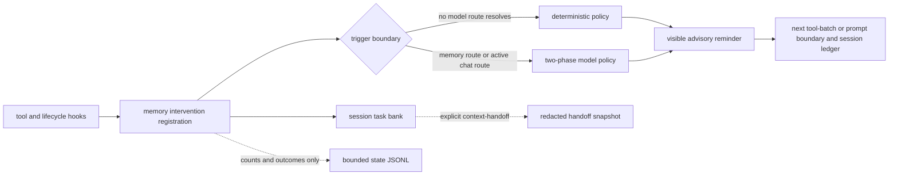

# Proactive task memory

The [evidence and memory contract](../architecture/evidence-and-memory.md) explains durable memory records, their review flow and their provenance.

After a durable context reduction, restoration uses a commit-scoped offer: stale content jobs and buffered reminders lose authority, known usage remains attributed, and restoration is consumed only after an admitted installation. See [Context continuity and recovery](context-continuity.md) for the lifecycle and its limits.

CLIO Coder's proactive task memory records requirements, environment facts, failed
attempts, and diagnoses in bounded session banks, and reminds the agent of them
at tool or turn boundaries. What outlives a session is a note: a claim bound to
a command that succeeded or a file that was read, which becomes a lesson only
after other sessions demonstrate it or you approve it. The design follows
Wu et al., *Remember When It Matters: Proactive Memory Agent for Long-Horizon
Agents* (2026), adapted to CLIO Coder's middleware and model routing.

The rules tier is always part of memory and makes no model calls. With the
default [memory surfaces](#memory-surfaces) the automatic paths run on rules
alone: the main agent writes notes through the `memory_note` tool, a failed
command followed by its fix is filed by rule, and the only memory model call is
the classifier that reads a statement you asked CLIO Coder to remember. The
model steps (`correct: model`, `bank: model`, `lessons: side`, `history: on`,
`observe: on`) are opt-in. A model step runs on the independent
`context.memory.target` and `context.memory.model` route when both are set, and
on the active chat route (`chat.target` and `chat.model`) when neither is. With
no route, memory stays in the rules tier. Disabling
`context.memory.enabled` removes observation, bank writes, model resolution,
reminders, the `# Memory` section, the `memory_note` tool's writes, handoff
offers, and handoff seeding.

## Quick start

Memory is on by default and needs no setup. While you work, CLIO Coder notes
your requirements, facts about your environment, what failed and why, and
reminds the agent of them when they matter again.

- `/memory` shows what it holds for this session.
- The agent keeps a note for later sessions with `memory_note`, bound to a
  command it ran successfully or a file it read. See
  [Notes, lessons and claims](#notes-lessons-and-claims).
- On a selected row, `p` proposes it as a lasting lesson for this
  repository, and `g` for every project. `clio-coder memory` reviews the
  proposals.
- Memory's model steps are off by default. When you turn one on it uses your
  chat model unless you give memory a route of its own in
  `/settings` → **Context and memory** → **Proactive memory**, where you can
  also turn memory off.

## Inspect or configure memory

### Turn memory off

To turn memory off, set `context.memory.enabled: false` in settings, or use `/settings` → **Context and memory** → **Proactive memory**. This stops observation, bank writes, model calls, the `# Memory` section and reminders, along with handoff offers and seeding. Dispatched workers lose the section too, and `memory_note` refuses with `memory_note: note writing is off for this session`. An explicit context-handoff request carries no task-memory block, `/memory` lists each eligible lesson as `off`, and `memory_recall` refuses with `memory is off`. A session records a `clio_coder_memory_off` ledger marker on its active path before its first turn or operator shell line with memory off, and history review, completed-task retention and observation read nothing past that marker, even after memory comes back on. A session recorded before this marker existed carries none and stays reviewable. Leaving the memory model unset uses the chat route when available; it does not turn memory off.

### Inspect the memory bank

| You want to… | Use |
| --- | --- |
| Inspect the bank and recent memory steps | `/memory` |
| Propose a bank entry for durable review | `/memory`, then `p` (repository scope) or `g` (global scope) on a selected knowledge or procedural row; over ACP, `_clio-coder/memory/propose` (see [ACP](../architecture/acp.md)) |
| Import the newest handoff's task memory | `/memory seed` |
| List, approve, reject or prune durable records | `clio-coder memory`, see [Memory CLI](../architecture/evidence-and-memory.md#memory-cli) |
| List the approved records one approver let into the prompt | `clio-coder memory list --approved-by operator` or `--approved-by guardian` |
| Merge duplicate claims and demote lessons that no longer hold | `clio-coder memory consolidate`, see [Consolidate the store](#consolidate-the-store) |
| Select a background model or change memory controls | `/settings` → **Context and memory** → **Proactive memory** |
| Review recorded cost | `/usage` or `clio-coder usage report` |
| Look up the default values and routing example | [Operator setup](#operator-setup) |
| Understand what survives a handoff | [Handoff continuity](#handoff-continuity) |

### Tell CLIO Coder what to remember

CLIO Coder captures a memory statement from the words you type when you submit them. Your words are the consent, so the statement is stored approved, with no proposal or review step. Only text you typed is read. Tool output, model text, queued resubmits, continuations and inlined file or skill bodies are never scanned ([operator-memory.ts](../../src/session-control/operator-memory.ts)).

These forms are matched case-insensitively ([operator-statement.ts](../../src/domains/memory/operator-statement.ts)):

| You type | Captured as |
| --- | --- |
| `# <statement>` as the whole submission, on one line | Remember |
| `remember that <statement>` or `remember: <statement>` | Remember |
| `remember <statement>`, when the statement says something (`is`, `are`, `uses`, `runs`, `needs`, `should`, `must`, `has`, `requires` and similar) and does not start with `to` | Remember |
| `don't forget <statement>` or `do not forget <statement>` | Remember |
| `from now on <statement>` | Remember, as a rule |
| `forget that <statement>` or `forget about <statement>` | Forget |

`remember`, `don't forget` and `forget` also match after a leading `please`. A phrase counts only at the start of a sentence that does not end in `?`, so "Do you remember that bug?" stores nothing. Sentences split at line breaks and after `.`, `!` or `?`, and the first matching sentence wins. When the statement is the whole submission, nothing is sent to the model. When the message has other sentences, the statement is captured and the whole message still goes to the model as an ordinary turn.

Each statement gets one of three scopes:

| Scope | Words that pick it | Where it is kept |
| --- | --- | --- |
| Session | `for now`, `for this session`, `in this session`, `just this session`, `for the rest of this session`, `temporarily`, `for this task`, `for this conversation` | A pinned `operatorNote` entry in the session ledger. It rides in every turn's `# Memory` section and survives compaction, and it ends with the session. |
| Project | `in this project`, `for this repo`, `in this repository`, `in this codebase`, `in this workspace`, `in here`, or no scope words | An approved repository-scoped record in `<dataDir>/memory/records.json`, bound to the current repository's identity. Outside a repository the capture fails and asks you to say `everywhere`. |
| Global | `everywhere`, `globally`, `in all projects`, `in all of my projects`, `for all my projects`, `across my projects` and similar | An approved global record in `<dataDir>/memory/records.json`, applied in every project. |

Session words win over global words, and global words win over project words. A statement with no scope words starts in project scope. When a background memory route is available, it classifies the statement's scope and kind (fact, preference, rule or command) within 20 seconds and moves an unscoped statement when it disagrees, with a new notice. A scope you named, or one you set with `/remember scope`, is never moved. Stating the same words again updates the existing record instead of adding a copy. Operator-stated records go first in the `# Memory` section, labeled `operator-stated <kind>`.

A statement that looks like it holds a credential is refused and never stored, even redacted. Keep a provider key in CLIO Coder's credential storage with `clio-coder auth login <target>` and other secrets in an environment variable or the OS keychain, then tell CLIO Coder the variable's name. A statement longer than 400 characters is refused. With `context.memory.enabled: false` nothing is captured: typed phrases reach the model unchanged, and `/remember` warns that memory is off.

The TUI reports each capture as a transcript line such as `Remembered for this project · change scope: /remember scope session|global · undo: /remember undo`. The `/remember` command does the same work by hand and never starts a model turn:

| Command | Effect |
| --- | --- |
| `/remember <text>` | Remember the text as typed. Scope words in it still pick the scope. |
| `/remember scope session\|project\|global [capture-id]` | Move the latest capture, or the named one, to that scope. |
| `/remember undo [capture-id]` | Undo the latest capture that is not already undone, or the named one. Undoing a remember removes the record or restores the one it replaced; undoing a forget puts the memory back. |
| `/remember forget <text>` | Forget, as `forget that <text>` does. |

A forget first looks for a pin in this session with the same words or words that contain each other. Otherwise it picks the approved record applicable here (global, or this repository) that shares the most words with the request, at least half of the shorter one's terms. An operator-stated record is removed. A lesson that came from evidence is rejected instead, so the same evidence does not propose it again. When nothing matches, nothing is forgotten and the notice says so. The process keeps its last 32 captures for undo and rescoping.

In the desktop app the same capture appears as a banner in the conversation, such as `Remembered for this project`, with the kind and text below it. Its buttons `Keep for this session`, `Keep for all projects` (the scopes it is not in) and `Undo` run `/remember scope` and `/remember undo` for that capture, and `Dismiss` hides it. A forget shows `Forgot` with `Undo`. ACP clients receive the capture as `_meta["clio-coder/memory-capture"]` on the notice's `agent_message_chunk` update, and a read-only ceiling refuses `/remember`.

## Notes, lessons and claims

What CLIO Coder keeps across sessions is a claim, not a sentence. A record is identified by its repository, the kind of claim, the claim's body and any condition it states, so two wordings of one claim are two revisions of one record and every session that reaches the same claim lands on that record ([promotion.ts](../../src/domains/memory/promotion.ts)).

| Claim kind | Body | Evidence that binds it |
| --- | --- | --- |
| Command | One command, as its program and words | The shell tool's own successful result for that exact command, run from the workspace root |
| Fix | A failed command and the command that then succeeded | Both results in one session, differing only in their bare options |
| Source | One quoted span of one repository file | A read of that file in the session |

A record has one of two standings. A **note** is unverified: `memory_recall` finds it, and a fix note can also ride the reminder on a failed call that matches its failed command, labelled unverified. A **lesson** is a note that was promoted, and only lessons reach the `# Memory` section and the other reminders.

Two writers file notes, and neither approves anything ([notes.ts](../../src/domains/memory/notes.ts)):

- **The main agent, through `memory_note`.** The tool takes `note` (at most 480 characters) and optionally `command`, `path` and `applies_when`. With `command`, the host binds the note to that command's successful result in this session and refuses a command that has not succeeded from the workspace root, or a help, version or always-succeeding command. With `path`, it binds the note to a file the session read. A note with neither is kept for `memory_recall` only and is never promoted without you. The result says which it was, for example `Noted [mem-…], unverified, bound to the command that succeeded here.` The tool is attached only to a main session that starts with `context.memory.surfaces.lessons: agent`, and workers never have it. See [`memory_note`](tool-usage.md#memorynote-keep-a-note-for-later-sessions).
- **Rules capture.** When one command fails from the workspace root and the same program with the same operands then succeeds with a bare option added or removed, and nothing in the workspace changed in between, the pair is filed as a fix note. A word carrying a value, such as `--filter=b`, is part of what runs, so a different value is a different command. A help, version or always-succeeding command never pairs. Capture runs under every `lessons` value except `off`.

A session whose information flow is restricted writes no note. A note that would carry a secret is refused, and its words are redacted as every stored lesson is.

### Consolidate the store

`clio-coder memory consolidate [--json]` is the explicit pass over the store. It makes no model call and runs only when you run it ([consolidate.ts](../../src/domains/memory/consolidate.ts)). For the records the current checkout would use, it:

- merges records of one claim into one, keeping the other wordings as earlier revisions and joining their verdicts and delivery counts;
- re-checks each lesson of this repository with the [delivery check](#delivery-checks) and demotes one that fails to a note with a regression, or reports it as withheld when you approved it;
- drops notes the automatic tier wrote that carry no command or source evidence and that no session ever observed or was delivered.

A record you approved or rejected is never merged, demoted, dropped or rewritten, and another repository's records are left alone. The text result is one line, `memory consolidate: scanned N, merged N, demoted N, withheld N, dropped N`, ending `; nothing changed` when the store was left as it was.

## Architecture



The task bank is in `src/domains/memory/` and belongs to one live session. It is
separate from both durable approved lessons and the regenerable repository
context engine. The registration is `observer.memory-intervention` in
`src/domains/memory/intervention.ts`; it hooks `before_tool`,
`after_tool`, `turn_start`, `turn_end` and `on_compaction`.

- **Private status** is the memory policy's short progress model. Inspect it
  with `/memory`. It stays out of ordinary reminders, the memory model's bank
  input, and handoffs. After compaction, CLIO Coder can include it in the restored
  state sent to the action agent.
- **Knowledge** contains stable task facts such as requirements, paths,
  environment facts, and constraints.
- **Procedural memory** contains attempts and outcomes such as failed commands,
  ruled-out hypotheses, diagnoses, and fixes that worked.

Knowledge and procedural entries have stable short IDs (`tm-k-<n>` and
`tm-p-<n>`, with the counter in base 36; status is `tm-s-<n>`). A visible
reminder is one `Memory:` advisory block. Producing it records nothing: the
cited entry IDs' injection counts and every other delivery effect start only
when the host finds the reminder's exact text inside its own framing of an
admitted request, which is a `<system-reminder>` block or a trailing
`[middleware:<severity>]` note on a tool result
(`src/core/reminder-framing.ts`). A reminder missing from three submitted
requests is released. One whose cited entry was rewritten or deleted, or whose
correction's failure has since resolved, is dropped before it is sent; a
failure that only repeated keeps its correction current
(`src/domains/memory/intervention.ts`).

The bank lives in process memory only. Each entry holds at most 1,200 characters
of whitespace-normalized text. The knowledge class keeps at most 20 entries and
the procedural class at most 30; saving past a cap evicts the entry touched
longest ago. The bank is never written to disk except as a redacted handoff
snapshot or a reviewed promotion (`src/domains/memory/task-bank.ts`).

The existing middleware path delivers that block at the first boundary that can
carry it, which is either a native tool-batch boundary inside the running turn or
the next accepted prompt, and persists its attribution in the session ledger.
There is no hidden `transformContext` injection.

## What reaches the model and when

Memory reaches the action agent through four channels. Each one is advisory text
or a labeled prompt section, never a tool or a permission.

| Channel | When | Content | Source |
| --- | --- | --- | --- |
| Tool-result annotation | The second identical failure in the bounded trajectory, at most once per operation per turn | One cited `Memory:` line appended to the failing tool's own result | `annotateRepeatedFailure` in `src/domains/memory/intervention.ts` |
| Deferred or turn-end reminder | At a native tool-batch boundary while the turn runs, at turn end for the rules tier, or on the next accepted prompt for a finished background step | A `Memory:` block inside `<system-reminder>`, recorded in the session ledger | `src/session-control/turn-middleware.ts` |
| Post-compaction restoration | After a durable continuity or summary commit is installed | Status (when no handoff note or summary already carries current state), knowledge and procedural entries, labeled unverified | `src/domains/memory/restoration.ts`, `src/session-control/turn-context.ts` |
| Approved durable memory | Selected at every prepared operator turn and compiled into the system prompt, then held until a completed compaction or a session switch. A later approval or revision arrives in the turn's reminder as a `# Memory update` block, and a rejection or deletion as a withdrawn line | A `# Memory` section of at most 5 approved records within 400 estimated tokens, each naming whether an operator approved it or the evidence gate retained it. Main sessions carry only records the turn concerns | `src/domains/memory/prompt-section.ts`, selection rules in the [evidence and memory contract](../architecture/evidence-and-memory.md#prompt-injection-rules) |

A background model never writes directly to the system prompt. Durable records
must pass operator approval or the repository-lesson evidence gate described
below before prompt selection can include them.

## Keep working commands from completed tasks

Completed-task retention runs only with `context.memory.surfaces.lessons: side`.
It is armed by evidence and not by activity: a fix pair, or a `finish`
declaration of `done` in an operator turn with a passed check, since the last
pass, and it runs at most once per operator turn. Under the default `agent`
value the main agent writes these notes itself through `memory_note`. When it
runs, retention
extracts reusable lessons from the session's own receipts. The host also keeps
commands the evidence proves, regardless of whether the lesson model proposes
them. A command qualifies when it is one simple invocation that executes a
repository file, as the program itself or as the script an interpreter such as
`node` or `python` runs (launchers such as `npx`, `env`, `pnpm exec` and
`uv run` are looked through), and either the same program on the same file
failed earlier and then succeeded, or the session read that file, the file
contains every passed option and environment assignment, and the command
succeeded. Naming a file is not running it, and a help or version call teaches
nothing about running it. A recipe whose command an approved lesson already
carries as evidence in other words is not filed again. Source:
`src/domains/memory/recipes.ts` and `src/domains/memory/completion-retention.ts`.

Only an exact receipt counts as a successful run. The shell tool's own ok
result with exit 0 vouches for the command it ran. A successful pure `&&`
chain run from the workspace root also counts each of its segments as a run of
its own, because exit 0 proves every segment exited 0; one leading `cd` to the
root itself is allowed. `;`, `||`, pipes, background launches, substitutions,
comments and multi-line scripts do not qualify because their exit status
cannot prove which part ran, and a chain with another `cd` or a state-changing
word such as `export`, `source`, `exec`, `builtin` or `command` is not split.
A shell call given a `cwd` other than the workspace root counts for nothing.
A command that cannot fail, such as `echo`, `printf`, `true`, `ls`, `cat`,
`pwd`, `date`, `sleep`, a bare `env`, or a `test` without a file operator,
proves nothing and is never evidence. Source:
`src/domains/memory/command-evidence.ts`.

Retention records its bounded progress under `<stateDir>/memory/retention/`.
A process that finds an unsettled retention can recover the completed task from
that session's ledger. A dead extraction owner becomes pending; saved candidates
are revalidated before retention continues. This uses the existing memory route,
deadline and evidence gate rather than making the bank durable. Source:
`src/domains/memory/runtime.ts`.

Retention that extracted lessons but could bind none of them to a receipt or a
quoted source settles as `abstained` with reason `missing-source-evidence`
instead of trying again: the same ledger yields the same evidence, so a second
extraction could only reword them. In the live session those lessons stay in
the bank; when its scope ends, only the entries that carry a `command:` or
`source:` evidence identity are filed as unapproved proposals. Source:
`src/domains/memory/completion-retention.ts` and
`src/domains/memory/lesson-feedback.ts`.

A completed task with no successful command receipt and no read excerpt, such
as a run that only edited files, settles as `abstained` with reason
`no-grounding-evidence` before any lesson call and records a
`lesson-extraction-skipped` observation. Its tool calls stay unreviewed, so
history review can still file a provisional proposal from them later.

With `context.memory.surfaces.history: on`, the guardian also reviews earlier
sessions of the same repository for lessons while the session is idle. History
review is off by default, and the guardian then parks once the live session's
own work is done. An excerpt counts as reviewed only after what it
taught is durable: filed in the store, or saved as pending candidates under
`<stateDir>/memory/history-candidates/`, which a later guardian step files
without a model call. When neither succeeds, the excerpt stays unreviewed and
the review parks until the guardian's next wake. At most 64 candidate files
are kept; past that, a failing store holds the review where it is. Source:
`src/domains/memory/guardian.ts` and `src/domains/memory/lesson-feedback.ts`.

## When a repository lesson becomes approved

A repository note becomes a lesson without you only after it has been
demonstrated: two complete demonstrations of its current wording, from two
distinct sessions other than the one that wrote it, with no contradiction of
that wording. A complete demonstration of a fix claim is its failed command
failing and then its fixed command succeeding in one session. A success of a
plain command claim counts only when the session had not been shown the note
first. A note that is both held and contradicted on one wording is contested
and waits for you. The gate speaks only for notes the task bank's knowledge
entries, `memory_note` command notes and rule-captured fix pairs produced. It
also waits for you when
another approved or operator-rejected repository lesson already carries one of
its `command:` evidence refs: two wordings of one command stay separate claims,
a rejection keeps its authority over rewordings, and which one stands is the
operator's call. A quote from a repository file is provenance only: the file
can vouch for any sentence it contains, so a lesson backed by `source:` refs
and no `command:` ref waits for the operator, and automatic approval needs a
command that could have failed. A lesson that quotes a source and names a
command CLIO Coder has not seen succeed carries that command as a
`command-claimed:` ref instead: it grants no approval, but it counts as the
lesson's claim on the command, so a rejected lesson still holds back a later
rewording that names the same command. Procedural proposals still wait for an
operator. Global, runtime and agent scopes also require operator approval.
The guardian never reverses an operator approval or rejection. A later
contradiction demotes a guardian-approved lesson. The `held` observation is an
evidence-gate input, not proof of a general claim. Source:
`src/domains/memory/guardian-gate.ts`.

In a live session a delivered lesson holds only when a later receipt satisfies
its own evidence: its exact command succeeded as one simple invocation, or a
read showed its quoted source and the checkout still contains it. Quiet steps
and unrelated successes decide nothing. Two recurrences, after submission, of
the failure the reminder was about record it as contradicted. Source:
`src/domains/memory/intervention.ts`.

## Claims and hypotheses that reach memory

CLIO Coder keeps a claims ledger beside memory: every judged `reproduce` or
`numeric-compare` check the main session runs, through `verify` or host
verification of a worker run with a declared gate, appends a claim saying
whether the result agreed with its reference within tolerance. Agreement is not
a verdict on truth. The log is per project, under
`<stateDir>/claims/`, and the full record is specified in
[Evidence and memory](../architecture/evidence-and-memory.md#claims-ledger).

- **Notes on contested or superseded results.** When the task text names a
  check or one of its paths, `verify` runs it, or a read, edit or write touches
  one of its files, and a claim of that check is contested or superseded, the
  main agent gets a short note at the tail of the turn or on the tool result.
  It names both sides of an open contradiction and says not to repeat a
  superseded verdict as current. Each state is offered once per session.
  Workers get no notes. Source: `src/domains/claims/delivery.ts`.
- **A lesson from a claim.** `clio-coder memory propose --from-claim <prefix>`
  builds an unapproved `repo` lesson citing `claim:<id>`. Approve it like any
  other proposal.
- **Regressions from a contradiction.** When a check that agreed later
  disagrees under the same commit, inputs, reference and tolerance, every
  memory record citing the overturned claim receives a regression. The record
  keeps its approval, stops reaching the prompt and `memory_recall`, and
  `clio-coder memory approve <id>` clears the regression after review. Source:
  `src/domains/memory/claim-link.ts`.
- **Hypotheses.** A hypothesis slate written by the literature pack's
  hypothesis workflow (see [Resource library](resource-library.md#science-packs)) is
  recorded in the same ledger. Each hypothesis starts `proposed`. A run of its
  check that records no judged claim marks it `tested`, and the latest judged
  run marks it `supported` (agrees) or `refuted` (disagrees). The status comes
  from the ledger, never from what the slate says.

`clio-coder claims` lists claims and hypotheses with their statuses, and
`clio-coder claims show <id-prefix>` prints one.

## Offer a lesson beside the action it concerns

`context.memory.surfaces.delivery` selects which channels carry lessons:

| Value | What delivers |
| --- | --- |
| `off` | Nothing from the store. `memory_recall` still reaches every record. |
| `section` | The `# Memory` section only. |
| `decision` (default) | The section, plus a reminder at a decision point: a failed command, a verification gap, a touched file or the turn's task. |
| `broadcast` | Those, plus every pending lesson at the session's first workspace change. |

The `# Memory` section carries a lesson that has command evidence or that you
approved. Under `broadcast`, an eligible approved lesson can appear at the
session's first workspace change, with lessons about the changed file first.
From `decision` up, one can appear when a read, edit or command touches
a file the lesson names; when verification finds no declared check; when the turn's task concerns it; or when a
failed command runs the same repository file through the same program as a
command the lesson recommends, or is exactly a failed example the lesson
quotes. A lesson recommends the command its `command:` evidence names. Without
one, it recommends every command it quotes except help and version calls and
those its own clause says failed or rules out. A lesson appears at most once
per session, counted from the request that carried it, and is omitted once its
recommended command has already succeeded there exactly. Each line names who
stands behind the lesson, such as `operator-approved`,
`retained automatically from execution evidence` or
`unverified note from an earlier session`, and
carries its stored `Applies when` and `Avoid when` conditions. An approved
lesson whose reminder was submitted is observed `delivered`, and `held` once
its recommended command then succeeds exactly. The reminder is advice and never
grants permission to execute the command. Source:
`src/domains/memory/intervention.ts` and `src/domains/memory/lesson-projection.ts`.

### Delivery checks

Every lesson is checked once per session, when it is first loaded for delivery,
and every channel asks the same gate. A lesson is withheld when it is certainly
dead: the program its command starts with no longer resolves (on `PATH`, as a
repository program or as a known runner), a file it quotes is gone, or the span
it pins is known exactly and the file no longer holds it. A lesson that binds a
path outside its repository checkout, such as another worktree, or a program
under `/tmp` or `/var/tmp`, is withheld too. A span the check cannot locate is
undecided and the lesson is delivered. The check proves nothing about a
subcommand, a flag or the claim itself.

What happens next depends on who approved the lesson:

- A lesson you approved is withheld for the session with its approval intact,
  and one notice names it, opening `Memory: withheld an operator-approved lesson for this session (<id>)`
  and stating the failed check. Review it with `clio-coder memory list`.
- An automatically approved lesson returns to the notes with a regression, and
  the notice opens `Memory: returned a repository lesson to the notes (<id>)`.
- An automatic approval that no longer meets the two-demonstration bar returns
  to the notes.
- A lesson delivered in three other sessions in a row with no verdict is
  demoted.

`/memory` opens on **Lessons**: the reusable lessons eligible for this session,
what each concerns, whether the main prompt carries it (`off` while memory is
off), its evidence and its track record. Task memory, review candidates and diagnostics occupy separate
tabs. Opening the view does not activate memory (`src/interactive/memory-overlay.ts`).

## Prepare observation notes for compaction

`context.memory.surfaces.observe` defaults to `off`. Setting it to `on` while
`context.memory.enabled` is on lets background memory prepare source-linked
notes that the existing compactor can use in place of the history they cover.
These continuity notes are separate from reusable lessons and preserve source
references; they do not approve a durable record. Source:
`src/domains/memory/observations.ts` and `src/domains/memory/runtime.ts`.

Preparation is sized so a session that never nears compaction pays little:

- It runs only when the next automatic fold would send history to a separate
  summary request: a separate compaction model, or a chat route whose cached
  prefix cannot carry the summary. It waits until the live context is within
  0.15 of the window (uncalibrated) below the compaction trigger, and never
  runs when automatic compaction is off. When the live
  budget cannot say, preparation defers with the status reason
  `pressure-unknown`; only a composition that supplies no fold planner at all
  runs without the gate. Two committed folds in a row that decline its notes
  for no gain stop preparation for the session.
- The observer is called only for a source group of at least the smaller of
  1,024 and half the source budget (and at least 256) estimated tokens, never
  for a group whose exact user material leaves no room for smaller notes. Each
  source revision gets at most two model attempts.
- Between turns it waits while the intervention owes a turn-boundary step, so a
  turn-end lesson pass runs first. A preparation call already in flight is not
  interrupted.

Observer input comes from the session's own messages through a reasoning-free
projection. Thinking blocks and provider signature fields never reach the
observer, and a payload shape the projection cannot carry exactly leaves its
unit uncovered (`src/domains/session/message-projection.ts`).

The observer answers with one JSON envelope of notes. A note that cites a
source reference the host did not supply, or that the host cannot read, is
dropped and the others stand. A `supersedes` link that resolves to no note is
removed without dropping its note. A batch with no acceptable note is refused.
The host repairs one missing final brace after the notes array. When the
answer wraps the envelope in a closed reasoning block (`<think>` and similar),
a markdown fence or surrounding prose, the host reads the first JSON object
that carries a `notes` array and discards the rest. An answer cut off inside
an unclosed reasoning block, or with no such object, is refused, as is any
other malformed envelope.

When prepared notes outgrow the journal budget, a reflection consolidates a run
of adjacent batches. It asks for at most 8 notes whose `supersedes` lists
account for every input note. A constraint, unresolved item or attempt that no
output note represents is carried forward verbatim. The reflection is refused
when that would exceed 16 notes or when the result is not smaller than its
inputs, and its inputs are deleted only after the reflection is written.

At compaction, memory receives the raw ledger slice the cut selected and
offers whole prepared batches that lie inside it. Uncovered units are
serialized from the same working-set projection the ordinary summary uses. The
compactor uses the offer only when the whole substituted summarizer request
fits the model's window and is smaller than the ordinary request; otherwise it
summarizes the ordinary history. When the main route can summarize inside its
cached request prefix more cheaply than the portable requests, and that live
call succeeds, the offer is declined as `live-prefix-cheaper` and no
`offer-used` event is recorded; if the live call fails, the portable request
carries the offer (`src/domains/session/compaction/compact.ts`).
Lifecycle events such as `batch-ready`, `notes-rejected`, `offer-declined` and
`offer-used`, which records `originalInputTokens` and `substitutedInputTokens`,
are journaled as `memory.observation_recorded` records in the session's
telemetry journal without note or message text.

Each session keeps at most 64 artifacts under
`<stateDir>/memory/observations/<sessionId>/`. When the directory is full,
unreadable files go first, then batches prepared against another checkpoint or
branch anchor, then batches a reflection replaced
(`src/domains/memory/observation-store.ts`). The daily retention sweep removes
the observations of sessions that no longer exist.

## Paper mapping and CLIO Coder constraints

| Paper mechanism | CLIO Coder implementation |
| --- | --- |
| Separate memory agent | One stateful middleware registration beside the unmodified action agent |
| Status, knowledge, and procedural bank | Bounded in-memory `TaskMemoryBank`; status stays out of every reminder except the post-compaction restore |
| Phase 1 bank maintenance | Strict `update_status`, `save_knowledge`, `save_procedural`, and `delete` operations |
| Phase 2 intervene or stay silent | One advisory `inject_reminder` effect or explicit silence |
| Fixed memory cadence | Deterministic decay signals plus a coarse interval floor |
| Learned intervention calibration | Structural authority gate: spontaneous reminders must cite a bank entry; deterministic triggers may be uncited |

<details>
<summary>The two-line envelope grammar and what the parser tolerates</summary>

Model output uses a strict two-line grammar parsed by [task-memory-policy.ts](../../src/domains/memory/task-memory-policy.ts):

```text
<operations>[{"op":"update_status","content":"Tracking the current requirement."}]</operations>
<no_intervention/>
```

When a visible reminder cites an existing bank entry, the second line uses:
```text
<operations>[]</operations>
<context_for_action>Restored requirement [tm-k-1]</context_for_action>
```

Knowledge and procedural saves use `{"op":"save_knowledge","content":"..."}` or
`{"op":"save_procedural","content":"..."}`; an `id` is only valid when updating
an existing entry.

The parser locates the envelope within a response instead of requiring an
exact byte-for-byte match. A markdown fence, a `<think>` block, a leading "Here is my
step:", a closing pleasantry, and a pretty-printed multi-line operations array
are all accepted. Two shapes are read conservatively rather than generously:

- A response with no phase-two line at all is silence, since silence is the
  prompt's documented default. Its phase-one writes still apply. An envelope
  truncated mid-reasoning yields nothing at all.
- Tag shapes are stripped from the reminder before it is emitted, so the memory
  model cannot close the `<system-reminder>` block it rides inside. Ordinary
  comparisons and arrows survive.

Operations are validated structurally as a batch. A malformed entry or more
than eight operations rejects the whole list without changing the bank.
For a valid list, two recoverable cases are handled per operation:

- A `save_knowledge` or `save_procedural` ID that names no entry of that class
  creates a new entry; a `delete` of an unknown ID is dropped.
- An unrecognized `op` is dropped while recognized operations remain eligible.
  A list with no recognized operations records `malformed` with reason
  `all_operations_invalid`.

Phase 1 writes remain valid when Phase 2 is gated or yields to a deterministic
reminder; an over-budget reminder is recorded as `gated` and suppressed rather
than discarding the writes that came with it. A timeout, provider failure,
malformed response, or telemetry failure never blocks a tool and produces no
reminder.

</details>

## Settings

All keys live under `context.memory` in `settings.yaml` (`src/core/defaults.ts`, validated in `src/core/config.ts`). A change applies at the next turn.

| Key | Default | Minimum | Effect |
| --- | --- | --- | --- |
| `context.memory.enabled` | `true` | | Enables observation, task bank writes, and reminder injection. `false` is the kill switch for the whole plane. |
| `context.memory.sideShare` | `0.15` | `0` | Caps automatic memory model calls at a share of the session's main output. See [Background budget](#background-budget). `0` removes the cap. |
| `context.memory.thinkingLevel` | `off` | | Thinking level of the memory side call. `off` sends no reasoning request. |
| `context.memory.target` | `null` | | Target for a dedicated background model route. A value that names no configured target resets to `null`. With `target` and `model` both unset, the model tier runs on the active chat route. |
| `context.memory.model` | `null` | | Wire model on that target. Cleared when `target` is unset; defaults to the target's `defaultModel` when `target` is set and `model` is not. |
| `context.memory.cadenceToolCalls` | `10` | `2` | Minimum completed-tool interval between background interventions. |
| `context.memory.trajectorySteps` | `8` | `1` | Completed tool-trajectory window analyzed during background evaluation. |
| `context.memory.maxOutputTokens` | `2000` | `1` | Bounds the rendered memory-bank context, the ordinary policy-model completion, and the reminder (4 characters per token). An always-on-thinking model receives twice this value and at least `4000` tokens, within the model's own output cap, so it can still reach the strict envelope. |
| `context.memory.timeoutMs` | `60000` | `1` | Wall-clock limit for one background memory-policy step, including its one permitted chat fallback attempt. The step is detached, so this deadline never delays a turn, but it does hold a request slot on a real inference endpoint that your own turns and dispatched workers queue against. Raise it only after inspecting the timeout and hit-rate evidence for the selected route. |

### Memory surfaces

Each memory surface has one switch under `context.memory.surfaces`. A change applies at the next turn, with one exception: `memory_note` is attached when a session's tools are registered, so turning `lessons: agent` on reaches the tool in a new session, while an attached tool refuses from the next turn once the value changes.

| Key | Default | Values | Effect |
| --- | --- | --- | --- |
| `context.memory.surfaces.lessons` | `agent` | `off`, `rules`, `agent`, `side` | Who writes cross-session notes. `agent` gives the main agent `memory_note`. `rules` keeps only rule-captured fix pairs. `side` adds the memory model's lesson pass and completed-task retention. `off` writes nothing. Rules capture runs under every value but `off`. |
| `context.memory.surfaces.delivery` | `decision` | `off`, `section`, `decision`, `broadcast` | Which channels deliver lessons. See [Offer a lesson beside the action it concerns](#offer-a-lesson-beside-the-action-it-concerns). A running session's `# Memory` section keeps what it was compiled with. |
| `context.memory.surfaces.correct` | `rules` | `rules`, `model` | In-session correction after repeated failures. `rules` keeps the repeated-failure annotation and makes no model call. `model` adds a model step on two consecutive tool errors or a loop signal. |
| `context.memory.surfaces.bank` | `rules` | `rules`, `model` | Task-bank maintenance. `rules` writes procedural entries from failures and knowledge from your statements. `model` adds a model step every `context.memory.cadenceToolCalls` tools. |
| `context.memory.surfaces.history` | `off` | `off`, `on` | Reviewing this repository's earlier sessions for lessons while the session is idle. Set `on` to turn it on. `clio-coder memory consolidate` is the separate model-free pass. |
| `context.memory.surfaces.observe` | `off` | `off`, `on` | Preparing observation notes for a predicted compaction. |

## Trigger semantics

Memory does not call a model after every tool. Signals accumulate and coalesce at
a turn-end or native tool-batch boundary; at most one prompted step is started for
that boundary, and it runs detached from it.

The interval trigger runs only under `context.memory.surfaces.bank: model`, and the tool-error streak and loop signal only under `context.memory.surfaces.correct: model`; both default to `rules`, under which the repeated-failure and post-compaction rows below still run and make no model call.

| Trigger | Behavior |
| --- | --- |
| Interval | After `context.memory.cadenceToolCalls` completed tools since the last prompted step; default 10. This is the nondeterministic, citation-gated path. |
| Tool-error streak | Two consecutive error outcomes. A successful tool resets the streak. Memory stays silent for a turn whose operator message asks for a repeat, because the repeat is the task. A clause that opens with a run, execute, invoke, try, re-run, re-try or repeat request and carries `again`, `twice`, `once more`, `a second time` or a similar phrase counts, as does `re-run`, `retry` or `repeat` itself. A negation such as `not`, `never`, `avoid`, `stop`, `without` or `don't` cancels it. That turn gets neither this trigger nor the repeated-failure annotation. |
| Loop signal | Reuses the orchestrator loop guard's verdict; it does not infer a second competing loop detector. |
| Repeated failure | The rules tier records failed operation fingerprints and annotates the failing tool result once the same failure appears twice in the bounded trajectory. A successful `write`, `system_modify`, `git_destructive` or `dispatch` call between the two failures resets the count, because rerunning a check after an edit is verification and not a repeat. |
| Post-compaction | After a durable context reduction, restoration offers status, knowledge and procedural entries once, without a model call, because compaction is precisely where execution facts leave the active window. See [Post-compaction restoration](#post-compaction-restoration). |

### Two delivery channels

A turn boundary is the wrong place to warn about a failure that happened forty
tool calls earlier in the same turn, because the reminder cannot reach the model
until the operator submits again. Memory therefore has two channels, and each
repeated failure uses exactly one of them:

- **Mid-turn annotation.** The second identical failure appends one cited
  `Memory:` advisory to that tool's own result, through the existing
  `annotate_tool_result` effect the loop guard already uses. The advisory uses
  the canonical result-disposition digest when one is available. Older hook
  producers fall back to the first tool-error line that names a problem. Every
  digest is redacted and byte-capped (240 bytes, `TOOL_RESULT_DIGEST_MAX_BYTES` in
  `src/tools/result-disposition.ts`) before it reaches the task bank. The model
  reads the advisory on its very next round. This is spent once per operation
  fingerprint per turn and re-earned in a later turn, because the same command
  failing again after an operator turn is news again.
- **Next-turn and tool-batch reminders.** Post-compaction reactivation and background-model
  reminders ride the `inject_reminder` buffer into the visible `<system-reminder>` block
  and persist in the session ledger. During active multi-tool execution loops, deferred
  reminders from completed background evaluations can also drain at native tool-batch
  boundaries (`prepareToolContinuation`), injecting actionable guidance between tool
  iterations without waiting for the operator to submit a new prompt. Reminders for
  aborted turns are dropped.

A boundary that already spoke through the annotation stays silent at turn end and
records one telemetry row, not two.

## Background steps never hold a turn open

`evaluateAsync` starts a detached model step and returns immediately. When the
step resolves, its reminder joins the deferred-reminder buffer and drains at the
next boundary that can carry it: a native tool-batch boundary if the session is
still executing tools, otherwise the next accepted prompt.

Three consequences follow:

- At most one background step is alive per session. A boundary that arrives while
  a step is still running is dropped rather than queued, so a model slower than
  the turns that trigger it can never build a backlog. The drop is recorded as
  its own telemetry row, because a cadence starved by a slow route and one that
  simply never triggered are otherwise identical in the step log. Its triggers
  stay pending, so the next free boundary still runs for them.
- A reminder can arrive one turn later than the trajectory that earned it. The
  rules tier is unaffected and stays synchronous, so deterministic protection
  keeps its original timing.
- After two consecutive model steps record `timeout`, the session stops spending
  its endpoint on the model tier. Later boundaries record `silent` with reason
  `llm_timeout_backoff` and the rules tier keeps working. No model step runs
  while the backoff holds, so only a bank reset clears the counter: `/new`,
  `/resume`, a turn switch and the other session changes
  (`MEMORY_INTERVENTION_TIMEOUT_BACKOFF_THRESHOLD`).

A headless `clio-coder run` submits no further turn, so a detached step could only
finish after the process exited. When triggers are pending there, the boundary
records `silent` with reason `no_consumer` and starts no model call. The rules
tier is unaffected.

`/memory` shows `step running` in its header while a step is in flight, and the
expanded footer dashboard's Memory bank row shows `updating`.

### Outcome semantics

The `/memory` overlay displays `last <decision>`, the combined outcome of the most
recent actual memory boundary. A **memory boundary** evaluates newly completed
tools or an explicit deterministic trigger, such as an interval, error streak, or
loop signal. Model-backed evaluation can run at a settled native tool-batch
boundary as well as at turn end.

A no-tool middleware continuation is another turn-end with no new tools since the
previous boundary, so it is not a new memory boundary and does not replace the
prior outcome. `last` therefore remains `injected` across such continuations until
a later tool-bearing or explicitly triggered step produces a new outcome, such as
a healthy tool leading to `silent`.

## Output validation

A small background model can derail mid-completion, and its text reaches both the
operator's `/memory` history and the action agent's next turn. Everything a step
produces is checked before it goes anywhere, and a failing item is dropped whole
instead of repaired (`src/domains/memory/task-memory-output.ts`,
`src/domains/memory/task-memory-policy.ts`).

A reminder is gated with reason `invalid_reminder` when it holds a chat-template
control token, an envelope tag, more than three non-empty lines, more than 500
characters, JSON-shaped text, first-person reasoning about the task or the answer
format, a script that appears nowhere in the task, bank or trajectory, or a
repeated sentence. A reminder with no closing tag was cut off and is rejected the
same way. The phase-one bank writes of that step still apply.

A stored operation is dropped, and counted as a dropped operation, when its
content holds a chat-template control token, a host framing tag
(`<system-reminder>` or a line starting `[middleware:`), deliberation about the
answer format, or a script foreign to the session. Stored content may quote JSON or the
memory grammar, because a session working on the memory tier legitimately does.

A well-formed reminder is still gated, and stays invisible, in these cases:

| Reason | Condition |
| --- | --- |
| `uncited` | A reminder started by the interval alone cites no current knowledge or procedural ID. Steps started by an error streak or a loop signal may be uncited. |
| `duplicate_reminder` | The text repeats the reminder already on screen, or one this session already submitted. Recorded as `silent`. |
| `suppressed` | The rules tier already spoke for this boundary. Recorded as `silent`; phase one still applied. |
| `over_budget` | The reminder exceeds `context.memory.maxOutputTokens` once prefixed with `Memory:`. It is dropped rather than truncated, because truncation could strip the citation that earns it a voice. |
| `resolved_failure` | A cited procedural entry records a call that has since succeeded in the observed trajectory, or, while the model answered, the failure it was asked about resolved or a fact it cites was rewritten. |
| `invalid_path` | The reminder names a workspace file that does not exist, holds more than 16 path references, or names a path over 320 characters. A path outside the workspace is not checked. |
| `no_repeated_failure` | The trajectory holds a failed tool call but no operation fingerprint seen at least twice with an error among them, and the reminder restores no unchanged bank fact. A `read` of a guessed path that does not exist does not count. |

The error-streak and loop paths are deterministic. The interval path is the only
one that must cite. The repeated-failure annotation and the post-compaction
restoration belong to the rules tier and need no model.

## Cost and defaults

The rules tier is enabled by `context.memory.enabled` and makes no model calls.
The LLM tier resolves its route from `context.memory.target` and
`context.memory.model`. With both unset it follows the live chat route: each
step uses whatever `chat.target` and `chat.model` are at that moment, so memory
tokens are billed to the chat model unless memory has its own route. The rules tier
answers alone when no chat route is configured, and under the default
[memory surfaces](#memory-surfaces) no automatic model step is started. Its default timeout is `context.memory.timeoutMs: 60000`.

Each model step's calls are journaled under the `memory` agent role and shown
as `memory steps` in `/usage`. `clio-coder usage report` reads the same journal
records after the process exits. `/memory` folds the `memory.step_decided`
records in the session, run and process journals: steps, tokens, model time,
and the proportion of steps that produced reminders.

A step shares the resolved endpoint's request capacity. When known occupancy
exhausts that capacity, the step is skipped with reason `endpoint_busy`. A shared
gateway URL alone does not imply one request slot or one physical server.

### Dedicated routing, chat fallback and endpoint capacity

CLIO Coder uses the explicitly configured memory target and model when both are
set. With neither set, it uses the active chat route. When an explicit route is
known unavailable, it uses the active chat route for that step. A step is skipped
entirely when the endpoint has no request capacity left.

<details>
<summary>Exactly which failures permit a chat attempt, and how capacity is counted</summary>

If the dedicated route is
known unavailable (missing target/runtime, down target, absent model in a known
catalog, or a model reported unloaded/loading), CLIO Coder selects the active chat
route for that step. A runtime client error on the dedicated route, or an
information-flow refusal of the dedicated destination, permits one chat attempt
within the original remaining deadline. It does not retry after a
timeout, cancellation, session/branch switch, malformed envelope, or a model's
explicit silence. The fallback never falls back again. Both routes unavailable
produce a visible `client_error` outcome. A memory role with no target and model
is not a fallback case: it uses the active chat route directly, with no second
route behind it, so an unreachable chat route records `client_error` for the step
and the rules tier keeps working. An explicit route that equals the chat route
has no distinct fallback either.

An information-flow refusal means restricted context cannot reach the selected
background model. The step records `information_flow_blocked`, the telemetry row
carries the admission diagnostic as `refusalReason`, and an interactive session
raises one `Memory skipped target <id>: <reason>` notice per session. When the chat
fallback is admitted, its own `Memory: configured route client error: <reason>`
notice takes the footer's compact row at once, and **Alt+U** opens the page listing
both. A headless run starts no background step, because no later turn would carry
its reminder, so it shows neither. The chat fallback is
admitted against the same policy, so a restricted session can end with no model
step at all. From its first label on, a restricted session also files no new lesson, starts no
completed-task retention for a task after the label and promotes no entry, because a durable record carries no
label and reaches every later route. `clio-coder memory propose --from-evidence` refuses the same way when the run
carries a label or its dispatching session does. Text recorded before the label can still be
filed or gain evidence: history review stops at the label, and a retention already
running, an interrupted one for a task finished before the label or a record already filed holds only what came before it. See [Information flow](information-flow.md).

A runtime notice names the selected chat fallback and its reason. Routing stays
session-local and does not edit saved settings. Each attempted call records its
own known usage under its actual target/model and emits its own telemetry outcome;
failed dedicated usage is retained alongside fallback usage. The final policy
result describes the final attempt, without merging different provider identities.
A generation change discards late content while preserving the original usage owner.

Capacity follows the same existing evidence as dispatch: explicit target
`maxConcurrentRequests`, current discovery, a valid discovery prior, then the
conservative one-slot default for a local-native runtime. Known occupancy includes
this process's foreground requests, active dispatch leases and held reservation
waves. A two-slot endpoint with one foreground request can admit memory; a full
one-slot endpoint skips it. Known dedicated saturation does not itself initiate
chat fallback. Larger declared capacities work without a new constant.

LiteLLM and OpenRouter are model-routed gateways, so CLIO Coder does not invent a local
one-slot limit for their URL. Distinct model routes can share that gateway URL (for
example, separate chat and memory target profiles pointing to the same LiteLLM
proxy); the gateway owns their physical routing and backend residency. Behind a
`litellm` or `openrouter` target, `modelEndpointKey` keys each stream as
`<url>#model=<id>` and also counts it under the plain gateway URL, so dispatch
admission and the settings endpoint rows, which read the gateway key, see the same
totals as before (`src/domains/providers/endpoint-capacity.ts`). Every other
runtime keeps the plain URL as its key. An explicit or discovered endpoint-wide
bound on the gateway still applies when present: the memory step then admits
against the gateway total. When the gateway has no declared or discovered
capacity, the memory step admits against its own model's key, counting only
streams on its own model plus gateway streams attributed to no model, so a turn on
another model through the same gateway no longer skips it
(`backgroundMemoryEndpointKey` in `src/entry/orchestrator.ts`). CLIO Coder's process-local foreground
holds and observed dispatch state are not a global scheduler for every client
using the gateway. Slot holds are released on success, failure and abort.

The existing `background_memory` expected-cold stamp remains keyed by endpoint
URL. It records a possible shared-endpoint cache disturbance, including after a
failed request, rather than proving that a different model behind the gateway
actually evicted the chat prefix.

</details>

## Background budget

Every model step is admitted against what its route costs before any request
leaves the process, so a skipped step costs nothing. CLIO Coder derives the route's
kind from its resolved pricing and runtime; there is no setting for it.

- **Metered** routes have a nonzero declared or catalog price. A step runs only
  while session spend plus its projected cost (estimated prompt tokens at the
  input rate plus `context.memory.maxOutputTokens` at the output rate) stays
  below `safety.limits.sessionCostUsd`, where `0` means no ceiling. Otherwise it
  is skipped with `cost_ceiling`.
- **Quota** routes bill a subscription CLIO Coder reads usage for (Codex, Anthropic
  OAuth, Claude Code, Antigravity). A step is skipped with `quota_window` while
  the binding window is at or past the warning level `/usage` draws, and with
  `quota_retry` while the usage endpoint's 429 retry interval runs. CLIO Coder never
  fetches usage for this. A missing, stale or unusable reading defers the step
  with `quota_unknown` until a trustworthy reading arrives.
- **Free** and **unpriced** routes, such as a LiteLLM proxy
  without declared `pricing`, have no dollar limit. The endpoint is the budget:
  a step takes a free slot or is skipped with `endpoint_busy`, and a foreground
  request competing for the same slot still preempts it. Once the endpoint has reported prefill and
  generation speed, the step's deadline is the time it needs for its prompt plus
  `context.memory.maxOutputTokens`. When that exceeds `context.memory.timeoutMs`
  the step is skipped with `time_budget`. With no measurement yet the deadline
  is `context.memory.timeoutMs`.

On every route kind, `context.memory.sideShare` caps what automatic memory may
spend. A session's first three automatic memory calls always run. After them a
further call is skipped with `side_share` while the session's settled memory
output tokens, plus the output budget of each memory call still in flight,
exceed that share of its settled main output tokens. On a route that reports
premium units, the same share applies to those. A call you asked for, such as
the classifier after a remember statement, is never skipped. `0` turns the cap
off. The default `0.15` is a design assumption, not a measured optimum, and the
cap can refuse a call that would have helped.

A skipped step is journaled as a `memory.step_decided` record with decision `dropped` and its reason, plus
`resumeAt` when CLIO Coder knows when room returns (a window reset or a retry instant).
`/memory` shows the newest skip and that time. A skipped step is not retried;
the next cadence tick or turn end decides again.

## Choosing a background model

Memory reads a trajectory and writes a bounded envelope. A small model can reduce
latency and resource use. CLIO Coder requests `context.memory.thinkingLevel` for
the memory route, and the default `off` sends no reasoning request.

The off request depends on runtime and model metadata: llama.cpp reads
`chat_template_kwargs.enable_thinking`, and LM Studio reads `reasoning_effort`,
with the off value selected by model family. A gateway needs a recognized,
unanimous upstream runtime declaration to establish the request dialect.

Servers may still return reasoning. The packaged gpt-oss-20b profile has no
upstream thinking-off mode, so an off request resolves to low effort. The parser
discards reasoning blocks and keeps the envelope; the output budget allows room
for a reasoning preamble.

No dedicated memory model is selected by default, so memory uses the chat model.
Set `context.memory.target` and `context.memory.model` to move it to a smaller
model. The role uses the same target machinery as chat and workers, so its model
can be local, remote, or shared with chat when request capacity permits. Local co-residency requires the models, KV caches, and
parallel slots to fit available memory.

## Operator setup

The shipped defaults are:

```yaml
context:
  memory:
    enabled: true
    sideShare: 0.15
    surfaces:
      observe: off
      delivery: decision
      lessons: agent
      correct: rules
      bank: rules
      history: off
    target: null
    model: null
    thinkingLevel: off
    cadenceToolCalls: 10
    trajectorySteps: 8
    maxOutputTokens: 2000
    timeoutMs: 60000
```

With `context.memory.target` and `context.memory.model` unset, a memory model step runs on
the active chat route. `/memory` shows `Memory route:` with `chat route (no memory
model set)` and the target and model in use, and the route line in the system
prompt reads `memory =chat (no memory model set)`. Set `context.memory.enabled:
false` for no memory model calls at all.

`/memory` opens on eligible lessons and also shows the current tier, last
decision, live bank, and a bounded history of the last twenty memory steps with their
trigger, decision, write count, cited-entry count, tier, and latency. That
history is the only place a capture, a gate, or a timeout becomes visible, since
those outcomes produce no transcript entry by design and only an actual injection
reaches the transcript. It carries counts and outcomes only, never bank or
trajectory text.

`/settings` exposes controls for every key above, with shorter operator-facing
row labels. The saved background-memory target is the Memory connection row in
Settings → Context and memory, independent of the chat target and the fleet default.
The memory target and model belong to the session's live routing: a change made in
the running session applies at once and is saved for new sessions, while an external
edit to `settings.yaml` changes the default for new sessions only. Each step
resolves its route from those effective settings when it starts.

An example gateway topology keeps the three backend routes distinct:

<details>
<summary>A worked three-route gateway topology and its role selection</summary>

| Role | Target | Runtime and endpoint | Model | Capacity |
| --- | --- | --- | --- | --- |
| Chat and memory fallback | `chat-target` | LiteLLM at `http://localhost:4000` | `chat-profile/qwen3.8-27b` | Gateway-owned unless an explicit or observed endpoint bound is available |
| Preferred background memory | `memory-dedicated` | Same LiteLLM gateway | `memory-profile/qwen3.5-4b` | Same capacity evidence rules |
| Alternative memory candidate | `memory-fallback` | Same LiteLLM gateway | `memory-profile/nemotron-3.5-lightning-30b-a3b` | Same capacity evidence rules |

The corresponding role selection in `settings.yaml` is:

```yaml
chat:
  target: chat-target
  model: chat-profile/qwen3.8-27b
context:
  memory:
    target: memory-dedicated
    model: memory-profile/qwen3.5-4b
```

These are example configured target/model IDs, not built-in routes. Compare a
slow dedicated model with an alternative using actual step latency, valid bank
writes and known usage; the active chat route remains the fallback. Do not create
aliases or change endpoint URLs just to bypass capacity accounting.

</details>

The deadline is a bound on what an optional call may hold that server for, not a
figure sized to capture the tail. The shipped `60000` is a bounded compromise,
and a step that exceeds it records `timeout` with
its work discarded. A route whose steps mostly record `timeout` is a
misconfigured deadline before it is a slow model, so read the ledger before
raising it: `/memory` shows the hit rate the raise would be buying.

The target ID is not hard-coded. Any configured orchestrator-eligible local
target and wire model can fill the background role. Before enabling it, use the
real target surfaces to verify the route:

```bash
clio-coder targets --probe
clio-coder models --target memory-dedicated
clio-coder models --target chat-target
clio-coder
```

Then inspect `/settings targets`, `/settings`, and `/memory`. Local co-residency still
matters: the background model, action model, their KV caches, and parallel slots
must fit the target's available memory. Increase `context.memory.timeoutMs` for
a deliberately slow local route; lowering `context.memory.maxOutputTokens`
bounds the visible reminder and ordinary completion budget but does not change
the background model's strict output grammar.

For an immediate kill switch, set `context.memory.enabled` to `false` in
`/settings`. Removing the background target instead returns the role to the active
chat route and keeps the model tier running; choosing **Chat route (no memory model
set)** in the Memory connection picker does the same.

## Where what the tier writes ends up

A bank entry lives and dies with its session. When the host finds a model-tier
reminder inside an admitted request, the entries it cited are also proposed into the durable store at
`<dataDir>/memory/records.json`, unapproved, scoped to the repository the session
is working in, with provenance naming the session and the source entry. The record
cites `session:<sessionId>` as its evidence reference and starts at confidence
`0.6`. An entry saved with one simple command quoted whole in its text also
carries a `command:` identity, and one saved with a quoted source a `source:`
identity. These name what the lesson recommends; whether a receipt satisfied
them is decided by the evidence gate. Completed-task retention also writes evidence-backed candidates through
this store bridge (`src/domains/memory/task-bank-promotion.ts`).

`/memory` and `clio-coder memory list` show the proposal.
`clio-coder memory approve <id>` is an operator action; eligible repository
knowledge can also pass the guardian gate described above. A step with
no session, or one running outside a canonical repository, proposes nothing:
global scope broadens applicability to every future session and is not a claim a
background step may make on the operator's behalf. An unapproved proposal that is
never reviewed becomes eligible for `memory prune --stale` after 30 days. When the
store reaches its 500-record cap, unpromoted notes make room, those without
evidence before evidence-backed ones and then the one observed longest ago
first. A lesson and a record you approved or rejected are never evicted. An
invalid record, including one in a shape older builds wrote, is skipped with one
notice instead of disabling memory and is dropped by the next store write;
`clio-coder memory list` reports how many records were set aside. The repository
a lesson belongs to is the repository root plus its root commit, and a linked
worktree shares it only when the main repository registers that worktree; see
[Repository-scoped identity](../architecture/evidence-and-memory.md#repository-scoped-identity).

Rules-tier reminders are not proposed. Their entries are this middleware's own
one-line records of a repeated tool failure, and filing each one as a durable
lesson would fill the review queue with rows nobody asked for. They remain
promotable by hand from `/memory`.

## Trajectory input and model writes

A trajectory step keeps two fields with different purposes. The operation
fingerprint identifies repeated calls using the tool name and arguments. The
result digest contains diagnostic text from the canonical result-disposition
projection with source provenance. Secret redaction and a 240-byte cap apply
before it reaches the task bank or background request. The prompt carries the
task text clipped to 2,000 characters and a trajectory rendered as valid JSON
within 4,000 characters, dropping the oldest whole steps first.

A metadata-only disposition contributes outcome facts without a captured body.
Results without a canonical disposition use a redacted deterministic fallback.
The model's bounded operation envelope can update task status, save knowledge,
or save procedural entries; validation controls which writes are admitted.

## Post-compaction restoration

When a continuity commit or compaction summary becomes durable, the memory
registration records the commit and prepares one restoration offer. A step
checkpoint under a prompt template's `turnPolicy: step` counts as a compaction
summary here, so memory restores into that step turn's tail as well; see
[Step checkpoints](context-continuity.md#step-checkpoints). The offer is
a user-role `<system-reminder>` message that opens with `Memory: remembered
execution context (unverified; current instructions take precedence).` followed
by one line per distinct content, each quoting the entry text and naming its IDs.
Entries with equal whitespace-normalized content share one line. Status leads and
is labeled `historical status`, but it is omitted when the accepted handoff note
or compaction summary already carries current state. Knowledge and procedural
entries follow in recency order. An entry whose text the accepted checkpoint
already states in whole words, whitespace normalized, is omitted rather than
repeated, and entries that do not fit the budget are omitted. The budget is the smaller of the room left in the context window and
`context.memory.maxOutputTokens`. The offer is consumed only after the host
installs the exact message into the admitted context; a cancelled or stale offer
is discarded and the pending restoration stays.

A surface that never binds a commit scope falls back to a rules reminder at the
next turn start, headed `Memory: execution state restored after compaction:`,
which restores status and knowledge only.

## Handoff continuity

The bank normally dies with the session. When `context-handoff` is explicitly
requested, CLIO Coder supplies the skill a redacted `clio-coder-task-memory` fenced
snapshot (`version: 2`) containing knowledge and procedural entries only, plus
the source session, its evidence reference, the runtime ID and redaction facts.
Ordinary turns receive no snapshot. The skill writes the handoff to
`.clio-coder/handoffs/handoff-YYYY-MM-DD[-slug].md`, an ignored project path;
private status and secret-shaped values do not cross the export boundary. The
parser reads only the `clio-coder-task-memory` fence with a `version: 2`
snapshot; any other handoff block is ignored.
`clio-coder context reset` removes `.clio-coder/handoffs/`.

When `/resume` restores a session with an id different from the previous one,
or a resumed session opens at startup, CLIO Coder checks only the newest
`handoff-*.md` by modification time (at most 1,000,000 bytes) and offers
`/memory seed` if it contains a valid snapshot. Seeding is explicit and
deduplicated by class and normalized content. The session takes the flow
restrictions of the snapshot's source session first, and under source rules a
source whose ledger cannot be read is refused. It resets injection attribution for
the new entries, and the master kill switch disables both the offer and the
writes. Navigation that parks, resumes or switches turns in the session clears the
prior bank before the new session can observe it. `clio-coder memory promote
--from-handoff` turns selected snapshot entries into reviewed proposals; see the
[Memory CLI](../architecture/evidence-and-memory.md#memory-cli).

## Telemetry

Each completed memory-policy attempt journals one structural `memory.step_decided`
record in the owning scope's telemetry journal, and each model step that
finished on an endpoint journals a `memory.step_completed` record naming the
endpoint and target. There is no separate memory step log; see
[Journals](../architecture/telemetry.md#journals) for where the journal lives.

<details>
<summary>Every field in a memory.step_decided record and what each outcome means</summary>

Every record has:

- `triggerReasons`: one or more of `interval`, `tool_error_streak`, `loop_signal`, `repeated_failure`, `durable_lesson`, `durable_lesson_variant`, `durable_lesson_verify`, `durable_lesson_subject`, `durable_lesson_task`, `turn_end`, `post_compaction`, `idle_review`, `manual`;
- `tier`: `rules` or `llm`;
- `bankDelta`: per-class (`status`, `knowledge`, `procedural`) added, updated, and deleted entry counts;
- `decision`: `silent`, `injected`, `gated`, `timeout`, `malformed`, or `dropped`;
- `reason`, which explains the decision;
- `bankOperations` accepted, `droppedOperations` refused, and `citedEntries`;
- `inputTokens`, `outputTokens` and `latencyMs` as facts that say whether each value was measured, estimated or unknown;
- `calls`, the call and attempt ids of the model calls the step made;
- `route` with the `targetId` and `modelId` that served the step, absent on rules-tier records;
- `resumeAt` when a budget skip knows when room returns.

The reasons are `intervened`, `model_silent`, `duplicate_reminder`, `suppressed`,
`uncited`, `invalid_path`, `resolved_failure`, `no_lost_context`, `over_budget`,
`invalid_reminder`, `unparseable`, `all_operations_invalid`, `deadline`,
`timed_out`, `endpoint_busy`, `endpoint_preempted`, `cost_ceiling`,
`quota_unknown`, `quota_window`, `quota_retry`, `time_budget`, `side_share`, `client_error`,
`information_flow_blocked`, `no_client`, `no_consumer`, `step_in_flight`,
`llm_timeout_backoff`, `no_repeated_failure`, `bank_empty` and `scope_changed`.

The same steps are also billed. See "Cost and defaults" for the
`/usage` row and the lifetime figures `/memory` folds out of these records.

`dropped` is the outcome that ran no step. Its reason says why: `step_in_flight`
means the boundary triggered while an earlier step still held the single
in-flight slot, `endpoint_busy` means the step found the known endpoint request
capacity exhausted, and the budget reasons above mean admission refused it.
None of them costs tokens or latency, each leaves its triggers pending for the
next free boundary, and none replaces the operator-visible last decision.
Counting `dropped` records against `llm` records over a session is how a
starved cadence becomes visible.

A step that exceeds the deadline records `timeout`, never `silent`: reason
`deadline` when the policy's own race fired first, and `timed_out` when the
transport aborted at its deadline. Both are distinct from `client_error`, which
is a route that refused rather than a route that was slow.

The record contains no task, trajectory, bank, error, or reminder text. Journaling
is best effort; a read-only state directory or full disk cannot alter
intervention behavior.

Note that routine no-tool continuation checks do not journal a step, as they
are not considered new memory boundaries. Only actual tool-bearing or explicitly
triggered memory steps produce records.

</details>

When debugging a model route, use research mode with `telemetry.research.content`
and workspace consent. Each step is then also journaled as a `memory.traced`
record whose object holds the reminder, the prompt and the raw response, and each
observation event as a `memory.observed` record with its facts; see
[Telemetry settings](configuration-and-targets.md#telemetry).

## Session scope

Proactive memory intervention runs in the main session. Dispatched workers use
their own loop detectors and tool-call limits; they do not register this memory
policy or receive the parent's memory bank implicitly. A headless
`clio-coder run --agent` run loads approved durable memory into the worker's
prompt as described in the [evidence and memory contract](../architecture/evidence-and-memory.md#prompt-injection-rules).
