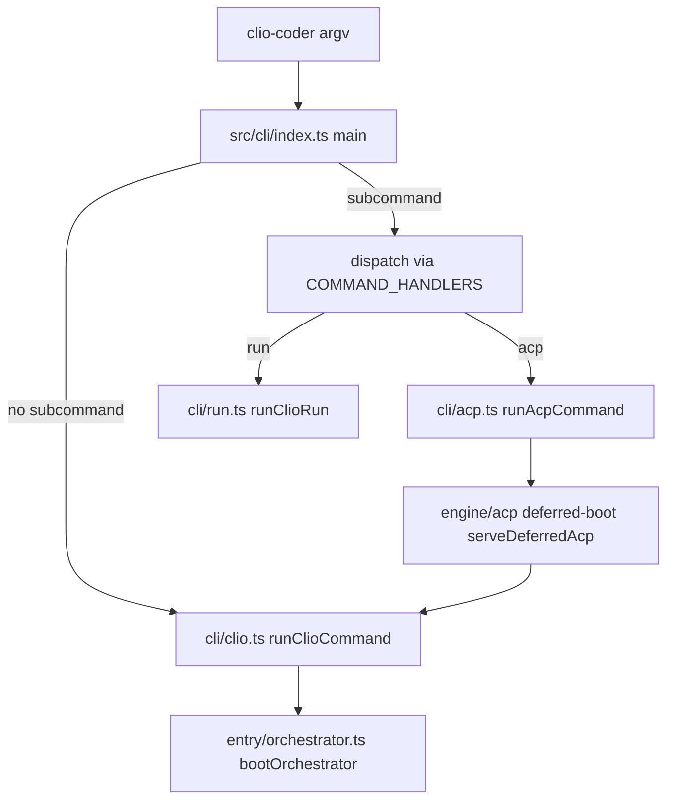

# Command-line surfaces, boot, and tool composition

This page is the map of the repository's runtime surfaces. A reader needs it to find which
entry point receives a request (a shell command, an ACP client, or the model's tool calls)
and which module owns the next step. Behavior is described at the level of the modules
inspected for this page; detailed behavior of each area lives on its own page.

## What the repository is

The package `@iowarp/clio-coder` is a terminal coding agent for scientific software. Its
source is organized under `src/`: `src/cli` holds the command-line surface, `src/entry`
the orchestrator that boots a session, `src/engine` the protocol and worker engines
(including the Agent Client Protocol server under `src/engine/acp`), `src/tools` the tool
surfaces the model calls, and `src/domains` the feature areas. The `apps/` directory holds
the graphical application, whose server and client entries are `apps/clio-coder-gui/server/main.ts`
and `apps/clio-coder-gui/client/main.tsx`. Those are discovery entries; this page does not
trace the GUI.

## Command routing

The compiled binary runs `src/cli/index.ts`. Its `main(argv)` function does the following,
in order, as read from source:

1. Checks the Node version through `nodeVersionError`.
2. Splits global flags with `extractGlobalFlags`, which is given `isCommandToken` so that
   flags are recognized before and after the subcommand name.
3. Handles `--help`/`-h` and `--version`/`-v` without loading a command module.
4. Refuses boot-only flags placed before a subcommand. `--demo`, `--autonomy` and
   `--allow-tools`/`--delegate-tools` each produce a message and exit code 2 when a
   subcommand is present. The `run` and `acp` subcommands are told to take those flags
   after the subcommand name.
5. Runs `unhonoredBootFlag` against the subcommand, treating `dev` by the command it
   names in its first argument.
6. With no subcommand, enables the boot compile cache and imports `src/cli/clio.ts`, which runs
   the interactive session through `runClioCommand`. With a subcommand, it calls `dispatch`.

`dispatch` looks the name up in `COMMAND_HANDLERS`, a `Map` of handlers declared in the
same file. Each handler dynamically imports its own module, so only that command's graph
loads. An unknown name prints `unknown subcommand` to stderr, writes the help text to
stderr, and returns 2. The `acp` handler enables the boot compile cache and calls
`runAcpCommand`. The `run` handler does the same and calls `runClioRun`. The `worker`
handler is internal: it imports `src/worker/entry.ts` and is used when a worker is launched
on a remote install.

The `acp` path in `src/cli/acp.ts` is the one place where a remote client attaches to the
harness. `parseAcpFlags` accepts `--cwd`, `--permission-timeout`, `--allow-tools`, and
`--delegate-tools`, rejecting anything else with a message. `runAcpCommand` changes into
the pinned directory, takes over stdout, creates the stdio transport, and builds an
`createAcpHandshake` declaring the capabilities the server advertises. It then calls
`serveDeferredAcp`, whose `boot` callback calls `runClioCommand` with `acp` set to the
transport and handshake. The handshake is answered before the orchestrator boots, so the
client's advertised surface can decide which tools the boot builds.

## Orchestrator boot

`bootOrchestrator` in `src/entry/orchestrator.ts` is the composition root. It records the
boot surface (`acp`, `run` or `tui`), installs signal handlers through the termination
coordinator, calls `ensureClioState`, applies pending migrations, converts the workspace
`.clio-coder/` directory, and then assembles providers, tools, sessions and telemetry.
Those steps are not traced in full here. The entry points the other surfaces depend on
are `serveClioAcpAgent` (called from the orchestrator at the ACP serve point) and the
background memory and compaction factories defined in the same file. Each of those is an
area of its own; see the links below.

The orchestrator also keeps a `BootResult` interface that is the value the surfaces
receive once the boot completes. This page does not inspect its fields.

## Tool surfaces

Three tools are the entry points the model sees for secondary capabilities. Each is
registered in `src/tools/core-bootstrap.ts`.

**Gateway.** `createGatewayTool` in `src/tools/gateway/index.ts` defines a single fixed
schema with the operations `find`, `describe`, `call` and `chain` (`GATEWAY_OPS`). The
`call` operation takes a `capability` name and an `args` record. Discovery grants no
authority: the gateway forwards to the registry, so a call runs under the named
capability's own admission. `src/tools/core-bootstrap.ts` constructs it with the shared `registry`
and optional `mcpCapabilities`, `rankCapabilities` and `onCapabilityCalled` dependencies.
When a capability is not registered, `unknownCapabilityMessage` returns one of two
messages: on a restricted surface it lists admitted names, and otherwise it lists the
registered tools. The focused test `tests/contracts/gateway-unknown-capability.test.ts`
builds a gateway over `createWorkerToolRegistry()` and asserts that `edit`, `shell`,
`terminal` and `mkdir` produce the same refusal under `allowedTools: ["read", "grep"]`,
while `shell` on an unrestricted surface reports `no such capability "shell"; registered
tools: ...` and does not contain `admitted capabilities`.

**Context.** `createContextTool` in `src/tools/context/index.ts` accepts the scopes
`workspace`, `settings`, `skills`, `recall`, `budget` and `semantic`. The `docs` and
`library` scopes return an error that names the gateway replacement, so those reads go
through the gateway. `run` reserves an observation budget with `reserveObservation`
before any scope handler runs; if the budget is exhausted it returns
`observationBudgetExhausted` without doing the scope's work. `src/tools/core-bootstrap.ts` builds
the schema with `createContextToolSurface` before the lazy import, so the advertised
schema does not change if settings change before first use. `src/domains/context/bootstrap.ts`
is the separate project-instruction generator. It is not a tool; its own page covers it.

**Data.** `src/tools/data/index.ts` exports `detectDataFormat`, `inspectData`,
`selectData` and `validateData`. `detectDataFormat` checks an explicit format first, then
the file extension, then the first bytes of the file. A SQLite magic header yields
`sqlite`; a leading `{` or `[` yields `json`, or `jsonl` when the second line also opens a
value; a tab on the first line yields `tsv`; a comma, semicolon or pipe yields `csv`.
Unknown content returns null. `tests/contracts/data-csv.test.ts` exercises this with
`detectDataFormat(file("x.csv", "{}"), "json")` expecting `json`,
`detectDataFormat(join(dir, "x.csv"), "yaml")` expecting `null`, and
`detectDataFormat(file("lines.txt", '{"a": 1}\n{"a": 2}\n'))` expecting `jsonl`.

## Semantic application boundary

`src/domains/semantic-app/index.ts` is the application boundary for the optional semantic
index. `openSemanticRoute` requires a configured and usable semantic setting, resolves the
target from the settings, and builds an embedding profile. `openSemanticApp` then adds
allowed media roots from the configured inboxes. The module's comment states that no model
is contacted at startup. The media path check in `providerInput` requires the canonical
path to be inside an allowed root and rejects symbolic links. Those checks are read from
source; no focused test for them was located.

## Things to watch when editing

- A new subcommand needs an entry in `COMMAND_HANDLERS` in `src/cli/index.ts`. A command
  that is only listed in `helpText` is not dispatchable.
- A boot flag added to `main` must also be handled by `unhonoredBootFlag` or it can be
  silently dropped before a subcommand. The code comments in `main` give this as the
  reason for refusing the flags.
- The ACP handshake capability list in `src/cli/acp.ts` is what the client sees before the
  orchestrator boots. Changing a capability there changes what the boot is told to build.
- The gateway's restricted-surface message is deliberately identical for excluded and
  unknown names. Changing the message shape should keep the assertions in
  `tests/contracts/gateway-unknown-capability.test.ts` true.

## Related pages

- [CLI modes](cli/modes.md) and [CLI](cli.md) describe the command surfaces in detail.
- [Entry](entry.md) covers the orchestrator.
- [Engine ACP](engine/acp.md) covers the ACP server.
- [Tools gateway](tools/gateway.md), [Tools context](tools/context.md) and
  [Tools data](tools/data.md) cover the tool surfaces.
- [Domains context](domains/context.md) covers the bootstrap generator.
- [Domains semantic](domains/semantic.md) covers the semantic index.
- [Tests contracts](tests/contracts.md) covers the contract tests named above.
