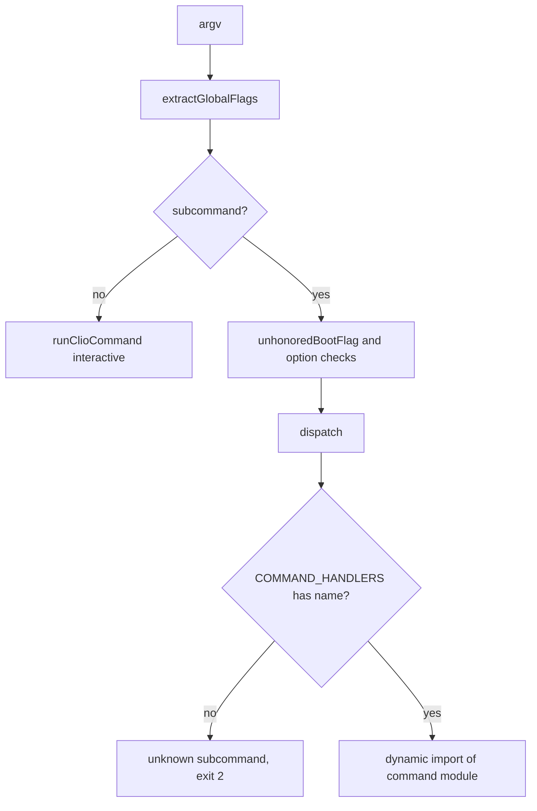

# Command-line surfaces

The `clio-coder` binary is a single entry, `src/cli/index.ts`, that parses global flags, then routes the first subcommand token to a handler. Each handler lives in its own `src/cli` module and is loaded with a dynamic import, so a command's code is not loaded unless it runs. Read this page when you need to know which module owns a subcommand, how global flags are validated before dispatch, or how the main command modules (`run`, `configure`, `targets`, `upgrade`, `wiki` generation and `fleet view`) start their work. Behavior specific to other areas, such as the agent runtime or the provider layer, belongs to the owning pages linked below.

## Entry and routing

`src/cli/index.ts` defines `COMMAND_HANDLERS`, a `Map<string, CommandHandler>` keyed by subcommand name. Each entry is an async arrow that dynamically imports one module and calls its exported runner. Examples: `configure` calls `runConfigureCommand` from `src/cli/configure.ts`, `targets` calls `runTargetsCommand` from `src/cli/targets.ts`, `upgrade` calls `runUpgradeCommand` from `src/cli/upgrade.ts`, and `run` calls `runClioRun` from `src/cli/run.ts`. The `fleet` entry routes `fleet nodes` and `fleet land` to their own modules and everything else to `src/cli/fleet.ts`. The `worker` entry is internal: it imports `src/worker/entry.ts`, which runs the worker stream server.

`main(argv)` in the same file runs in this order:

1. It checks the Node version against `MIN_NODE` (`[22, 19, 0]`) and returns 1 with a message if the runtime is older.
2. It calls `extractGlobalFlags(argv, isCommandToken)`, from `src/cli/argv.ts`. A global flag error returns 2.
3. It handles `--help`, `-h`, and `--version` before any dispatch.
4. It builds `bootOptions` from `--api-key`, `--no-context-files`, `--no-skills`, `--skill`, and the panes flags. `--demo`, `--autonomy`, and the tool-limit flags are refused when they appear before a subcommand, because the message tells the operator to place them after it.
5. `unhonoredBootFlag` refuses a boot flag that the named command does not read. `BOOT_OPTION_COMMANDS` is `run` and `acp`. `--with-panes` is refused for every command, since it applies to the interactive session only. The retired `--no-panes` is an unknown global option and exits 2.
6. With no subcommand, `main` calls `runClioRun`'s sibling `runClioCommand` from `src/cli/clio.ts` to start the interactive session. Otherwise it calls `dispatch(subcommand, subArgs, bootOptions)`.

`dispatch` looks up the handler. If none exists it prints `unknown subcommand`, writes the help text to stderr, and returns 2. If one exists, it calls `installHumanStdoutHandler` and then the handler, and converts an incomplete-installation error into a repair message with exit 1. The `dev` entry routes to `dispatch` again with the nested subcommand, after checking `DEV_COMMANDS`.

Two details of the dispatcher are constrained by the code itself. `isCommandToken` is the same map, so a top-level value flag such as `--api-key` cannot consume a command name as its value. `RETIRED_SUBCOMMANDS` keeps `context-init`, `context-index`, and `context-clear` as tokens that cannot be dispatched. Adding a subcommand therefore means adding one entry to `COMMAND_HANDLERS`, and that is the only place the name is recognized.

The focused test `tests/contracts/cli-ignored-flags.test.ts` runs `src/cli/index.ts` in a scratch home. Its table asserts that `--with-panes run hello` and `--with-panes acp` each exit 2 with a stderr message naming the flag and the command, and that `--api-key k-123 doctor` exits 2 without echoing the key. A separate case asserts that `--no-context-files --no-skills run --help` still exits 0, which shows that `run` keeps the boot options it honors.

## Run: headless turns and fleet dispatch

`src/cli/run.ts` exports `runClioRun(args, options)`. It calls `parseRunCliArgs` from `src/cli/args.ts`, then `withRunFailureReporting`, then `executeRunCommand`. A `FileReferenceError` raised during execution is written as a diagnostic and returns exit 2.

`executeRunCommand` runs inside `withRunOverrides`, which carries one-run overrides (`maxContextTokens`, and sampling only when `--agent` is set) through a scoped transport so worker subprocesses inherit them. Then it applies these checks in order:

- `--help` prints `HELP` to stdout, or to stderr when `--json` is set, and returns 0.
- Parser diagnostics of type `error` print `USAGE` to stderr and return 2.
- Fleet dispatch flags without `--agent` return 2 (`hasDispatchOnlyOptions`).
- `--read-only` without `--agent` sets `constraints.readOnly` on the main-agent task scope.
- `--turn-mode`, `--allow-tools`, `--delegate-tools`, or `--no-delegate` combined with `--agent` return 2.
- `--session` combined with `--continue` returns 2.

The remaining path through `executeRunCommand` and `runDispatch` (around `src/cli/run.ts:618`) is not covered by this page's inspection. The focused tests that exercise these flags are listed under [Focused tests](#focused-tests).

## Configure and onboarding

`src/cli/configure.ts` exports `runConfigureCommand(argv, inStream, outStream, startsChat)`. The first branch is `--gui-host`, which fixes the child transport used by the GUI: it calls `ensureRegistryPopulated` and then `runBrowserConfigure` from `src/cli/configure-browser.ts`. Otherwise the arguments are parsed by `parseSetupArgs`. A parse error prints the error and `HELP` and returns 2. Then:

- `--edit` requires TTY streams on both ends, otherwise it returns 2. It then calls `editSettings` with a `ConfigurePrompts` instance.
- `--json` writes `readSettings()` as indented JSON to the output stream and returns 0.
- `--list` calls `printRuntimeList` and returns 0.
- `--interop` calls `runInteropReview`.
- A positional runtime argument is refused with a message pointing to `clio-coder auth login` and `configure --runtime`.
- `--runtime` is looked up in `getRuntimeRegistry()`. An unknown id returns 2 with a suggestion from `closestRuntimeId`.

When `--runtime` is given together with a target setup flag (`--id`, `--url`, `--model`, `--api-key`, `--gateway`, `--lifecycle`, and others), the call runs `runNonInteractive`. When a setup flag or `--runtime` is given without a TTY and the spec is incomplete, the call returns 2 with a message naming the missing `--runtime` or `--id`. Otherwise it constructs a `ConfigurePrompts` and calls `runInteractive`. A `ConfigureNavigation` exit returns 0 if at least one target exists in settings, and otherwise goes to `firstRunCancelled`.

`src/cli/configure-onboarding.ts` holds the first-run wizard. `canRunOnboarding(streams)` returns whether both streams are selectable terminals. When it is false the caller keeps a numbered readline flow. `runOnboardingWizard(streams, options, host?)` builds a `Wizard` object, with `select` and `text` bound either to a supplied `ConfigureWizardHost` or to the prompt helpers, and an `Answers` record. Its options are `mode: "first" | "add"` with an optional runtime and `startsChat`, or `mode: "edit"` with a target. `startsChat` is set only in `first` or `add` mode.

The `Answers` type comments state that every field is typed `| undefined` because the repository compiles with `exactOptionalPropertyTypes`, and that going back a step clears the answers that depended on the one changed.

## Targets

`src/cli/targets.ts` exports `runTargetsCommand(args)`. It dispatches on the first argument to `runList`-style helpers and the profile operations (`runProfileSet`, `runProfileRemove`, `runProfileRename`, `runProfileBind`, `runProfileUnbind`, `runProfileBindings`), as well as `runUse`, `runRemove`, `runRename`, `runConvert`, and `runFleet`. Each subcommand has its own argument parser (`parseListArgs`, `parseUseArgs`, `parseWorkerArgs`, `parseProfileRemoveArgs`, and others). `wantsHelp(args)` treats `--help` anywhere in a subcommand's arguments as a request for usage, so `use --help` prints `USE_USAGE` and does not look up a target named `--help`.

Listing renders a table through `formatTargetTable`. `tableWidths` fits the `TABLE_COLUMNS` to the terminal width, shrinking columns in `TABLE_SHRINK_ORDER` and growing them in `TABLE_GROW_ORDER`. Each row is produced by `targetTableRow(providers, status)`, which uses the provider contract.

This page does not trace the `runUse` write path or the settings mutations beyond the function signatures, so their persistence behavior is not described here.

## Upgrade

`src/cli/upgrade.ts` exports `runUpgradeCommand(argv, dependencies)`. The `dependencies` argument is a `Partial<UpgradeDependencies>` merged over `DEFAULT_DEPENDENCIES`, which names the real implementations (`inspectInstallation`, `lookUpAvailableVersion`, `runNpmInstall`, `runInstallerUpgrade`, `runPostInstallUpgrade`, `runBackgroundRestart`, `runPending`, `runRestart`) and `isInteractive`. The dependency seam lets tests substitute each step; `tests/contracts/upgrade-command.test.ts` builds its own `runUpgradeCommand` call with `inspectInstallation`, `lookUpAvailableVersion` returning version `99.0.0`, and `runPending` returning an empty result.

Flow of `runUpgradeCommand`:

1. `parseUpgradeArgs(argv)` parses the flags `--dry-run`, `--channel` (one of `CHANNELS`), `--skip-migrations`, `--post-install`, `--json`, `--restart`, `--refresh-runtime`, `--rollback`, and `--help`. Unknown arguments throw, and the caller returns 2. `--restart` cannot combine with `--json` or `--post-install`, and `--rollback` cannot combine with `--post-install`, `--refresh-runtime`, or `--restart`.
2. `--restart` without `--dry-run` requires an interactive terminal (`deps.isInteractive()`), otherwise it returns 2 and prints the resume hint.
3. `resolveClioDirs()` and `clioDirLayoutProblems(dirs)` are checked. Unsafe layout returns 2.
4. For `--post-install` on a fresh home, `initializeClioHome()` runs before migrations are recorded.
5. `deps.inspectInstallation()` determines the installation method. When the installer recorded a channel and `--channel` was not passed, that recorded channel is used.
6. `--rollback` is accepted only for the `installer` installation kind.

The rest of the flow, covering the registry lookup, npm install, installer upgrade, pending migrations and restart, is in `src/cli/upgrade.ts` beyond the lines inspected here.

## Wiki generation

`src/cli/wiki-generate.ts` provides the model-backed documenter used by the context wiki command. `resolveDocumenterModelId(route)` loads the config, resources and providers domains, resolves a target and model through the worker profile bound to `WIKI_AGENT_ID`, then the fleet default, then the first configured target, and canonicalizes the model id against the provider status. Any missing piece returns `UNRESOLVED_DOCUMENTER_MODEL`, and the domains are always stopped in `finally`.

`modelWikiGenerate(options)` returns a `WikiGenerate` function. With `options.dispatch` supplied, it calls `generateWikiWithDocumenter` directly and does not own the lifecycle. Without it, it calls `loadWikiDispatch()` and wraps the work in `withWikiDispatchLifecycle({ dispatch, stop }, ...)`. The `finally` block always emits a `generate` progress event with the invocation usage.

`withWikiDispatchLifecycle` registers handlers for SIGINT, SIGTERM and SIGHUP. On a signal it aborts the signal passed to `generateWikiWithDocumenter`, runs `close` (dispatch `drain`, then domain `stop`) under a 2000ms `runWithBudget`, and calls `process.exit` with 130, 143 or 129. Without a signal, `close` runs after generation completes. Cleanup failures are reported with `writeShutdownNotice` and rethrown when there is no earlier failure. The handlers are removed in `finally`.

This page does not read `generateWikiWithDocumenter` itself, so this page does not describe what the documenter writes.

## Fleet view

`src/cli/fleet-view.ts` exports `runFleetView(args)`. It parses arguments with `parseViewArgs`. A string result is an argument error: it writes the message to stderr, writes `HELP` to stdout, and returns 2. `--help` returns 0. `applyViewDirs(parsed.dirs)` is applied before the run is resolved, and `fleetInspectionScope(parsed.all)` sets the scope.

Dispatch by identifier:

- `--watch` with a selection path: when stdin or stdout is not a TTY, the selected run's snapshot is printed once and the call returns 0. Otherwise `runWorkersDashboard` from `src/cli/fleet-board.ts` is loaded and run.
- A fleet root id (prefix `FLEET_ROOT_PREFIX`) is resolved with `resolveFleetRootId`. An unknown or ambiguous root fails with exit code from `fail`. `--json` on a root is refused, and `--follow` on a root prints the index with a stderr note. The index is rendered with `renderFleetRunView`.
- Any other id is resolved with `resolveRunId` against the run ledger. An unknown or ambiguous id fails. `loadRunViewModel` produces the snapshot, which `--json` writes as indented JSON.

The remaining rendering and follow loop are not traced on this page.

## Focused tests

- `tests/contracts/cli-ignored-flags.test.ts` covers the global-flag refusals (`--api-key k-123 doctor`, `-nc fleet status`, `--with-panes run hello`, `--with-panes acp`, and the retired `--no-panes`) against the real entry, the `parseRunCliArgs` diagnostic for `--with-panes`, and `share export --dry-run` writing no archive.
- `tests/contracts/upgrade-command.test.ts` drives `runUpgradeCommand` through injected dependencies and an installed-prefix fixture.
- Other tests that reference these entry points, found by search across `tests/`, include `tests/contracts/run-cost-ceiling.test.ts`, `tests/contracts/targets-use-unused-model.test.ts`, `tests/contracts/dispatch-recording-surface.test.ts`, `tests/extended/upgrade-lifecycle.test.ts`, and `tests/extended/package-manager-upgrade.test.ts`. This page does not read these files, so they are listed for routing only and their cases are not described.

## Things to watch when editing

- A new subcommand belongs in `COMMAND_HANDLERS` with a literal dynamic import. The map is also the source for `isCommandToken`, so the name is protected from being consumed by a value flag in the same change.
- A new boot flag that a command reads must be added to `BOOT_OPTION_COMMANDS` or the flag will be refused for that command. Flags not in that set are refused for every other command.
- `runConfigureCommand`'s non-TTY checks are what keep a non-interactive invocation from writing the initial settings template and exiting 0. Keep those checks ahead of the wizard.
- The `Answers` fields are `| undefined` by design, so do not replace them with optional properties under `exactOptionalPropertyTypes`.

## Related pages

- [Interactive surfaces](interactive/surfaces.md) for the interactive session started when no subcommand is given.
- [Cli modes](cli/modes.md) for the mode modules that the interactive and print paths use.
- [Domains dispatch](domains/dispatch.md) for the dispatch runtime that `run` and wiki generation use.
- [Domains providers](domains/providers.md) for the target and model resolution used by `targets` and the wiki documenter.
- [Domains lifecycle](domains/lifecycle.md) for the installation detection and migrations used by `upgrade`.
