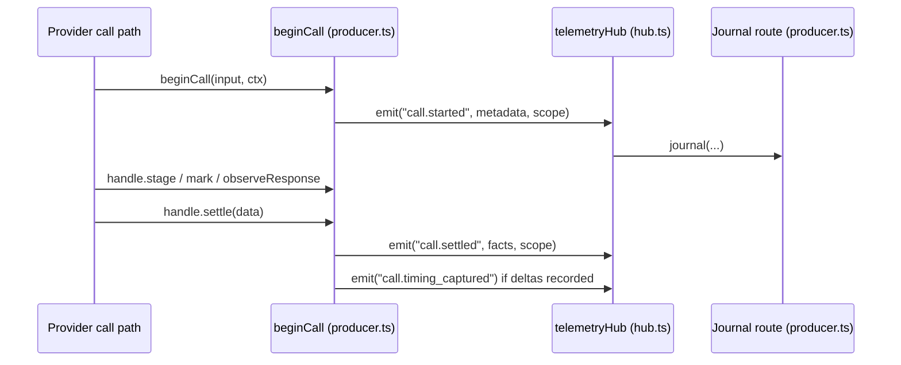

# Telemetry event hub, producer and call lifecycle

The core telemetry layer is the single path through which the harness emits events. A reader needs this page when adding or renaming an event, deciding which scope a record belongs to, or changing how a provider call is started, settled or abandoned. The layer has four parts: the event registry, the hub that fans events out, the producer that routes journal records to sinks, and the telemetry context that names the owner of each record.

## What the area does

Each event is declared once in `EVENTS` in `src/core/telemetry/events.ts`. An entry is either `durability: "journal"`, which is written to a sink and also delivered live, or `durability: "live"`, which reaches in-process subscribers only. The `journal` helper in that file sets `version: 1` by default and accepts `tier`, `cc` (content class), `capture`, `scope` and an optional `project` function. `EventName` and `JournalEventName` are derived from this object.

Producers call `telemetryHub().emit(name, payload, ctx?)`. The hub (`src/core/telemetry/hub.ts`) does two things in order: it hands the payload to the journal route, then it fans it out to subscribers. The return value is true only when a journal record was enqueued. Two call sites in `src/engine/` illustrate this: `src/engine/external-call-telemetry.ts` emits `process.started` with a context, and `src/engine/apis/residency.ts` emits `residency.mutated` and `runtime.notice_raised` as live events.

## What owns it

- `src/core/telemetry/hub.ts`: `createTelemetryHub` builds a hub with `emit`, `emitContent`, `subscribe`, `listeners` and `clear`. `telemetryHub()` returns a process-wide singleton. `attachJournalRoute` installs the journal route that the producer provides. Before a route is attached, journal emissions go into `earlyEmissions`, which is capped at `EARLY_JOURNAL_LIMIT` (4096); overflow is counted in `earlyDrops`, and both are flushed when the route attaches.
- `src/core/telemetry/producer.ts`: `registerTelemetrySink`, `registerRunTelemetrySink`, `registerProcessJournalSink` and `registerProcessTelemetrySink` register sinks keyed by owner string (`session:`, `run:`, `process:`). Only one process owner is allowed; a second registration throws. `enqueueTelemetry` is the routing function. `beginCall` returns a `TelemetryCall` handle that emits `call.started`, `call.settled` and `call.timing_captured`.
- `src/core/telemetry/context.ts`: `TelemetryContextSchema` is a three-branch TypeBox union: a session context, a run context with `sessionId: null`, or a process context carrying `processId`. `telemetryOwner` maps a context to its owner key. `withTelemetryContext` runs work inside an `AsyncLocalStorage` store. `withToolTelemetryContext` and `ownerTelemetryContext` build contexts for tool calls and for records about a known owner.
- `src/core/telemetry/events.ts`: the event registry described above. `EventPayload<N>` is the type a subscriber receives: the projected payload when a `project` function exists, otherwise the schema's static type.
- `src/core/telemetry/render.ts`: the display-string module. Its header states that it is the only place outside GUI server strings that formats money. `renderUsdSpend` routes through `renderUsdParts`, which renders `"not measured"` when a sum has no priced parts, `"$0.00 local"` for free local calls, and a `~` prefix with `est` for estimates.

Other files in `src/core/telemetry/` (`src/core/telemetry/schemas.ts`, `src/core/telemetry/dto.ts`, `src/core/telemetry/live-events.ts`, `src/core/telemetry/capture.ts`, `src/core/telemetry/envelope.ts`) define payload schemas and DTOs. They were discovered through imports and the anchor digest; this page does not describe their contents in detail.

## Emit and delivery

`emit` in `createTelemetryHub` calls `journal(name, payload, undefined, ctx)` first, then `deliver(name, payload)`, and returns the journal result. Delivery is synchronous: `deliver` iterates a snapshot of the listener set for the name, so a listener that subscribes or unsubscribes during fan-out does not change that delivery. A listener that throws, or returns a rejected Promise, is reported through `writeDiagnostic` and does not reach the emitter. The source comment says that delivery is not deferred because a deferred delivery would drop `shutdown.*` events when `process.exit` runs first.

`emitContent` takes a preimage and calls `journal` only; it does not notify subscribers. The source comment says content reaches the writer alone.

When the journal route is attached, `enqueueTelemetry` in `src/core/telemetry/producer.ts` runs the route. For a live event it calls `traceLiveEvent`, which may write a `bus.traced` record when the sink admits it, and returns false. For a process-scoped journal event with no process owner yet, the record is kept in `earlyProcessRecords` (bounded by `EARLY_JOURNAL_LIMIT`) and counted in `earlyProcessDrops` on overflow. For any other journal event the sink is chosen by `sinkFor(ctx)`. A session-scoped record that has a session context with no run and no preimage can be handed to the reopener registered through `registerTelemetryReopener`. Otherwise an unowned record increments `unownedRecords` and is dropped.

Admission is checked twice. `telemetryCaptures(kind, ctx)` lets a producer ask in advance whether a kind would be captured. `enqueueTelemetry` checks `sinkAdmits` before applying `definition.project` and again inside `enqueueInto`. A record the sink does not admit returns false without being counted as a gap or a failure, per the comment at `enqueueInto`.

## Call lifecycle

`beginCall(input, given)` in `src/core/telemetry/producer.ts` mints a `callId` and returns the attempt-0 handle. Each attempt has its own `attemptId`, and a `scope` that combines the context with those ids. The handle emits `call.started` on creation and records stages through `stage(name, "start" | "end", facts)`. `mark("firstByte" | "firstToken")` records a point in time. `observeResponse` marks `firstByte` on the first 2xx response and keeps that response in memory for later reads.

`settle(data, reportedModel)` is the one place that emits `call.settled`. It returns early when the attempt has already settled, which makes a second settle a no-op. It removes the attempt from `liveAttempts` and applies `unsentByStages` when the attempt was tracked, never reached its send stage, reported `sent_unsettled`, and has no provider evidence (a response id, a measured reported model, or a measured usage field). That function sets `disposition` to `never_sent`, nulls `usage`, marks pricing not applicable, and removes `interruptedEstimate`. After `call.settled` is emitted, a `call.timing_captured` event is emitted only when a delta histogram was enabled and recorded at least one delta.

`abandon(cause)` calls `settle` with `abandonedSettlement(sent, cause)`. That helper sets `disposition` to `sent_unsettled` or `never_sent` depending on whether the send stage started, and marks unobserved usage and pricing as `unknown`. `nextAttempt` returns one successor per settled attempt, and returns null while the attempt is still live.

`telemetryCallInContext` looks up the live handle for the current async context's `attemptId`.

Here is the flow for one attempt, reduced to the calls named above:

## Test coverage

`tests/contracts/call-stages.test.ts` exercises the settlement path. One case asserts that a request refused at admission for budget reasons settles with `disposition: "never_sent"`, that `stages.admission.waitedOn` is `"budget"`, and that `stages.send`, `stages.firstToken` and `usage` are absent. Another case asserts cache re-prefill accounting for a recompiled memory section, with `firstDivergentSection` set to `"memory"` and a billed amount computed from the re-prefilled tokens.

`tests/contracts/telemetry-producers.test.ts` registers a sink through `registerTelemetrySink` in a `capture` helper that records enqueued records and filters admitted kinds. One case runs a tool call through `resolveAgentTools` and asserts that the `tool.settled` record carries `turnId: "turn-1"` and `toolCallId: "tool-call-1"` in its context, and that its payload has `outcome: "ok"` and `resultBytes` equal to the byte length of the fixture output. A second case asserts that `middleware.fired` payloads carry the rule id, the effects and the evidence string.

Searching the repository with `grep` shows that many other tests import `src/core/telemetry/hub.ts` or `src/core/telemetry/producer.ts`, for example `tests/contracts/telemetry-journal.test.ts` and `tests/contracts/completed-worker-projection.test.ts`. Those files were not read for this page, so no claims are made about their assertions.

## Things to watch when editing

- A live subscriber runs on the emitter's stack. The `TelemetryListener` doc comment in `src/core/telemetry/hub.ts` says a long synchronous listener blocks every later listener and the `emit` caller.
- Journal payloads are owned by their sink once emitted. Subscribers must not mutate them, per the `TelemetryHub` doc comment.
- Payloads are typed at compile time only. Data that crossed a process boundary keeps its runtime validation, per the same comment.
- `enqueueTelemetry` contains a comment that no serialization, filesystem access or locks may enter its call stack. Keep new work out of that path.
- A new event is added by inserting an entry into `EVENTS`. Its `scope` decides which owner receives it: `process` records are routed only to the process owner, and `session` records need a context that names a session. Check `src/core/telemetry/events.ts` for the existing `journal` option shape before adding a field.
- A new `project` function changes what journal subscribers see versus what live subscribers see; `EventPayload<N>` types the live payload.
- A render change in `src/core/telemetry/render.ts` affects every display string that goes through `renderUsdParts`. The `COST_NOT_MEASURED` constant is also exported and reused by callers.

For payload schemas and the wider telemetry domain, see [Domains telemetry](../domains/telemetry.md) and [Core](../core.md). The sink implementations that consume these records are described in the telemetry domain, which this page does not inspect in detail.
