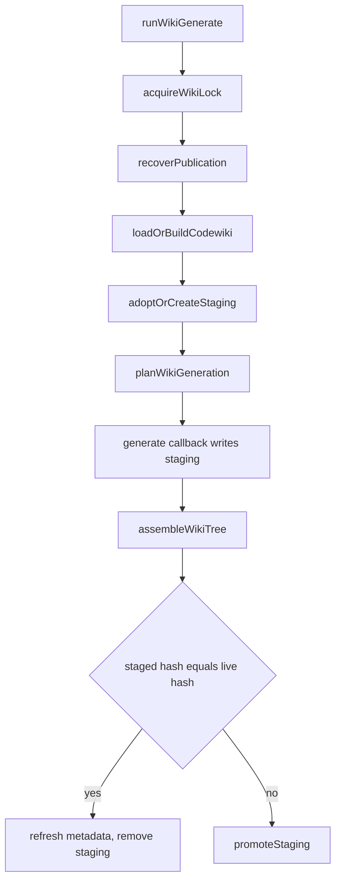

# Context domain: codewiki index, project wiki generation, bootstrap, budget admission and working-set policies

The `src/domains/context` module owns several related pieces of project and session context. It builds and incrementally maintains a symbol index of the workspace (the codewiki). It generates a structured project wiki from that index through a staged, lock-protected run. It runs the bootstrap that prepares the `CLIO-CODER.md` handbook. It evaluates request admission and live context pressure, selects the context a delegated worker receives, and holds the working-set policy registry that decides what conversation context is evicted under pressure. A reader who changes any of these needs this page.

## Entry point and composition

`src/domains/context/index.ts` is the public barrel. It re-exports the adoption scanner, bootstrap (`runBootstrap` and its types), codewiki build and sync functions, wiki generation (`runWikiGenerate` and its types), wiki layout and plan helpers, staleness checks and the context domain runtime (`ContextDomainModule`, `createContextDomainModule`). Importers of the barrel identified by search include the CLI (`src/cli/context.ts`, `src/cli/init.ts`, `src/cli/bootstrap-generate.ts`), the prompts extension, the semantic ingestion path and the interactive footer and dashboard. `src/domains/context/refresh.ts` imports `runWikiGenerate` directly. The caller relationships of the barrel were identified by search, not traced line by line.

## Bootstrap

`runBootstrap` in `src/domains/context/bootstrap.ts` is the exported entry, taking a `RunBootstrapInput` and returning a `RunBootstrapResult`. It wraps `runBootstrapWork`. Errors whose name is `AbortError` are rethrown as `ContextOperationAbortError` carrying the operation facts committed so far; other errors propagate unchanged. `runBootstrapWork` first calls `input.signal?.throwIfAborted()`, then detects the project type and scans sibling agent configuration with `scanAgentConfigs` from `src/domains/context/adoption.ts`. It reports `scan` progress through `progress`.

In the non-preview branch, it reconciles the codewiki through `coordinateCodewikiWrite` with an `ensure` operation. Its `previous` argument reads the fingerprint from `readClioState`. Its `afterCommit` hook persists the index for generation through `persistCodewikiForGeneration`. In preview mode (`input.preview === true`) it calls `buildCodewikiCandidate` instead and writes nothing.

The generator step is the call `output = await (input.generate ?? heuristicBootstrapOutput)(generateInput)`. When the caller supplies `generate`, that callback receives a `BootstrapGenerateInput` and returns a `BootstrapStructuredOutput`. When it does not, `heuristicBootstrapOutput` produces the output without a model. The generated output then passes through `stabilizeGeneratedOutput`, which takes a callback that counts retained model sections. If the mode was `model` and no section was retained, the generation is downgraded to `heuristic` with the fallback reason `bootstrap draft contributed no evidence-grounded rules or sections`. Model-reported generation is taken from `reportGeneration` when the generator calls it, as the focused tests do.

The write is inside `coordinateCodewikiExclusive`. The callback decides between three outcomes:

- If `shouldPropose` is set, or a publish would happen and `CLIO-CODER.md` changed since the initial read (`sourceChanged`), `writeClioMdProposal` writes a new file into the `.clio-coder/proposals` directory (the directory is built with `join(cwd, ".clio-coder", "proposals")` in `src/domains/context/bootstrap.ts`). The file name is generated from a timestamp and a UUID with a `CLIO-CODER-` prefix, plus a provenance JSON, and the action is `proposed`.
- Otherwise, if a publish would happen, `writeClioMdFile` serializes the output through `serializeBootstrapOutput`, which re-parses it with `parseClioMd` and throws `bootstrap produced invalid CLIO-CODER.md` on failure, then writes it with `safeResourceWrite`. The action is `wrote` or `refreshed`.
- Otherwise the action is `preserved`.

The focused test `tests/contracts/context-initialization.test.ts`, case `a concurrent human edit is preserved as a proposal`, sets `applyClioMd: true`, and has its generator overwrite the handbook with `A concurrent human edit.` before returning. It asserts that `result.summary.action` is `proposed`, that the handbook bytes equal the human edit, and that a `proposalPath` exists. The case `a failed rewrite preserves the exact authored handbook bytes` pairs `rewriteClioMd: true` with a generator that reports `existing` and the `offline` fallback, and asserts the original text, including repeated spaces, is preserved.

## Codewiki index

`src/domains/context/codewiki/indexer.ts` builds the index. The public entry points are:

- `buildCodewiki({ cwd, language })` enumerates indexable workspace files with `enumerateWorkspaceFilesAsync`, filters them with `isIndexablePath`, and passes them to `buildFromPaths`. It is the full build, used when no artifact exists.
- `updateCodewikiPaths(cwd, codewiki, paths)` applies an incremental update for a named batch. `inspectCodewikiPaths` normalizes the batch, and reads and hashes only the named paths. A path that is unchanged by hash is dropped from the batch. The function then re-parses only the paths that changed, keeps the file and symbol records of all other files, and rebuilds edges from the merged file set through `codewikiFromBuiltFiles`. If the batch names the root ignore file, a path ending in the ignore-file name, `.git/info/exclude`, `.git/index` or `.gitmodules`, `inspectCodewikiPaths` sets `global` and the function falls back to `syncCodewiki`. A batch with no index changes returns the input artifact without parsing.
- `codewikiPathsNeedUpdate(cwd, codewiki, paths)` runs only the inspection step. It reports whether a notification would change the index without parsing anything.
- `syncCodewiki(cwd, codewiki)` enumerates the whole workspace, reads and hashes every visible indexable file, and compares hashes with the artifact. It collects additions and content changes, and removals (indexed paths no longer present), and passes them to `updateCodewikiPaths`. When no path changed it returns the input object, except that an index containing a Python file whose recomputed edges differ is returned as a new object with updated edges only.

Parsing goes through `src/domains/context/codewiki/tree-sitter.ts`. `createTreeSitterExtractor` initializes the parser runtime, then returns an extractor with `langs` for TypeScript, JavaScript, Python, Go, Rust, C, C++, Java, Ruby and C#. Its `ensureGrammarsForPaths` maps each path to its grammar candidates (`grammarCandidatesForSourceFile`; an ambiguous header loads both `c` and `cpp`) and loads each needed WebAssembly grammar once, deduplicating concurrent loads. Grammar files resolve under the package's own `dist/assets/grammars` directory through `grammarAssetPath`, not through `node_modules`. `extract(path, text)` selects the grammar with `grammarForSourceFile`, returns empty results for empty text, and throws `tree-sitter grammar not loaded for <path>` when the caller skipped `ensureGrammarsForPaths`; the file comment states that the throw routes the file to the regex fallback rather than indexing it with zero symbols. A parse failure is rethrown as `tree-sitter parse failed for <path>`. `updateCodewikiPaths` awaits `loadTreeSitterExtractor` and `ensureGrammarsForPaths` before calling `buildFile`. Symbols for languages without a tree-sitter grammar fall back to regex extractors (`fallbackExtractors` and `extractWithExtractors` in `src/domains/context/codewiki/indexer.ts`). No test that drives the not-loaded throw was located; the search scope was the `tests` directory of this package for the extractor names, and the throw is supported by source only.

Focused coverage is in `tests/extended/codewiki-freshness.test.ts`. In the case `keeps unchanged symbols when reconciling notified and external changes`, `buildCodewiki` indexes three files `a.ts`, `b.ts` and `c.ts`, the test rewrites `a.ts` and `b.ts`, calls `updateCodewikiPaths(cwd, initial, ["a.ts", "c.ts"])`, and then `syncCodewiki(cwd, partial)`. It asserts with `strictEqual` that the `c` symbol object is identical to the one from the initial build, and that a second `syncCodewiki(cwd, reconciled)` returns the same object. The Python import case in the same file (`resolves Python relative depth, package initializers, and local absolute imports`) asserts that `syncCodewiki(cwd, { ...wiki, edges: [] })` deep-equals `wiki`, which shows that stale edges are rebuilt, and that `syncCodewiki(cwd, wiki)` is strictly equal to `wiki`.

## Bootstrap project scan and adoption

`scanAgentConfigs(options)` in `src/domains/context/adoption.ts` is the sibling-configuration scanner that `runBootstrapWork` calls with the workspace and home directories. It walks the candidate specifications from `discoverCandidateSpecs`, reads each through `readCandidate`, and separates accepted sources from rejected ones. A candidate that would exceed the aggregate source byte budget (`MAX_TOTAL_SOURCE_BYTES`) is recorded as rejected with the reason `aggregate source byte budget exceeded`. Accepted sources are sorted with project scope before global scope, then by their order. The result carries `importedRules`, `conflicts`, a `sourceHash` over all snapshots (accepted and rejected), and the per-source snapshots. The global-scope source set is included only when `includeGlobal` is true. `adoptionSnapshotsHash` and `adoptionSourcesChanged` expose the same snapshot hashing for change detection, and `renderImportedAgentContext` renders the imported rules for the handbook draft. The focused test `tests/extended/project-bootstrap.test.ts` calls `scanAgentConfigs({ cwd: root, homeDir: home, includeGlobal })` and asserts that `adoption.sources` contains the `nested/AGENTS.md` display path. The per-candidate reading rules (secret-like line detection, size limits per source) were read as declarations in source and not traced line by line.

## Project wiki generation

`runWikiGenerate` in `src/domains/context/wiki/generate.ts` is the orchestrator. Its input is `RunWikiGenerateInput` (`cwd`, `mode`, `depth`, `retryPending`, `replan`, `onlyPages`, `model`, a `generate` callback and a progress sink). Its result is `RunWikiGenerateResult` with status `generated`, `noop` or `failed`. The `generate` callback receives a `WikiGenerateInput` whose `outputDir` is the staging directory, never the live wiki. The CLI supplies the callback through `modelWikiGenerate` in `src/cli/wiki-generate.ts`, which dispatches one writer per plan page; that dispatch is described on [Domains dispatch](dispatch.md).

`runWikiGenerate` rejects `replan` combined with `retryPending` with a thrown error before taking the lock. The run then proceeds in this order, as read in `runWikiGenerate`:

1. `acquireWikiLock` (`src/domains/context/wiki/generate.ts`, around `src/domains/context/wiki/generate.ts:219`) calls `ensureProjectIgnore` and creates `.clio-coder/wiki.lock` with the `wx` flag, writing the process pid. If the file already exists and the recorded pid is alive per `isProcessAlive` (`process.kill(pid, 0)`, with `EPERM` counted as alive), it returns a failed lock whose problem reads `wiki generation is already running (lock held by pid ...)`. If the holder is dead or the pid is unreadable, the stale lock is removed and recreated; if that recreation loses a race, the run is refused with the same problem. The release removes the lock file on the run's exit path, and a stale lock is also reclaimed by pid liveness later.
2. `recoverPublication` (`src/domains/context/wiki/generate.ts:332`) finishes or reverts an interrupted promotion. When `.clio-coder/wiki-prev` exists, it removes `wiki-prev` if the live wiki validates against its recorded `contentHash`; otherwise, if `wiki-prev` validates, it moves any live wiki aside into a `wiki-interrupted-*` directory and renames `wiki-prev` back to `wiki`. It throws `wiki recovery requires a valid publication` when neither directory validates.
3. `loadOrBuildCodewiki` calls `coordinateCodewikiWrite` with an `ensure` operation and writes the state file through `writeClioState` in `afterCommit`.
4. `adoptOrCreateStaging` (`src/domains/context/wiki/generate.ts:302`) adopts the most recently modified `wiki-staging-*` directory that already holds the plan file, or creates a fresh one with `mkdtempSync` and seeds it with the current wiki pages through `seedStaging`. Other staging directories are removed.
5. `planWikiGeneration` resolves the depth and candidate plan. `resolvePlan` reconciles a resumed plan with existing pages. A page whose recorded source content no longer matches (checked with `wikiSourcesMatch` against the captured `sourceContent`) is set back to `pending`. A page with a validation failure may keep its draft for a repair attempt only when `allowDraftReuse` is true and its `runId` is recorded.
6. `input.generate` is called with the staged `outputDir`, the resolved plan, and the `resumed`, `retryPending` and `replan` flags. If it throws, the live wiki is untouched and the staging tree is kept so that the next run resumes from it. If `generate` is absent, the run fails with `wiki generation requires a model runtime` before any write.
7. After the generator returns, the checkpoint plan is read from staging, `retiredPages` are removed, and `assembleWikiTree` repairs links and drops empty pages. Plan entries missing from disk are marked pending through `reconcilePlan`.
8. If the staged content hash equals the live hash, only metadata is refreshed and staging is removed. Otherwise `promoteStaging` (`src/domains/context/wiki/generate.ts:353`) removes any old `wiki-prev`, renames the live `wiki` directory to `wiki-prev`, renames the staging directory to `wiki`, and on a failed second rename removes the partial staging tree and restores `wiki-prev` to `wiki`. The previous directory is removed only after a successful promotion.

Metadata is written by `writeWikiMetaInDir` and `writeWikiMeta` in `src/domains/context/wiki/meta.ts` (exported through the barrel as `writeWikiMeta`). The plan checkpoint lives in staging until publication is prepared, so a crash during rename can recover the previous pair.

### Page validation

`validateWikiPageEvidence` in `src/domains/context/wiki/evidence.ts` checks one writer output before assembly repairs metadata. It rejects content over 2 MiB. It then parses the frontmatter with `readWikiPage`, and each `coverage_gaps` entry becomes a failure reason prefixed `Coverage gap:`. It rejects a body that is empty once HTML comments and heading lines are removed. It checks that `sources`, `tests` and `coverage_gaps` are lists of nonempty strings when present. A reference in `sources` or `tests` that contains `:` or `#` is rejected as a non-plain path. Backticked file citations in the body are added to the reference set and resolved against the repository root, with symlink targets required to stay inside it. The function also rejects reference sets over 512 entries.

`inspectWikiPageEvidence` in `src/domains/context/wiki/evidence.ts` is the wrapper that `resolvePlan` and the publication path call for a page on disk. Its file-size and total-size limits for literal checks are described in the source comments and were not separately traced.

### Focused tests for generation

`tests/extended/wiki-generation-outcomes.test.ts` drives `runWikiGenerate` through `modelWikiGenerate` with a faux dispatch. Its `generator` helper returns a fixture dispatch whose `dispatch` method writes the file named in the prompt. The `beforeEach` creates a git repository with "src/a.ts", "src/b.ts" and "src/extra.ts".

- The case `preserves substantive coverage gaps as pending drafts until a writer completes the assignment` uses the gap text `Inspect the admission rejection branch and its focused test.` and a writer that writes a page carrying that `coverage_gaps` entry. It asserts that the run reports `pending` of 1, that `generation.pagesWritten` is 0, that the plan page's `lastFailure.detail` matches `Coverage gaps:`, and that the rendered quickstart reads `0 complete, 1 pending`. A second run with `retryPending: true` dispatches exactly one writer, which overwrites the page with a clean draft, and then reports `pending` of 0.
- The case `restores the last publication after SIGKILL between publication renames` calls `initialize()`, then `crash("backup")`. The `crash` helper runs `tests/fixtures/wiki/publication-crash.ts` in a child process and asserts that the child exits by `SIGKILL`. The case then exercises `recoverPublication` on the next run.
- The case `validates links to a later planned sibling before it becomes written, pending draft, empty, or missing` is a parameterized family that exercises link repair against a later planned sibling. Its link inputs were read, but the individual per-target assertions were not read.

Other focused files in the same scope, `tests/extended/wiki-only-pages.test.ts`, `tests/extended/wiki-plan.test.ts`, `tests/extended/wiki-depth.test.ts` and `tests/extended/wiki-source-freshness.test.ts`, were located by name and not read.

## Request admission, pressure and live budget

`src/domains/context/budget/request-fit.ts` exports `requestFits(input, output, window)`. It is a hard admission check: it returns true only when all three arguments are non-null, input and output are finite and nonnegative, the window is finite and positive, and `input + output <= window`. The file comment states that pressure thresholds are kept separate from this check. The focused test `tests/contracts/request-fit.test.ts`, case `request admission includes output, accepts equality, and refuses unknown or invalid budgets`, asserts `requestFits(24_000, 12_000, 32_000)` is false, `requestFits(24_000, 8_000, 32_000)` is true (equality with the window is admitted), and that `null`-like and invalid inputs and a `requestFits(0, 0, 0)` call return false.

`src/domains/context/budget/pressure.ts` exports `evaluatePressure(facts, policy, prior)` as a pure policy: it performs no I/O and triggers no reduction itself. Its inputs are `PressureFacts`, a `ResolvedPressurePolicy` from `resolvePressurePolicy`, and a prior `AdvisoryMemory` (starting from `INITIAL_ADVISORY_MEMORY`). `resolvePressurePolicy` rejects a reduce threshold outside `(0, 1]`, a working-set target not strictly below the reduce threshold, incomplete advisory thresholds (only one of notice or prepare supplied), and advisory thresholds that are not strictly ordered `notice < prepare < reduce`. When notice and prepare are omitted they are derived as `reduce * NOTICE_PROPORTION` and `reduce * PREPARE_PROPORTION`, with the defaults `DEFAULT_REDUCE_THRESHOLD` 0.8 and `DEFAULT_WORKING_SET_TARGET` 0.6 (source comments in `src/domains/context/budget/pressure.ts`).

Inside `evaluatePressure`, an unmeasured window or input yields a `normal` phase with `admission.result` of `unknown` and does not advance the advisory memory. Otherwise the complete input is `inputTokens + pendingRequestOverheadTokens`, and the required tokens add `outputReserveTokens`. If the required total exceeds the window the phase is `recover` with admission `unsafe`; if pressure reaches the reduce threshold the phase is `reduce` with admission `reduce-first` unless a no-useful-cut refusal for the identical request was carried.

The focused test `tests/contracts/context-pressure.test.ts` pins these branches. In the `request admission against the real output reserve` block, the case `recovers on overflow even when every percentage threshold is below notice` uses a 32,000-token window with a 16,000-token output reserve at a 0.625 ratio. It asserts the phase is `recover`, the admission is `unsafe` with reason `exceeds-window`, the required tokens are 36,000, the headroom is -4,000, and no advisory is emitted. The case `admits the same input when the reserve fits` uses a 4,000-token reserve and asserts phase `normal`, admission `admit`, and headroom 8,000. The case `asks for reduction first at the reduce threshold while the request would still fit` uses a 0.85 ratio on a 64,000 window and asserts phase `reduce`, admission `reduce-first` with reason `pressure-at-reduce-threshold`, and positive headroom. The case `reports a measured reading without upgrading an estimate to a provider-exact claim` asserts that the `inputSource` label does not change the pressure figure. The file also contains advisory re-arm cases (`announces a crossing once and stays quiet while it holds`, `re-arms only after pressure falls below the reset band`) and a case `stops asking for a cut that the same revision already refused`.

`src/domains/context/budget/live-view.ts` is the producer that feeds these facts into a published view. `resolveLiveBudgetPolicy(reduceThreshold, workingSetTarget)` calls `resolvePressurePolicy` with whichever numbers are supplied. When that resolution is rejected, it returns the default policy together with the rejection reason, so the view can state that the configured policy is not in force. `createLiveBudgetProducer()` returns a stateful producer with `publish`, `current` and `reset`. `publish(input)` computes a material fingerprint over the request identity (session, anchors, model, window, token measurements, breakdown, policy values, reduction and handoff state, and the other fields listed in `materialFingerprint`). It deliberately excludes `capturedSnapshotId` and the advancing ledger leaf. A changed fingerprint increments a sequence number and produces a revision `lb-<sequence>-<hash prefix>`. The advisory `evaluatePressure` runs only on a material transition or when no decision is held, so a refresh that changes nothing does not consume an advisory crossing. `pressureFacts` maps the view into `PressureFacts`, setting a missing output reserve to `NaN` so the policy reports unknown rather than admitting an unpriced request, and it sets `pendingRequestOverheadTokens` to 0 because the live estimate already includes pending text and tool schemas. The published view is frozen, and nested reduction and handoff objects are copied at the boundary.

The focused test `tests/contracts/context-live-budget.test.ts` covers the producer. In the `live budget producer` block, the case `keeps one revision while the material inputs hold and moves it when they change` publishes the same input twice and asserts the revision is unchanged, then publishes a same-length input with `reductionBasisKey: "fp-2"` and asserts the revision moves while `estimatedInputTokens` is unchanged. The case `never aliases an initial capture, a reconciliation, and later tool growth onto one revision` asserts three distinct revisions for three accountings, and that republishing the earliest input yields a revision different from the first one. The `live budget policy resolution` block includes `reports a refused pair instead of presenting a fabricated configured policy`. Other cases in that file cover the output-reserve separation, frozen optional projections and unknown measurements.

`src/domains/context/budget/inspection.ts` declares `BudgetInspection`, a union of `{ status: "available"; capability: "native"; view: LiveBudgetView }` and `{ status: "unavailable" | "unsupported"; reason }`, and `BudgetProvider`, a zero-argument function returning it. The file's comments state that the provider refreshes accounting only, with no runtime initialization, model calls or I/O, and that it is a native-session port never inherited by a dispatched worker. this page read the types only; no caller of `BudgetProvider` was traced.

## Worker context selection

`captureWorkerContext(source, messages)` in `src/domains/context/worker/snapshot.ts` builds the frozen `WorkerContextSnapshot` that selection later reads. It drops system messages, drops assistant messages that stopped with `error` or `aborted` along with any tool result whose call id belonged to them, and truncates to the complete-history length. It deep-copies the source and the visible messages with `structuredClone`, records the excluded tail and interrupted counts, and computes `contentHash` with `contextHash`. The file comment states that the deep copy is essential because Pi copies message arrays but retains nested objects.

`selectWorkerContext(snapshot, policy, intentPaths)` in `src/domains/context/worker/select.ts` builds the context seed for a delegated worker from a frozen `WorkerContextSnapshot`. It performs no I/O and no model call. It first recomputes `contextHash` over the snapshot without its `contentHash` field and throws `worker context: snapshot digest mismatch` on disagreement. It then branches on the policy mode:

- `fork` copies every snapshot message with `structuredClone` and selects no refs. Its budget is `policy.max_tokens` when given, otherwise unbounded.
- `splice` builds candidates from the snapshot. A user message is required and carries a `message:<index>` ref; a user message with an image throws a `required user images` error that directs the caller to native fork or an isolated briefing. Assistant messages enter only when explicitly referenced. A tool result carries a `tool:<toolCallId>` ref, is kept when explicitly referenced, when it is an error, or when its call's path argument falls under `policy.paths` (or the `intentPaths` fallback when none are given). Image-bearing tool results throw when explicitly referenced or errored. Unknown explicit refs throw `worker context: unknown refs in this snapshot`. The splice budget defaults to `WORKER_CONTEXT_SPLICE_TOKENS` and is also bounded by `WORKER_CONTEXT_MAX_BYTES` minus 8192. Required candidates (user context, errors and explicit refs) must fit or the call throws `required user context, errors and explicit refs exceed splice budget`. Remaining candidates are added newest-first, and an older duplicate with the same key is skipped once a newer one has been considered.

Both modes then re-check the rendered messages against the token and byte budgets and throw `fork exceeds its token or byte budget` for fork. The returned `WorkerContextSeed` carries a `provenance` object (version, mode, source, `snapshotHash`, `selectedRefs`, omitted-message counts and a `contentHash`) plus the rendered `messages`. Splice output is a single user message whose text begins with `WORKER_CONTEXT_PREAMBLE`.

The focused test `tests/extended/worker-context.test.ts` contains these cases, each read at the assertion level shown:

- `splice selects exact path evidence without unrelated assistant conclusions or stale duplicate reads` builds a snapshot from a user task, two stale and current read pairs, an unrelated "src/b.ts" pair and a final assistant message, then calls `selectWorkerContext(captureWorkerContext(source, messages), { mode: "splice", paths: ["src/a.ts"] })`. It asserts the rendered packet contains `Keep the public API` and `CURRENT`, omits `STALE`, `UNRELATED` and `Done.`, and that `selectedRefs` deep-equals `["message:0", "tool:new"]`.
- `explicit refs override selection but cannot escape the frozen snapshot or silently exceed the budget` asserts that `refs: ["tool:b"]` pulls in the `B` observation, that `tool:foreign` throws `/unknown refs/`, and that a single 5000-repetition user message throws `/required user context/` in splice mode and `/fork exceeds/` in fork mode, both at `max_tokens: 256`.
- `splice preserves failures and refuses to discard required images` asserts that an unresolved error result survives splice selection, that splice mode throws `/required user images/` for an image-bearing user message, and that fork mode accepts the same snapshot.

The worker store `persistWorkerContextSeed` in `src/domains/context/worker/store.ts` parses a seed with `parseWorkerContextSeed` from `src/worker/context-seed.ts`, writes it as JSON named by `provenance.contentHash` under the `context-seeds` directory of the Clio state directory (`clioStateDir`) with mode `0o600` through `safeResourceWrite`, then re-reads and re-parses the file before returning its path. The dispatch caller is `src/domains/dispatch/extension.ts`, which calls `persistWorkerContextSeed(req.contextSeed)` on the ACP dispatch branch when `req.contextSeed` is present, before `assertBudgetAdmitsRoute`. A second call site appears later in the same file. A parse or write failure therefore stops dispatch before the budget check. The focused test `tests/extended/worker-context-dispatch.test.ts`, case `ACP receives one portable splice, seals its context provenance, and refuses native fork`, dispatches a splice seed through `bundle.contract.dispatch` and asserts that `receipt.outcome` is `succeeded`, that the output contains `Inherited occurrences: 1`, and that `receipt.workerContext` deep-equals `seed.provenance`. The same case asserts that a fork-mode seed on the ACP route rejects with `/fork requires a native Pi runtime/`. A second case in that file dispatches an oversize fork seed built from `"large ".repeat(5000)` against a 1000-token context window and asserts exit code 1, a `worker_context_exhausted` event, and that the provider receives no request.

## Working-set eviction and policy registry

`planEviction(policy, input)` in `src/domains/context/working-set/engine.ts` turns a policy's selection into an `EvictionPlan`. It calls `policy.select(input)`, returns `null` when no candidate comes back, and builds maps from turn id to entry and from tool call id to call path. For each candidate it refuses a key already evicted or already claimed in this plan. It resolves the entry and, for a tool result, assigns a recall alias `r<n>`. It builds a marker with `markerFor` and prices the freed tokens with `tokensFreedByEviction`, and refuses any candidate that frees zero or fewer tokens. Accepted candidates record `ref`, `reason`, `tokensFreed`, `marker`, the optional `by`, and for aliased tool results a `contentHash` from `bodyHash`. The result carries `tokensBefore` from the full request anchor and `tokensAfter` reduced by the freed total. `buildEvictionFields` wraps the plan into a `contextEviction` record with the trigger, the pressure and snapshot before-values, and basis `request-context`. Callers of `planEviction` are `src/session-control/turn-context.ts`, which calls `(deps.planEviction ?? planEviction)(policy, { entries, view, cwd, settings, pressure })` on the working-set branch with `pressure.threshold` and `pressure.target` capped by the output reserve when `requiredFit` is set, and the replay runner in `src/domains/context/working-set/replay/runner.ts`. `src/domains/context/working-set/project.ts` mentions the function only in a comment. The outcome of a returned plan past the call was not traced.

`src/domains/context/working-set/policies/index.ts` maps a policy id to a policy object. `resolveWorkingSetPolicy(id)` returns `ageHorizonPolicy` for `age-horizon`, `structuralV2Policy` for `structural-v2`, and `structuralPolicy` for every other id. `resolveReplayPolicy(id)` returns `ageHorizonPolicy` for `age-horizon` and otherwise returns `resolveComposedPolicy(id)` from `src/domains/context/working-set/policies/compose.ts`. The file's header comment states that the live engine and the replay runner resolve the same object from the same settings value, and that the replay harness accepts derived composition ids the live settings enum never admits.

`composePolicy(id, rungIds, options)` in `src/domains/context/working-set/policies/compose.ts` builds a `WorkingSetPolicy` from an ordered rung list. It looks up each rung in `RUNGS` and throws `unknown working-set rung` for an unknown one. Setting `pinRecalledTwice` is true when the list includes the `recalled_twice` rung, unless the profile overrides it. On each `select` call the composer resolves the profile from the settings, builds a path index and a protection cutoff once, and resolves the profile pins. Its emitter refuses a unit that is already claimed or already evicted, a unit that `isProtected` protects, and a unit whose freed tokens are zero or less. A chained tool-call aggregate is settled through `settleChain`, so it leaves only when every member has an earned reason, and it carries the reason of its weakest member, the latest rung in the policy's order. Candidates are visited newest-first within each rung, which the source comment justifies as keeping the cold region after the eviction point small. The emitter exposes a `projected` function that the age rung uses as its stopping projection.

`resolveComposedPolicy(id, options)` resolves a composition id. The shipped ids `structural-v1` and `structural-v2` map to fixed rung lists, `STRUCTURAL_V1_RUNGS` and `STRUCTURAL_V2_RUNGS`. A `rungs:<a>/<b>` id is accepted only when every part is a valid rung id. A derived `<base>+<rung>` inserts the rung before the tail rungs `thinking_turn_closed` and `age_horizon`, or leaves the list unchanged when the rung is already present. A derived `<base>-<rung>` removes the rung. The derived forms require a base listed in `SHIPPED`. Anything else returns `null`, including `age-horizon`, which the registry handles before calling this function.

The rung bodies in `src/domains/context/working-set/policies/rungs.ts` each have an `id` equal to the eviction reason they emit and a `run(input, emit)` function. The emitter decides protection and accounting, so a rung only decides which observations qualify. Examples read in source: `staleAfterMutationRung` emits a read-class observation whose file was mutated later; `supersededReadRung` emits a read whose lines are covered by a later read of the same file; `failureResolvedRung` emits an error observation with a later success (`findLaterSuccess`); `supersededCallRung` emits a rerunnable op (`bash`, `grep`, `find`, `ls`, `code_nav`) with a later run (`findLaterRun`); `ageHorizonRung` is the only pressure-aware rung. It returns immediately when the projection is at or below `threshold * window`, and otherwise emits tool results from the cutoff backward until the projection reaches `target * window`. Its `ageOrder` of `bash_first` makes two passes, bash results first. `recalledTwiceRung` emits nothing; it exists so that `recalled_twice` is a valid rung id and the composer applies the pin.

`src/domains/context/working-set/policies/structural.ts` defines `structuralPolicy` and `structuralV2Policy`. `src/domains/context/working-set/policies/age-horizon.ts` defines `ageHorizonPolicy` as a standalone policy object.

Because `resolveWorkingSetPolicy` falls through to `structuralPolicy` for unrecognized ids, a settings value outside the two named ids selects the `structural-v1` composition. A search of the `tests` directory of this package for `resolveWorkingSetPolicy`, `resolveReplayPolicy`, `composePolicy` and `resolveComposedPolicy` returned no matches, and the same search excluding dot directories returned no matches for the registry or composer. This is a search finding limited to this package's `tests` directory; the registry behavior described above is source-only evidence. The consumers that reference these names are `src/session-control/turn-context.ts`, `src/cli/context-working-set.ts` and `src/domains/context/working-set/replay/report.ts`, located by search and not traced.

## Things to watch when editing

- `updateCodewikiPaths` and `syncCodewiki` must keep `CODEWIKI_VERSION` and fingerprint semantics aligned with `src/domains/context/codewiki/artifact.ts`. The fingerprint upgrade path is covered by `tests/extended/fingerprint-upgrade.test.ts`, which was located but not read.
- `runWikiGenerate` depends on the order of lock acquisition, publication recovery and staging adoption. The current order is lock, then `recoverPublication`, then `adoptOrCreateStaging`. Reordering these would change what a resumed run sees; no test for that specific reordering was inspected.
- The staged-hash equality check decides between metadata-only and full promotion. Changes to `computeWikiContentHashOfDir` or `assembleWikiTree` change which runs publish.
- Pages are validated before assembly repairs links, so a change to the validator affects whether a page is accepted as written.
- Bootstrap's write decision depends on `sourceChanged`, which compares the handbook's existence and text against the snapshot taken at the start of the run. Moving that snapshot or the write call changes when a draft becomes a proposal instead of a write.
- `requestFits` and `evaluatePressure` are separate: admission is a hard window check, and pressure phases are advisory. Callers that treat a `reduce` phase as a refusal would diverge from the file's stated contract.
- `createLiveBudgetProducer` advances its sequence and advisory state only on a material fingerprint change. Adding a field to `LiveBudgetInput` that should change the revision requires adding it to `materialFingerprint`; a field left out does not change the published revision.
- `selectWorkerContext` treats fork and splice differently for images: splice throws on required images and fork carries them. A change to either branch alters which snapshots can be delegated.
- Adding a policy id requires a branch in `resolveWorkingSetPolicy`. An id without one silently resolves to `structural-v1`.
- Adding a derived composition requires its base to be listed in `SHIPPED` in `src/domains/context/working-set/policies/compose.ts`; an unknown base returns `null` from `resolveComposedPolicy`.
- Live settings admit only the shipped ids; derived `+`, `-` and `rungs:` ids are reachable only through `resolveReplayPolicy`.
- Changing a rung's `id` changes the eviction reason it records, and the composer's `rank` depends on the position of the reason in the policy's rung list.

## Coverage notes

`BudgetProvider` in `src/domains/context/budget/inspection.ts` is a zero-argument function returning `BudgetInspection`. It is an optional `getContextBudget` dependency in `src/tools/core-bootstrap.ts` and `src/tools/context/index.ts`. The context tool calls `deps.getContextBudget?.()` in `src/tools/context/index.ts` and, when it is absent, substitutes an `unavailable` inspection whose reason states that the run has no native session budget port and that worker and external-agent budgets are not the parent session's budget. The orchestrator supplies `() => chat.inspectLiveBudget()` in `src/entry/orchestrator.ts`. The file comment states that this port is native-session only and is not inherited by a dispatched worker. The `unavailable` and `unsupported` branches of the context tool were not traced.

The worker-side recall module `src/domains/context/worker/recall.ts` was located and not traced. Related pages: [Domains dispatch](dispatch.md) describes the writer dispatch that `modelWikiGenerate` uses, and [Domains memory](memory.md) and [Domains session](session.md) cover adjacent state. These links are for navigation only; the claims above stay within the inspected interfaces.

