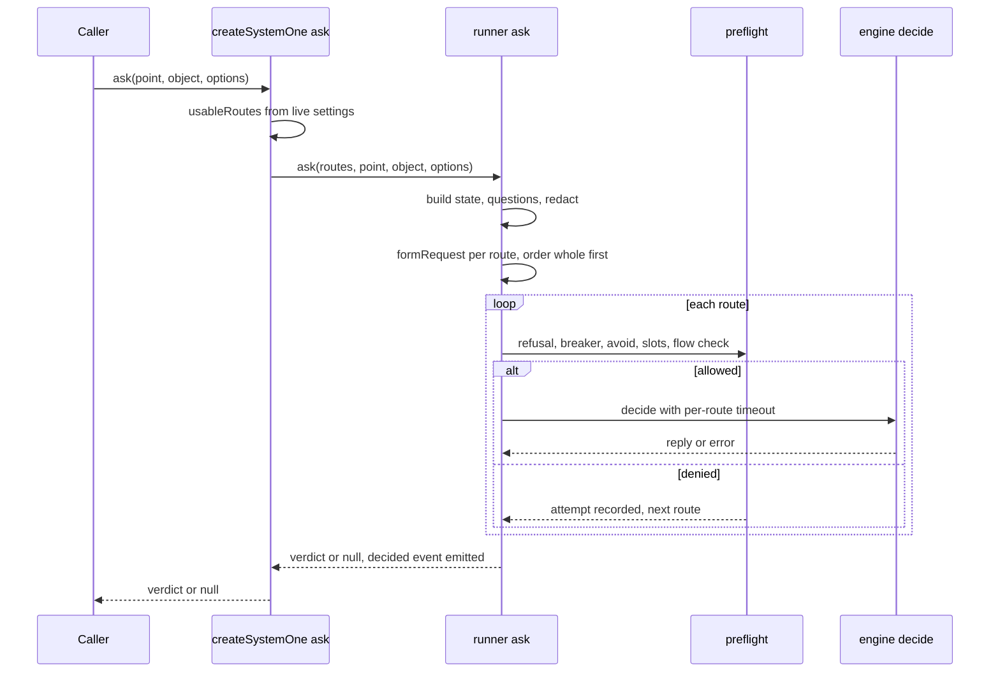

# System One decision engine

System One is the component that answers typed, bounded questions about a state
(a yes/no, a choice among options, or a score across levels) by sending them to a
configured decision engine. A caller builds a decision point, asks it about one
object, and receives either a verdict or `null`. The area is needed when changing
how a question is formed, how routes are chosen and timed out, how a request is
checked before it leaves the process, or how the consult tool reports its readings.

## What the area does

`createSystemOne` in `src/domains/system-one/factory.ts` builds the instance the
composition root holds. On each `ask` it resolves the named routes from live
settings, builds or reuses one engine per route, and hands the routes to the
runner. The runner in `src/domains/system-one/runner.ts` owns the lifecycle of one
ask: formation, redaction, the flow check, per-route timeouts, the breaker, and
the single content-free `system_one.decided` telemetry event. Engines are
selected from `ENGINE_KINDS` (see `src/domains/system-one/engine-kinds.ts`) by a route's `kind`. The
`llm` kind speaks chat completions through `src/domains/system-one/engines/llm-wire.ts`.

The public contract lives in `src/domains/system-one/types.ts`: `Question`
(`noul`, `choice`, `score`), `Answer`, `Abstention`, `EngineRequest`,
`EngineReply`, `DecisionEngine`, `DecisionPoint`, `AskOptions`, `Verdict`,
`RouteAttempt`, and `SystemOne`. `src/domains/system-one/index.ts` re-exports the
public surface.

## Ownership and public symbols

| Source | Owns |
| --- | --- |
| `src/domains/system-one/index.ts` | Barrel of the public surface: `createSystemOne`, `noteSystemOneCall`, `PROFILES`, `isAnswered`, and the types. |
| `src/domains/system-one/factory.ts` | `SystemOneDeps`, `SystemOneInstance`, `createSystemOne`. Route resolution, engine memoization by configuration digest, the credential-presence sampler, and the `slotsFull` check. |
| `src/domains/system-one/runner.ts` | `createRunner`, `BREAKER_THRESHOLD` (3), `BREAKER_COOLDOWN_MS` (5 minutes), `RunnerRoute`, `RunnerDeps`, `noteSystemOneCall`, the flow-check contract `DecisionFlowCheck`. |
| `src/domains/system-one/types.ts` | The question, answer, engine, decision point, and verdict contract. |
| `src/domains/system-one/profiles.ts` | `PROFILE_IDS`, `PROFILES`, the declared capability profiles (`generic`, `jev`, `laya`, `laya-multilingual`, `julia-1`, GLiNER and Strands profiles, and the implicit `llm-structured`). |
| `src/domains/system-one/points/index.ts` | The decision points exported for callers: `consultPoint`, `consultFilterPoint`, `triagePoint`, `JUDGE_SCREEN_POINT`, and bounding helpers. |
| `src/domains/system-one/points/consult.ts` | `consultPoint`, `consultFilterPoint`, `fitFilterItems`, `smallestRequestWindow`, and the consult caps. |
| `src/domains/system-one/engines/llm-wire.ts` | `hasChatWire`, `chatBaseUrl`, `createHttpChannel`, `createOneShotChannel`, `ChatHttpError`, and the per-runtime thinking-off table. |

## How an ask flows

The composition root in `src/entry/orchestrator.ts` constructs the instance with
`createSystemOne`, passing `settings`, `providers`, `credentialsPresent`, a
one-shot port, `admitLlmRequest`, `currentSession`, and a `flowCheck` that reads
the session's flow ledger. Callers reach it through `ask`.

Within `ask` in `src/domains/system-one/factory.ts`, the sequence is:

1. `usableRoutes()` reads live settings, resolves each startup route name that
   settings still name, and drops any route whose target, runtime, or engine kind
   reports a problem. Routes with a problem are recorded, not used.
2. If no route is usable, the caller's `onFailure` receives the first problem and
   `ask` returns `null`.
3. Otherwise `runner.ask` runs with the usable routes. Any exception is caught in
   `src/domains/system-one/factory.ts`, reported through `onFailure`, and turned into `null`.

Within `src/domains/system-one/runner.ts`, `ask`:

- clears the object (`clearedObject`), builds the state and questions with the
  point, and redacts their values. A point that builds no state or no questions
  asks nothing and returns `null`.
- forms a request per route with `formRequest` from `src/domains/system-one/formation.ts` (not re-read
  here). A refused formation records a failed attempt and moves on. Routes whose
  formation abstained on nothing are tried before routes that abstained on some
  questions.
- for each ordered route, checks the total deadline, then `preflight`. `preflight`
  rejects a route in this order: a refusal recorded for its digest, an open
  breaker, an `avoid` destination, a busy optional route (`slotsFull`), and a
  flow check that denies or throws. A flow check that throws is treated as
  denial. A null destination skips these destination checks entirely.
- calls `attempt`, which races `engine.decide` against a per-route timer bounded
  by the smaller of the route's timeout and the remaining total. A reply clears
  that route's breaker. A timeout caused by the route's own bound increments
  failures and opens the breaker at `BREAKER_THRESHOLD`. A timeout caused by the
  ask's total does not change the breaker. A cancellation by the caller does not
  count against the engine. A refusal reported as an `unknown model` 400 is kept
  in `refused`, which no later ask retries until the engine's configuration
  digest changes.
- stops on the first answered route. A `canceled` outcome ends the whole ask.

After the loop the runner decodes the reply's answers through the formation's
`decode`. Each question with no usable answer gets an abstention. The point's
`read` turns the answers into the typed value. If no value comes back, `ask`
returns `null`. The decided event is emitted once per ask with the outcome,
latency, asked and abstained counts, and up to sixteen route attempts. It is
journaled under the session captured at the start of the ask, and it carries
only the call ids collected through `noteSystemOneCall`.

Engine construction is cached per route name by the digest of its name,
configuration, target, runtime id, and whether a one-shot port exists (`digestOf`
in `src/domains/system-one/factory.ts`). A changed configuration rebuilds the engine, and a refusal
recorded for an older digest is not reported for the new one, as `refusedEngines`
filters by digest.

## Decision points and the consult tool

`consultPoint` in `src/domains/system-one/points/consult.ts` is the decision point behind the consult tool.
Its id is `consult` and its version `consult-v1`, with a total deadline of
`CONSULT_DEADLINE_MS` (45 seconds). It bounds the evidence by `CONSULT_MAX_FILES`
(12 files) and `CONSULT_MAX_FILE_CHARS` (6000 code points per file). Its `read`
returns, for each question, either a reading or a marked abstention. A pick
returns its mass per option without a winning key. A score returns the expected
position alongside its mass by level. Each reading is rounded to three decimals.

`consultFilterPoint` asks one yes/no per item under one criterion. A match is
probability at least 0.5, the question's own boundary. Its value lists matches
with scores, scored ids, and unscored ids with reasons. A label-only (categorical)
readout omits scores. `fitFilterItems` caps the text at `CONSULT_FILTER_MAX_CHARS`
(64,000 code points) and fits each item against the smallest whole-request window
that `smallestRequestWindow` reports across routes.

Other points are exported from `src/domains/system-one/points/index.ts`, including `triagePoint` and the
judge-screen point. Their behavior is not inspected for this page.

## Engine wires and profiles

`src/domains/system-one/engines/llm-wire.ts` handles the `llm` kind. `createHttpChannel` posts to
`{base}/chat/completions` for runtimes listed in `CHAT_WIRES`, and sends a
per-runtime thinking-off field from `THINKING_OFF`. Runtimes absent from that table
get no such field. Each request is first admitted through `host.admitLlmRequest`
when present. A refused admission reports through `onAdmissionRefused` and
rethrows. The call's auth and send stages are marked on the telemetry call, and
the response body is read through `probeJson` from the providers domain.

`src/domains/system-one/profiles.ts` declares capability profiles as static contracts, not measurements.
Each profile fixes which semantic kinds are permitted, the option bounds, token
bounds, the renderer id, the readout kinds, and whether its numbers count as real
probabilities. `generic` declares `probabilities: false`. `jev` declares
`windowCounts: "whole-request"`. The `laya` profile caps its window at 512 tokens
and `laya-multilingual` at 1024. `julia-1` declares an option range of 2 to 20 and
an 8192-token window ceiling. `profileFor` and `engineCapabilities` (not read in
full here) resolve a profile into an engine's capabilities.

## Caller and dependency relationships

- Upstream: the orchestrator in `src/entry/orchestrator.ts` is the only composition
  root inspected here that calls `createSystemOne`. Other importers found by search
  include `src/entry/system-one-control.ts`, `src/cli/system-one.ts`, and
  `src/domains/system-one/engines/systemone.ts`. `noteSystemOneCall` is imported
  from the same barrel by the entry side-request admission.
- Downstream: the runner depends on `core/telemetry` for the decided event, on
  `domains/evidence/redact` for scrubbing, on `src/domains/system-one/formation.ts` for request building,
  on `src/domains/system-one/profiles.ts` for `exactBoundFor`, and on `src/domains/system-one/scrub.ts` for `clearedObject`. The
  factory depends on `domains/providers` for targets, runtimes, endpoint capacity,
  and one-shot admission.
- The information-flow check is supplied from outside the area. The orchestrator
  builds it from the session's flow ledger, and the runner treats its result as a
  permit or denial per request.

## Focused tests

`tests/contracts/consult-tool.test.ts` is the focused test found that
exercises the consult workflow end to end through the consult tool. Its cases
include:

- `returns a pick's distribution with no winner, and requires both yesNo outcomes`:
  a typed engine's reply yields `kind: "pick"` with `distribution: { a: 0.7, b: 0.3 }`,
  and the serialized result must not contain a `choice` field. A question missing
  `whenFalse` is refused with `whenFalse must be non-empty`, and the engine is
  not asked.
- `sends nothing on a restricted flow`: a flow check that denies yields
  `flow denied: restricted evidence` in the result, and the engine is asked zero
  times. A flow-check function that throws makes the consult call return an error
  containing `nothing was sent`.

Other cases in the same file cover the filter form, file digests, the window fit,
and label-only readouts. Those are listed by name only; their bodies were not read
for this page. This page does not search the repository for further tests of the runner's
breaker or the `attempt` timeout paths, so no test is cited here for them.

## Things to watch when editing

- `ask` must keep returning `null` rather than throwing. The factory and the runner
  both catch errors, and the callers depend on `null` meaning absence.
- A timeout from the ask's total deadline must not open a breaker. The branch that
  checks `timedOut && timeoutMs < route.timeoutMs` in `src/domains/system-one/runner.ts` is what enforces
  this, and no focused test for it was located.
- The flow check runs before any byte leaves for non-null destinations only.
  Changing that order changes which requests reach the check.
- A route's configuration digest decides both engine reuse and whether a recorded
  refusal still applies. Changing what goes into `digestOf` changes both behaviors.
- Adding a decision point means a module under `points/`, an export in
  `src/domains/system-one/points/index.ts`, and a call site where the caller already waits. The consult
  point's version string (`consult-v1`, `consult-filter-v1`) is what telemetry
  groups by, so bump it when the wording or state shape changes.
- The consult deadline and file caps are documented in source as unmeasured bounds
  derived from the engine kinds' timeouts, not fitted to observed latency.
