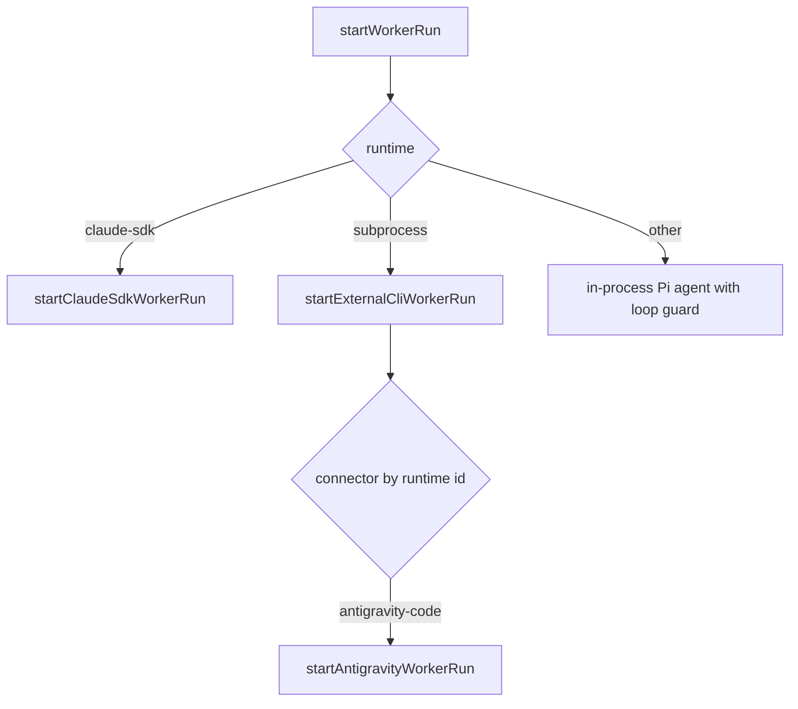

# Engine runtime: worker runs, loop guard, sessions and external CLI connectors

The engine layer under `src/engine/` runs the model side of Clio: a bounded worker run, an orchestrator turn, the tool-round and stream plumbing around each provider call, the session files that hold a conversation, and the connectors that drive external agent CLIs. A reader needs this page when a change touches how a run starts, how tool calls are admitted or stopped, how a conversation is persisted, or how an external CLI is launched.

## What the area covers

- `src/engine/worker-runtime.ts` owns the worker run boundary. `startWorkerRun` is the exported entry point. It validates the result contract, then branches on the runtime: `claude-sdk` goes to the Claude SDK worker, a `subprocess` runtime goes to `startExternalCliWorkerRun`, and any other runtime is run in-process through the Pi agent.
- `src/engine/agent.ts` wraps Clio's engine `Agent`. `createEngineAgent` accepts `EngineAgentOptions`, which adds the `beforeToolBatch` and `beforeStreamRequest` admission hooks, a native `transcriptStreamFn`, and `onStreamInvocation` on top of the Pi `AgentOptions`.
- `src/engine/loop-guard.ts` provides the loop guard. `createLoopGuardRegistration` builds a registration that the worker and orchestrator register as a `before_tool` middleware. Its registration id is `LOOP_GUARD_REGISTRATION_ID`, which is `guard.loop`.
- `src/engine/session.ts` defines the on-disk session format: `ClioSessionMeta`, the JSONL header and turn records, and the `ClioSessionWriter` and `ClioSessionReader` interfaces.
- `src/engine/provider-payload.ts` controls the tool-choice of each provider request. `applyToolRounds` applies the first round that changes a request, and `streamToolRound` retries only a rejected routing parameter.
- `src/engine/harmony-stream.ts` routes streamed Harmony-format output. `routeHarmonyStream` takes an `AssistantMessageEventStream` and a `HarmonyStreamOptions` value and returns a rewritten stream.
- `src/engine/external-cli/connectors.ts` is the registry of managed CLI connectors. `src/engine/antigravity/subprocess-runtime.ts` is the Antigravity (`agy`) connector.
- `src/engine/oauth-browser.ts` holds the browser login handoffs for Codex and Anthropic. Its owning page is not covered in depth here.

## Worker run flow

`startWorkerRun(input, emit)` in `src/engine/worker-runtime.ts` is called with a `WorkerRunInput` and an `emit` callback. Before any runtime branch it calls `assertResponseSchemaRuntime`, rejects `contextSeed` for non-HTTP runtimes, and parses `resultContract` with `parseWorkerResultContract`. The branches that follow are:

1. `runtime.id === "claude-sdk"` goes to `observeExternalWorkerRun` with `startClaudeSdkWorkerRun`.
2. `runtime.kind === "subprocess"` returns `startExternalCliWorkerRun(input, emit)`.
3. Otherwise the worker registers Clio API providers, reads the layered settings for `input.cwd`, installs the output-token and guardrail defaults, and builds a per-run safety context with `createWorkerSafety`.

The in-process path then creates a `loopGuardRegistration` with `createLoopGuardRegistration`, which is the middleware that gates each tool call.

Only the branch conditions above and the `subprocess` dispatch were read. The in-process Pi loop is not traced past the loop guard registration.

## External CLI connectors

`src/engine/external-cli/connectors.ts` holds a fixed list of connectors, one per runtime id: `claude-code`, `codex-cli`, `opencode-cli`, `pi-cli` and `antigravity-code`. `externalCliConnector(runtimeId)` returns the matching entry or `null`. `startExternalCliWorkerRun` throws `no managed CLI connector for runtime '<id>'` when there is no match. The matched connector is started through `observeExternalWorkerRun`, and telemetry observation is disabled for `pi-cli` and `opencode-cli`.

### Antigravity

`src/engine/antigravity/subprocess-runtime.ts` launches the `agy` binary from `PATH`. The permission mode is decided by `antigravitySubprocessConfig(readOnly)`:

- `readOnly` true yields `extraArgs` `["--mode", "plan", "--sandbox"]` and `externalMode` `"plan+sandbox"`.
- otherwise it yields `["--mode", "accept-edits"]` and `"accept-edits"`.

`buildAgyArgs(input)` assembles the argv. It first calls `assertToolProfileEnforceable(input.toolProfile, "antigravity-code")`, then appends `--input-format stream-json`, `--output-format stream-json` and `--disable-slash-commands`. It adds `--model` when `wireModelId` is non-empty. It adds `--conversation <sessionId>` only when `sessionId` is a non-empty string, and throws when the session id exceeds 4096 bytes or contains control characters.

`buildAgyStdinLine(input)` builds one JSON line `{"event":"user","message":{"content":...}}`. The prompt is the system prompt, the dynamic prompt bodies, and the task, joined with blank lines. It throws when the prompt exceeds `ANTIGRAVITY_MAX_PROMPT_BYTES` (4 MiB).

The streaming reader enforces byte caps: `ANTIGRAVITY_MAX_STREAM_LINE_BYTES` (1 MiB per line), `ANTIGRAVITY_MAX_STREAM_BYTES` (8 MiB total), and `ANTIGRAVITY_MAX_RESPONSE_BYTES` (4 MiB) on accumulated text through `appendBoundedText`. Usage from agy is normalized in `normalizeUsage`. The result is marked with `clioExternal.cost: "missing"` so dispatch prices the call from the target's declared rates instead of booking it as zero cost.

Focused test: `tests/contracts/antigravity-subprocess.test.ts` asserts that `buildAgyArgs(input)` equals the argv the fake binary observed. It asserts that a read-only input produces `--mode plan --sandbox` followed by the stream-json flags and the model, that an empty `sessionId` adds no `--conversation`, that `sessionId: "abc"` appends `["--conversation", "abc"]`, and that `antigravitySubprocessConfig(false)` equals `{ extraArgs: ["--mode", "accept-edits"], externalMode: "accept-edits" }`. A separate case asserts that session ids of 4096 bytes and of multibyte or quote-bearing text are passed through unchanged.

## Loop guard

`createLoopGuardRegistration(options)` in `src/engine/loop-guard.ts` returns a `LoopGuardRegistration`. Its per-run state includes a soft tool-call limit, a read reserve, a run-level denial budget, and per-turn maps for blocks, lockouts, call counts and stagnation streaks.

Several constants bound it, all exported from the same file:

- `INTERACTIVE_LOOP_BLOCK_BUDGET` is 2. It is the per-turn block budget for interactive turns.
- `workerLoopBlockBudget(toolCalls)` returns `max(INTERACTIVE_LOOP_BLOCK_BUDGET, ceil(toolCalls / 10))`. For a non-positive or non-integer count it returns the interactive budget. The per-10-calls scaling is the constant `WORKER_LOOP_BLOCK_CALLS_PER_BLOCK`.
- `LOOP_SYNTHESIS_BACKSTOP_DENIALS` is 2. After a synthesis lockout, the model is stopped after this many further denials.
- `WIDE_BATCH_DENIAL_FLOOR` is 32. The run-level denial budget is `max(toolCallCap, WIDE_BATCH_DENIAL_FLOOR)`.
- `RESULT_STAGNATION_THRESHOLD` is 3. A third same-shape call with an identical result is blocked.

The denial budget is applied by `boundRunDenials`. When a `block_tool` effect appears and the attempt count exceeds the budget, the guard returns a synthesis backstop reason. The `WIDE_BATCH_DENIAL_FLOOR` comment in the source gives the reason: one wide parallel batch must be able to steer its siblings instead of ending the run.

The worker passes a `turnBlockBudget` derived from `workerLoopBlockBudget`. Interactive turns use the fixed budget. `createLoopGuardRegistration` reads `options.turnBlockBudget ?? INTERACTIVE_LOOP_BLOCK_BUDGET`.

Focused tests: `tests/extended/loop-guard-epoch.test.ts`, `tests/extended/synthesis-lock.test.ts` and `tests/contracts/gateway-loop-guard.test.ts` exercise the guard. Their individual assertions were not read, so this page does not describe their cases.

## Agent wrapper

`createEngineAgent(options)` in `src/engine/agent.ts` destructures `streamFn`, `transcriptStreamFn` (default `engineStreamSimple`), `onStreamInvocation`, `beforeToolBatch` and `beforeStreamRequest`, and passes the rest to the Pi `Agent`. Each stream invocation first calls `onStreamInvocation`, then attaches the checkpoint observer and compaction policy from the `WeakMap`s keyed by the agent. The tool batch hook is wrapped by `batchAwareBeforeToolCall`, which evaluates the batch decision once per assistant message and returns a block result on rejection. `refusedStream` converts an admission failure into an assistant error message with `stopReason` `"error"`, or `"aborted"` when the signal was aborted.

`createEngineAgent` also exports the stream-replay path. When the first message carries a provider checkpoint marker and a replay fallback is registered, a rejected replay reason matching `portableReplayReason` (for example `setting-off`, `non-codex-route`, or the `native-replay-*` markers) triggers one rebuild and one fresh invocation.

The per-agent Codex configuration is stored with `setEngineCodexConfiguration` and read with `engineCodexConfiguration`. `compactEngineCodex` throws `ProviderCompactionError("native-pending-tools")` when an assistant tool call has no matching tool result, so a compaction never cuts an in-flight batch.

## Provider tool rounds

`applyToolRounds(model, context, options, rounds, targetId)` in `src/engine/provider-payload.ts` iterates the candidate rounds in order and returns the first one that changes the request. A round that the provider previously rejected is recorded in `rejectedChoices`, keyed by target, API, provider, base URL, model id and forced or none kind. A rejected forced choice that falls back to `none` is changed to `auto`.

`streamToolRound` retries only a rejected `tool_choice` error before any output is pushed, and performs at most one `auto` retry. The source matches a 4xx or 5xx status together with a message containing `tool_choice` or `tool choice`. Rate, auth and server errors are not retried.

## Session storage

`src/engine/session.ts` defines the on-disk layout described in its module summary: `sessions/<cwdHash>/<sessionId>/`, containing `docs/wiki/meta.json` (`ClioSessionMeta`) and an append-only `current.jsonl`. `CURRENT_SESSION_FORMAT_VERSION` versions the header. `ClioTurnRecord` holds the turn kinds validated by `isTurnKind`, and `SessionTreeNode` describes the tree rebuilt by `treeFromFileEntries`. `readSessionTailTurns(id, maxTurns)` reads only the tail of a session file. `atomicWrite` and `writeJsonlFileAtomic` handle the write path. This page did not trace the append and recovery code in depth, so details of corrupt-file handling are not described here.

## Things to watch when editing

- The `startWorkerRun` branch order matters. The `subprocess` branch is taken before the in-process setup, so changes to in-process settings or guardrail installation do not reach external CLI workers.
- `buildAgyArgs` calls `assertToolProfileEnforceable` before building the argv. A change to the tool-profile check changes whether Antigravity launches at all.
- The Antigravity read-only mode depends on both `--mode plan` and `--sandbox`. Removing either changes the permission contract that `antigravitySubprocessConfig` reports as `externalMode`.
- The loop guard budgets are coupled: `WIDE_BATCH_DENIAL_FLOOR` and `LOOP_SYNTHESIS_BACKSTOP_DENIALS` each set a bound on denials, and the comments in `src/engine/loop-guard.ts` explain the wide-batch case they protect.

## Related pages

Provider and runtime descriptors are covered in [Domains providers](domains/providers.md). Dispatch that calls `startWorkerRun` is covered in [Domains dispatch](domains/dispatch.md). The ACP surface is covered in [Engine acp](engine/acp.md), and the other engine API adapters in [Engine apis](engine/apis.md).

## What this page does not trace

- The in-process Pi agent loop after the loop guard registration in startWorkerRun was not traced to its completion.
- The loop guard's per-turn lockout and synthesis lockout behavior was not traced to a specific test case assertion.
- The session append, recovery and corrupt-file paths in src/engine/session.ts were not read in depth.
- The Claude, Codex and pi-cli connector implementations and the Harmony retry path in retryHarmonyFailureOnce were not read.
- The oauth-browser.ts Anthropic login flow was only partly read; its Codex callback handoff was read.
