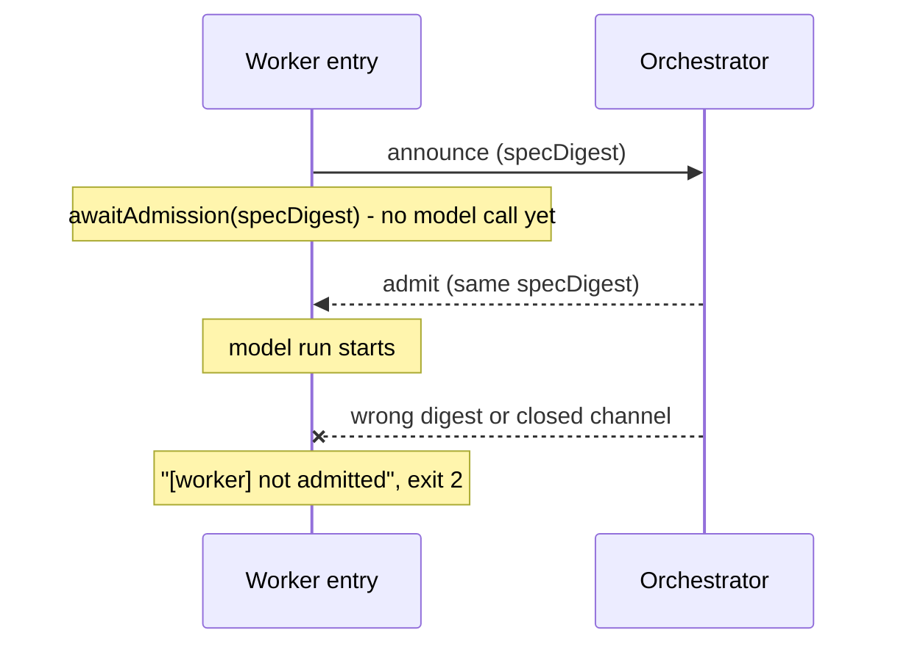

# Contract tests: run_script, dispatch admission, worker boundary, gateway, ACP, telemetry, continuity and safety

The `tests/contracts` directory holds behavior-level tests for the rules a caller of a Clio tool, the dispatch path, the ACP surface or the gateway can rely on. A reader needs this page when they want to know which contract a test pins down, or when they change an enforcing source and need the nearest tests to rerun. The tests import real source modules and assert on their results. This page describes the assertions that were read in the current pass; it does not claim that any test was executed.

## Anchor files

- `tests/contracts/run-script.test.ts`: the `run_script` tool.
- `tests/contracts/dispatch-admission.test.ts`: dispatch validation, the admission gate and capacity queueing.
- `tests/contracts/worker-boundary.test.ts`: the orchestrator-to-worker protocol, event projection, steering, admission, attestation and permission reuse.
- `tests/contracts/gateway-mcp.test.ts`: MCP servers reached through the gateway, including trust, lazy launch and teardown.
- `tests/contracts/acp-v1-sessions.test.ts`: the ACP v1 session surface.
- `tests/contracts/telemetry-journal.test.ts`: telemetry producer boundaries, write-location rules and journal overflow handling.
- `tests/contracts/continuity-fold.test.ts`: the continuity handoff fold, which validates chain extension.
- `tests/contracts/safety-gates.test.ts`: the safety policy engine's block, allow and ask decisions.

## run_script

### Ownership

`src/tools/run-script.ts` owns the tool. `RUN_SCRIPT_INTERPRETERS` is the interpreter allowlist; the tool's parameter schema uses it as the `StringEnum` of the `interpreter` property. `validateRequest` performs the argument checks against a workspace root and an `outsideAllowed` flag. Run records go through `src/core/run-records.ts`, and command execution is in `src/core/safe-exec.ts`; those two modules were not read.

### Flow

A caller invokes the tool with an argument object. `validateRequest` runs before any run record is created:

1. The interpreter argument is trimmed and checked with `isInterpreter` against `RUN_SCRIPT_INTERPRETERS`. A value outside the list returns the error `interpreter must be one of <list>; got '<value>'. Paths and other executables are not accepted.`
2. The script path is resolved to a real path. When `outsideAllowed` is false and the real script path is not inside the real workspace root, the call returns `script resolves outside the workspace root: <script> -> <real path>`.
3. The working directory is resolved. When `outsideAllowed` is true and a `cwd` is given, it is resolved against the root with `path.resolve`; otherwise `resolveSafeCwd` is used. A resolved cwd that is not a directory returns `cwd is not a directory`. When `outsideAllowed` is false and the cwd's real path is outside the root, the call returns `cwd escapes the workspace root through a symbolic link`.

The source comment above the outside-root check records that the flag exists so that an operator at a permissive autonomy setting can run a script outside the workspace after the network scan. this page did not trace how the caller derives `outsideAllowed` from operator mode or sandbox state.

### Focused test cases

`tests/contracts/run-script.test.ts` contains these cases:

- The refusal case for scripts outside the workspace calls the tool with `{ interpreter: "node", script: <path> }` for six inputs: an absolute path to an outside file, a symbolic link at the root pointing outside, a path through a symbolic link directory, the parent-relative argument `"../evil.js"`, a missing `missing.js`, and a directory `sub`. Each must return `kind: "error"`, and `runDirs` must find no run directory. The `"../evil.js"` argument is accepted with either a not-found or an outside-root message.
- The escaping-cwd case covers `cwd: ".."` and a symbolic link that escapes the root.
- The interpreter refusal case passes values outside the allowlist, such as `/usr/bin/env`, `python3.12` and `perl5`, and asserts that no run record is created.
- A workspace root reached through a symbolic link runs and records under the canonical root.

The refusal tests use real temporary workspaces and real files, and they refuse before execution, so they do not need a stubbed command runner.

### Things to watch when editing

- The interpreter allowlist and workspace confinement are separate checks. Passing `outsideAllowed` true skips the confinement checks for both the script and the cwd, so a change to how that flag is derived changes which scripts can run.
- Refusals from `validateRequest` return before a run record is created, and the focused test asserts the absence of run directories for these cases.

## Dispatch admission

### Ownership

- `validateJobSpec` in `src/domains/dispatch/validation.ts` validates a job spec. `DISPATCH_BRIEFING_MAX_BYTES` and `INTERNAL_DISPATCH_BRIEFING_MAX_BYTES` are exported from the same file; the focused test imports the internal limit.
- `admit` in `src/domains/dispatch/admission.ts` takes an `AdmissionRequest` and an injected subset predicate `subsetFn`. It runs two checks in order. First, when `subsetFn(requestedScope, orchestratorScope)` returns false, it refuses with the reason `scope <agentId> is not a subset of the orchestrator scope: <describeScopeExcess>`. Second, for each entry in `requestedActions`, it refuses with `action <action> not in requestedScope.allowedActions` when the requested scope's `allowedActions` set does not contain that action. Otherwise it returns `admitted: true` with reason `ok`.
- `createCapacityAdmissionController` in the same file builds the capacity gate. The queue is in `src/domains/dispatch/admission-queue.ts` and leases are in `src/domains/dispatch/capacity-lease.ts`.
- `admissionWriteBoundaries` in `src/domains/dispatch/extension.ts` maps a task worktree's write paths back onto the checkout before the subset check; the harness-origin recipe check is in the same extension module.

### Flow

A dispatch request is validated by `validateJobSpec`. When `requestOrigin` is `harness` and `readOnly` is not true, validation returns `requestOrigin harness requires readOnly true`. For a harness-origin request whose agent is not read-only, the dispatch extension produces the message `dispatch: harness-origin runs require a read-only recipe; ...` before a worker is spawned. Scope admission goes through `admit`, and the capacity controller decides when a worker may start.

### Focused test cases

`tests/contracts/dispatch-admission.test.ts` contains these cases:

- "validates harness origin only with an explicit read-only request and the internal briefing ceiling" sends `{ agentId: "scout", task: "Inspect the source", requestOrigin: "harness" }` with `readOnly` absent and with `readOnly: false`. Both return `{ ok: false, errors: ["requestOrigin harness requires readOnly true"] }`. With `readOnly: true` the spec is accepted and `requestOrigin` and `readOnly` are preserved. A briefing of `INTERNAL_DISPATCH_BRIEFING_MAX_BYTES + 1` bytes returns `briefing must be <limit> UTF-8 bytes or fewer`, and a `requestOrigin` of `unknown` returns `requestOrigin must be one of: user|agent|internal|harness`.
- "refuses a harness-origin coder and admits shadow Scout to worker creation" uses `makeDispatchBundle` from `tests/harness/dispatch.ts` with a spawn stub that counts starts. A harness-origin `coder` request with a workspace-edit recipe is refused with the read-only recipe message and the spawn stub is not reached. The same request for `scout` reaches the spawn stub, which throws a fixture error to mark the reach.
- "names the root or action that exceeds the orchestrator scope in a subset denial" calls `admit` with the real `isSubset` predicate from `src/domains/safety/scope.ts`. A `git-master` request whose `allowedWriteRoots` holds an outside-the-workspace test input (an absolute path under a directory named `elsewhere`), against `WORKSPACE_SCOPE`, is refused with a reason matching `^scope git-master is not a subset of the orchestrator scope: write root <that input> lies outside`, and the reason ends with the advice `leave write_roots empty`. The input is a synthetic string in the test, not a repository file. A `coder` request with `WORKSPACE_SCOPE` against an orchestrator of `READONLY_SCOPE` is refused with a reason matching `needs action class dispatch, execute, write`. That text is produced by the subset predicate's excess description, so this case exercises the first check; the test does not exercise the `requestedActions` loop.
- The task-worktree case calls `admissionWriteBoundaries` with a worktree at `/dev/shm/clio-test-worktrees/run1` and asserts that "src/a.js" and `test/` map to paths under the checkout root, while a second synthetic outside-the-workspace input, named in the test as an unrelated place, is unchanged. Admitting the first two mapped roots against `WORKSPACE_SCOPE` returns `admitted: true`.
- Capacity cases cover a same-endpoint foreground deadlock being refused rather than queued, ordinary saturation being queued, and deterministic ordering with a fail-closed queue bound. The capacity tests hold a peer lock by writing a lock file through `holdCapacityLockAsPeer`, which records a live pid that is not the test process; the lock file format was not read in full.

### Things to watch when editing

- The harness-origin read-only rule is in `validateJobSpec`, and the recipe check is in the dispatch extension. The `coder` case depends on both, so changing either can change which error a caller sees.
- `admit` takes its subset predicate as an argument, so scope containment is enforced by the injected function, not by the gate itself. The `describeScopeExcess` reason text is part of what callers see.
- The `requestedActions` loop in `admit` runs only after the subset check passes, so an action rejection and a scope rejection produce different reason prefixes.

## Worker boundary

`tests/contracts/worker-boundary.test.ts` pins the protocol between the orchestrator and a dispatched worker process. The protocol types and hashing live in `src/domains/dispatch/worker-protocol.ts` and `src/worker/protocol.ts`; the worker entry is `src/worker/entry.ts`, where `announceWorker` emits an `announce` control frame carrying `specDigest` and the function returns the digest. The worker then calls `demux.awaitAdmission(attestedDigest, WORKER_ADMISSION_WAIT_MS)` from `src/worker/stdin-demux.ts` before any model call. A rejected wait writes `[worker] not admitted: <message>` to stderr and returns exit code 2. Process spawning is in `src/domains/dispatch/worker-spawn.ts`.

Focused cases read:

- "reuses permission answers only for the exact call and unchanged permission conditions" builds a cache key with `workerPermissionCacheKey` from `src/engine/worker-runtime.ts`. A remembered `approve` or `deny` is returned only for the same tool, arguments (independent of key order) and permission context. A different `cwd`, a different command, a changed permission context (`net:project-verifier-confirm` or `autonomy:yolo`) or a changed action class each miss the cache.
- "binds transport admission to the entire approved worker identity" builds an attestation with `approvedIdentityForSpec` and checks `verifyWorkerAttestation`. An identical attestation returns `{ ok: true }`; changing `toolSignature` returns `ok: false`.
- "emits canonical hash domains and normalizes released event ids at the wire read boundary" pins the hash domains: the settings fingerprint is the SHA-256 of `clio-coder.settings:` plus canonical JSON, the spec digest uses the `clio-coder.workerSpec:` domain, the tool signature is the SHA-256 of the sorted tool names, and the endpoint hash of an undefined endpoint is the SHA-256 of `clio-coder.endpoint:none`.
- "projects incremental events and preserves terminal evidence under backpressure" passes a `message_update` through `projectWorkerEventForStdout`, which keeps only `assistantMessageEvent` (here `{ type: "text_delta", delta: "tail" }`) and drops the cumulative `message` field. It then pushes three events into `createBoundedEventQueue(2)`: a display update, a `message_end` terminal event, and a second display update. The queue shifts the `message_end` first and reports `droppedDisplayFrames` of 1, so the terminal frame survives while a display frame is dropped under pressure.
- "serializes live steering and acknowledges exact accepted sequences" passes three steers with sequences 1, 2 and 3 to `createOrderedSteerHandler` concurrently. The delivery callback returns false for text `"refuse"`. The test asserts that delivery runs in order `["first", "refuse", "third"]`, that the accept callback receives sequences `[1, 3]`, and that the reject callback receives one reason containing `does not accept`.
- "starts no model run until the orchestrator admits the attested digest" starts a real worker entry. After the announce arrives, the test waits 500 ms and asserts that stdout is empty and no model request was made. Only after it writes an `admit` frame carrying the announced `specDigest` does the run start.
- "exits unadmitted with code 2 on a wrong digest or a closed channel" runs two workers concurrently, one answering with a wrong digest and one closing stdin. Both must exit with code 2, print `[worker] not admitted: ` on stderr, write nothing to stdout, and make zero model requests.

The remaining cases in this file (stdout write failures, backpressure on the stdout lane, output bounding, hook queries and hook verdicts) were not read; they are not described here.

### Things to watch when editing

- The announce-then-admit ordering is asserted by a timing-based wait, so the 500 ms pause is a test aid for the "no run before admit" claim, not a guarantee of the protocol's timing.
- The event-queue case shows that a terminal `message_end` is retained while display frames are dropped; changing the queue's drop policy changes that outcome.

## Gateway MCP

`tests/contracts/gateway-mcp.test.ts` exercises MCP servers reached through the `gateway` tool. Its surface is described on [Tools gateway](../tools/gateway.md).

Focused case read: "never launches an untrusted server, lists it with the trust remedy, and launches a trusted one on a scoped refresh". The test trusts one server with `trustMcpServer` at action class `read`, then asserts:

- Registration launches no client, and dashboard connection sampling does not start one.
- An unscoped `find` with `query: "mcp"` launches nothing and names the trusted server in `missingCatalogs`, with a note that tells the caller to use `gateway(op="find", server="<id>", refresh=true)`.
- A scoped `find` with `server: "fake"` and `refresh: true` launches exactly that server, once, and leaves the other declared server unspawned.
- An untrusted server is listed with status `untrusted`, the remedy `clio-coder mcp trust marker`, the interactive remedy `/mcp trust marker`, and no catalog.
- A `call` routed to the untrusted server is refused with a message that says it is never launched until trusted, and no client is started.
- A second `call` to the trusted server reuses the session's client; closing the source waits until the trusted server's process is gone and records one teardown report that is complete.

Other gateway cases cover caching, cancellation, process-group termination, result bounding, and stale declarations (for example "treats a trusted server whose declaration changed as stale and never launches it"). Their assertions were not read, so they are listed by name only.

## ACP v1 sessions

`tests/contracts/acp-v1-sessions.test.ts` drives the ACP surface through a `fixture` helper that talks JSON-RPC to the session server. The engine-side surface is described on [Engine ACP](../engine/acp.md).

Focused cases read:

- "ACP close cancels and waits for an active prompt": after `initialize` and `session/new`, a `session/prompt` is started, a `session/set_mode` during it is rejected with a message matching `/active prompt/`, then `session/close` returns `{}`, the fixture records that the prompt was cancelled, and the pending prompt resolves with `stopReason: "cancelled"`.
- "a refused injecting command does not produce a successful ACP turn": a slash command `/skill missing` whose `invoke` returns an error level and that injects a user turn is sent as a prompt. The prompt request rejects with JSON-RPC code `-32603` and the message `the prompt turn failed`.

The other ACP cases cover resume without replay, paged session listing, history streaming, replay of crashed sessions, and pricing facts. Their assertions were not read.

## Telemetry journal

`tests/contracts/telemetry-journal.test.ts` pins boundaries and journal behavior read.

- "producer boundaries reject filesystem helpers and serialization without blocking enqueue" and "rule11 keeps writes under the telemetry root inside the telemetry domain" call checker functions from `tests/boundaries/check-boundaries.ts`, which take a file name and a source string and return violation strings. `checkTelemetryProducer` flags a producer that imports `open` from `node:fs/promises` or calls `JSON.stringify` or `new DatabaseSync`, and accepts a plain `sink.enqueue(event)`. `checkTelemetryWrites` flags write-style source text that targets telemetry paths when the checked file is outside `src/domains/telemetry/`; the same text under that directory is not flagged.
- "journal overflow and invalid records produce gaps, rotation preserves records, and secrets are redacted" opens a call journal with `queueCapacity: 2` and `segmentBytes: 1`, emits four `session.opened` events and flushes. The test asserts `journal.health().dropped` is 2. It then emits one event with an unexpected field, which yields `invalid` of 1. A settled call whose stop detail contains an `api_key=` assignment is written as `api_key=[redacted:assignment]`. The read-back rows contain two `journal.gap` records, one with reason `writer-drop` and count 2 and one with reason `invalid-record` and count 1, exactly two `session.opened` rows, and at least one `journal.segment_closed` row.
- "a flush returns only after the batch a sibling flush started behind the one in flight is written (#434)" and the overlapping-ownership case are listed by name; their assertions were not read.

The worker forwarding case and the remaining journal cases in the file were not read.

## Continuity fold

`tests/contracts/continuity-fold.test.ts` exercises `foldContinuity` from `src/domains/session/continuity/fold.ts`, with the contract types in `src/domains/session/continuity/contract.ts`.

Focused cases read:

- "folds prepared through acknowledged with matching terminal evidence": a prepared-through-acknowledged transaction with matching terminal evidence folds to phase `acknowledged`, one attempt spent, commit outcome `summarized`, no anomalies, and authority `recall_only`.
- "treats an identical duplicate as idempotent and a contradictory one as a conflict": a repeated identical reducing record is not an extra attempt, while a contradictory record for the same sequence raises the `duplicate_conflict` anomaly, sets `validated` to false and yields the action `recall_only` with reason `conflicting_evidence`.
- "refuses a commit that is not a validated successor of reducing": a continuity-only commit at sequence 50 with no spent attempt raises `malformed_continuity_record` and leaves the phase at `prepared`. The same commit with attempt 1 validates structurally but is still refused with `illegal_transition`, because sequence 50 does not follow the head. In the fold source, `illegal_transition` is raised when a phase transition is not in `LEGAL_PREDECESSORS`.

Other cases cover predecessor and attempt checks, refusal of a third reduction attempt, carry verification, resume and pause handling, and clock ambiguity. Their assertions were not read.

### Things to watch when editing

- The fold checks chain extension against the observed head, not against the sequence number. Changing the transition check changes which of these cases is refused.

## Safety gates

`tests/contracts/safety-gates.test.ts` exercises `createSafetyPolicyEngine` from `src/domains/safety/policy-engine.ts` and `mapAutonomy` from `src/domains/safety/autonomy.ts`. In the policy engine, `block` is the final verdict, `ask` is a net rail, and `allow` is the remaining case; a zero-access match and a bash read of a zero-access path produce the reason code `secret_path_bash`.

Focused cases read:

- "hard-blocks zero-access paths before confirmation or ordinary ask rails": reads and writes of `.env` and `credentials.yaml`, and shell commands that reach `.env` through `$'\x2eenv'`, `$'.env'`, `$".env"`, nested `bash -c`, and option-bearing shells such as `bash -o pipefail -c` or `zsh -x -ec`, return `kind: "block"` both with and without a `confirmed` argument. A read of `~/.ssh/id_rsa` returns `reasonCode: "secret_path_bash"`.
- "admits only standalone git diff whitespace checks in default mode": `git diff --check` and `git diff --cached --check` return `allow` with rule `builtin:git-diff-check` and execRecognition `recognized`, and map to `allow` under both default and yolo autonomy. Adding `--ext-diff`, `--output=`, a pipe, a `&&` chain or command substitution makes the command unrecognized and maps to `ask` in default mode, while a redirect to `.env` or a `cat` of `~/.ssh/id_rsa` is blocked.
- "recognizes only exact toolchain version probes": `node --version`, `go version` and `python3 -V` return `allow` with rule `builtin:version-probe`.

The first describe block in this file also asserts that an `rg` command is treated as pending, not recognized, until the login environment capture settles, after which the policy follows what the environment holds.

### Things to watch when editing

- The tests show that recognition is per exact command shape. Broadening a recognized pattern changes which commands map to `allow` under default autonomy, and these tests pin the current narrow set.

## Running the tests

The declared commands in `package.json` include `pnpm run test:file` and `pnpm run test`. The narrowest checks for this page are the `pnpm run test:file -- <file>` forms listed in the front matter. this page did not run any of them.
