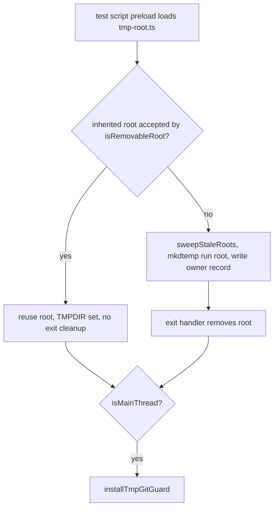

# Test harness fixtures

The files under `tests/harness/` are shared fixtures. Contract, extended, smoke, and extended-smoke tests import them instead of building their own temp roots, Clio homes, fake providers, dispatch contexts, or telemetry views. Read this page before adding a test that needs any of those, or before changing one of these modules, because a change here reaches every test that imports it.

## What the area does

The modules fall into four groups.

1. Process-level isolation, installed by a preload: `tests/harness/tmp-root.ts` and `tests/harness/tmp-git-guard.ts`.
2. In-process or child-process Clio state isolation: `tests/harness/scratch-env.ts`.
3. Test doubles for collaborators: `tests/harness/openai-compat-fixture.ts` (a mock OpenAI-compatible HTTP provider), `tests/harness/dispatch-stub-context.ts` (a minimal `DomainContext`), and `tests/harness/headless-denial-fixture.ts` (a chat loop wired to a scripted agent).
4. Telemetry test helpers built through the real read model: `tests/harness/telemetry-view.ts` and `tests/harness/telemetry-lies.ts`.

## Process-level isolation

### `tests/harness/tmp-root.ts`

This file is a preload. Its module comment explains the purpose: tests call `mkdtemp(join(tmpdir(), "clio-coder-<something>-"))` in many places and some never clean up, so the harness points `TMPDIR` at one per-run root before any test module loads. Because `os.tmpdir()` reads `TMPDIR` on every call, mkdtemp calls made by any test land inside that root, and removing the root at exit collects them. The comment says the preload is loaded with `--import` by the test scripts in `package.json` and runs again in each test child, which inherits the root through the environment.

On load it deletes `FORCE_COLOR`, `NO_COLOR`, `COLORFGBG`, and `CLIO_CODER_THEME` from `process.env`, so color defaults do not depend on the invoking shell.

It then resolves a per-run root:

- If `CLIO_CODER_TEST_TMP_ROOT` is set and `isRemovableRoot` accepts it, the process sets `TMPDIR` to that value and registers no exit handler, so a test child reuses the root of its runner. The preload also accepts an inherited value equal to the canonical system temp directory when that directory's basename carries the prefix.
- Otherwise it calls `sweepStaleRoots()`, creates a fresh `mkdtemp` root under the canonical system temp directory with the `clio-coder-tests-` prefix, writes `.owner.json` inside that root containing the current PID, sets `CLIO_CODER_TEST_TMP_ROOT` and `TMPDIR`, and registers a `process.on("exit")` handler that removes the root when `isRemovableRoot` still accepts it.

`sweepStaleRoots()` lists `clio-coder-tests-*` entries in the system temp directory. It removes a root only when the root's mtime is older than four hours, its `.owner.json` names a positive integer PID, and `process.kill(pid, 0)` fails with `ESRCH`. The module comment states that liveness is never inferred from age alone. No focused test for this owner-liveness branch was located by a repository-wide search for `sweepStaleRoots`, `.owner.json`, and `CLIO_CODER_TEST_TMP_ROOT`; the matches were in `tests/harness/`, package and CI scripts, and an unrelated test under `tests/extended/` that this page does not read (see coverage gaps).

`isRemovableRoot(dir)` is the gate on every recursive delete in this module. It requires the resolved path to start with the canonical system temp directory followed by a separator, the basename to start with `TEST_TMP_ROOT_PREFIX` (`clio-coder-tests-`), and `lstatSync` to report a directory, so a symlink is refused. An inherited value that fails the check is not trusted: the preload replaces it with a fresh root.

When none of the five `CLIO_CODER_*_DIR` variables or `CLIO_CODER_HOME` is set to a non-blank value, and a run root exists, the preload sets `CLIO_CODER_HOME` to a `home` directory under the run root and sets `CLIO_CODER_REQUIRE_HOME_PREFIX=1`.

The temp-git guard is installed last, and only when `isMainThread` is true. The file comment explains that a worker thread cannot use a static import of the guard on Node 22, so the import is dynamic and gated.

### `tests/harness/tmp-git-guard.ts`

Installed by `installTmpGitGuard({ systemTmp, runRoot })`, which `tests/harness/tmp-root.ts` calls on the main thread. The module comment gives the reason: `src/tools/ignore-policy.ts` looks for a `.git` by walking up from a search path, so a stray `.git` marker at the system temp root or at the run root changes results for every `mkdtemp` scratch directory beneath them. The guarded paths are the `.git` entries directly under those two directories. The installer records whether each already existed. A pre-existing one is reported on stderr at install time and is not removed.

The installer is idempotent: a second call returns immediately.

The guard wraps the `node:fs` creators listed in `FS_CREATORS` and the promise subset in `FS_PROMISE_CREATORS`, then republishes them with `syncBuiltinESMExports()`. For most creators the destination is the first argument. For `copyFile`, `cp`, `link`, `rename`, and `symlink` (and their Sync forms), `DESTINATION_IS_SECOND_ARG` selects the second argument. `guardedHit` returns the guarded path when the resolved destination equals it or lies beneath it; it returns null without resolving when the string does not contain `.git`. A hit throws an `Error` built by `guardMessage`, and the original creator is not called.

For child processes, `wrapChildProcess` covers the synchronous entry points `execFileSync`, `execSync`, and `spawnSync`. It snapshots which guarded paths exist before the call and, after the call, throws `guardMessage` naming the argv and cwd if a guarded path appeared; the guarded path takes precedence over the child's own failure. The asynchronous entry points `exec`, `execFile`, `fork`, and `spawn` record offenders on the child's `close` event into `childOffenders`. The `util.promisify.custom` implementation carried by `exec` and `execFile` is wrapped by `wrapPromisified`, so `promisify(execFile)` is covered by the same check. No focused test for this child-process attribution branch was located by a repository-wide search for `wrapChildProcess` and `childOffenders` (see coverage gaps).

At process exit the guard writes all recorded child offenders, plus any guarded path that now exists and was not present at install, to stderr, and sets a non-zero exit code when none was set. It never deletes a `.git`.

## Clio state isolation: `tests/harness/scratch-env.ts`

`scratchClioEnvVars(dir, options)` returns the environment that points five per-root variables at a directory: `CLIO_CODER_HOME`, `CLIO_CODER_DATA_DIR`, `CLIO_CODER_CONFIG_DIR`, `CLIO_CODER_STATE_DIR`, and `CLIO_CODER_CACHE_DIR`, with `CLIO_CODER_INTEROP_HOME=none`. Setting `requireHomePrefix` adds `CLIO_CODER_REQUIRE_HOME_PREFIX=1`. The per-root variables override `CLIO_CODER_HOME`, so the two must move together.

There are three entry points, one for each call pattern:

- `makeScratchHome(prefix)` creates a directory under the temp dir and returns `{ dir, env, cleanup }`. Its `env` sets `requireHomePrefix`. It does not modify `process.env`, so it takes no lock. It is meant for spawning a binary with `env`. `tests/extended-smoke/headless-artifact.test.ts` builds a child `env` from `scratch.env` and `TMPDIR: scratch.dir`.
- `newScratchClioHome(prefix)` is async. It acquires the process-wide env lock, creates the directory, assigns `scratchClioEnvVars` into `process.env`, and calls `resetXdgCache()`. It returns the directory string. `clearScratchClioHome(dir)` removes the directory, resets the cache, and calls the release function stored for that directory.
- `isolateClioEnv(prefix)` is async and acquires the same lock. It snapshots `process.env`, applies the isolated variables, resets the cache, and returns `{ dir, restore }`. `restore()` deletes keys that were not in the snapshot, reinstates snapshot values, removes the directory, resets the cache, and releases the lock.

The lock is a promise chain (`envLockChain`, `acquireEnvLock` in `tests/harness/scratch-env.ts`). Each acquire installs its own gate as the chain tail, awaits the previous gate, and returns its release function. The module comment explains the reason: under `--experimental-test-isolation=none` contract files share one process, and issue #84 showed two files' hooks clobbering each other's `CLIO_CODER_HOME`. A test that calls one of the async acquires must `await` it in `beforeEach` and must release it through the matching clear or restore function. A skipped release leaves every later acquire waiting.

## Test doubles

### `tests/harness/openai-compat-fixture.ts`

`startOpenAICompatFixture(reply, options)` starts a Node `http` server on an ephemeral port. It answers `GET /v1/models` with a list (default one model, `mock-model`) and `POST /v1/chat/completions`. It pushes every parsed request body into `requests`. Other routes return 404. `reply` is a string or a function of the request.

For `stream: false` requests it returns one JSON completion. For streaming requests it writes SSE chunks. Options control `initialErrors` (leading failures with a given status), `replyChunks`, `chunkDelayMs`, `responseHeaderDelaysMs`, `reasoningChunks` under `reasoningField` (default `reasoning_content`), and a `usage` override.

The `toolCall` option yields one `function` tool call with `finish_reason: "tool_calls"` in place of the text reply. It accepts a fixed `OpenAICompatToolCallScript` or a function of the request that may return null to fall through to text. The server resolves the script as follows: a function is called on every streaming request, while a fixed script applies only while `hasToolExchange(request)` is false. `hasToolExchange` reports whether the message history already contains a `tool` role message or an assistant message with a non-empty `tool_calls` array. The `rawArguments` field on a script sends the `function.arguments` string verbatim, so a test can send malformed JSON.

A concrete consumer of the fixed script is `tests/extended-smoke/headless-artifact.test.ts`. Its loop runs three scenarios, `clean`, `recovered`, and `terminal-error`, each calling `startOpenAICompatFixture` with a `toolCall` for the `gateway` tool. The `recovered` and `terminal-error` scenarios add `initialErrors` entries with status 503 and 401. The assertions in that test were not traced past its setup. Function-form scripts are used by `tests/extended-smoke/scout-citation-pipeline.test.ts` and `tests/extended-smoke/user-hook-path-protection.test.ts`, as found by search; those assertions were not traced.

The file also exports `closeServer`, which calls `closeAllConnections()` before `server.close()`, and three seeders that rewrite `settings.yaml` in a config directory: `seedOpenAICompatOrchestrator` (adds the `mock-chat` target at the fixture URL and sets the chat target and model), `seedOpenAICompatToolOrchestrator` (adds tool and chat capabilities and an optional `safety.autonomy`, throwing if that key is absent), and `seedOpenAICompatFleetDefault`. `seedBootstrapTransportTargets` and `seedUnregisteredRuntimeTarget` also rewrite the `targets:` block.

### `tests/harness/dispatch-stub-context.ts`

`dispatchStubContext(options)` returns a `DomainContext` with a `bus` from `createTelemetryHub` and a `getContract` function. `getContract` resolves `config`, `safety`, `agents`, `providers`, `middleware`, and `scheduling`, and returns `undefined` for any other name.

The providers stub reports one target as healthy: the first entry of `settings.targets`, or a default `openai` target when the list is empty, in which case it also writes that target into settings and points `fleet.default` at it. The safety stub's `evaluate` always returns an `allow` decision. The scheduling stub returns a `ceilingUsd` of 5, a preflight verdict of `under`, and `maxWorkers` of 4, with `options.scheduling` spread over those defaults. Agent recipes are loaded from the shipped `src/domains/agents/builtins` directory through `loadRecipesFromDir`.

The `agentTools` option replaces only the `coder` recipe. It sets that recipe's `tools` and `toolRequirements.required` to the option's list (with `optional` empty). `capabilityClass` becomes `workspace-edit` when the list includes `write` or `edit`, and `read-only` otherwise. When the list lacks the context tool, the recipe's `skills` and `boundSkillPaths` are cleared. `useRuntimeDefaultAgentBudget` sets that recipe's `budget` to `null`. Other fields come from the shipped recipe. Tests that omit these options get the unmodified builtin recipes.

Consumers of the `agentTools` override include `tests/contracts/worker-mcp.test.ts` (for example, a surface built from the base tools plus `edit` and `write`) and `tests/contracts/gateway-worker.test.ts`. The individual case assertions in those files were not traced. Consumers that pass a `scheduling` override include `tests/contracts/local-capacity.test.ts`, `tests/contracts/run-cost-ceiling.test.ts`, and `tests/extended/dispatch-retry-capacity.test.ts`; their assertions were not traced.

### `tests/harness/headless-denial-fixture.ts`

`runtimeFixture(cwd)` builds a real `createWorkerSafety` and `createRegistry` with `bashTool` registered, and a `createChatLoop` from `src/session-control/chat-loop.ts` wired to a fixture provider whose target id is `fixture`. The `createAgent` dependency returns a stub agent whose `prompt` issues a scripted sequence of `bash` executions through the registry, emits matching `tool_execution_start` and `tool_execution_end` events, and then emits a `message_end`. It returns `{ loop, events, safety }`.

The exported `inline` constant is a `python3 -c` command that writes `sentinel.txt`. The script starts that call first, so the registry parks it for permission. It then cancels the parked request with `HEADLESS_PERMISSION_DENIED_REASON` through `registry.cancelParkedCall`, which is the headless denial path. The script then runs an `ls` on a missing file, a successful `ls sentinel.txt`, and a hard-refused `rm -f`. It finishes by emitting two legacy `tool_execution_end` events whose result text contains the words "blocked cancelled", to show that those words alone do not classify a call.

The consumer is `tests/fixtures/headless-denial-driver.ts`, which calls `runHeadlessMainAgent(loop, { prompt, mode: "json", ... })` from `src/cli/modes/print.ts` with the fixture loop and writes the collected events to the path in `argv[2]`. `tests/extended/dogfood-headless-denial.test.ts` imports `inline` from this fixture.

## Telemetry helpers

### `tests/harness/telemetry-view.ts`

`telemetryViewOf(sessionId, records, runs)` builds a `TelemetryView` through the `telemetryView` function in `src/domains/telemetry/telemetry-live.ts`, passing each journal as a `JournalSource` with `present`, `records`, `modes`, `skipped`, and `damaged`. Surface tests use it so the numbers they check come from the read model the product uses.

`goldenTelemetryRecords(sessionId)` reads `tests/fixtures/telemetry/golden/p0/journal.jsonl` through `scanTelemetrySegment` and rekeys each record's `ctx.sessionId` and `ctx.agent.id`. `goldenSessionJournal` rebuilds the segment bytes with the golden header. `telemetryCall(sessionId, options)` clones a settled golden call and its started record, assigns fresh ids with `newCallId`, `newAttemptId`, and `newRecordId`, and applies overrides for role, model, usage, cost, disposition, and cache facts. The option comments state that `null` for a count means the provider did not report it, and an omitted count is a measured zero.

### `tests/harness/telemetry-lies.ts`

This module holds detectors for the lie rules L1 through L10 described in its comments. Each detector returns an array of `ref: display` strings, and a test asserts the array is empty. `quantitiesOf(value)` walks a DTO and collects every object carrying `fact`, `display`, and `ref`. The detectors are:

- `unparsableRefs`: each quantity's `ref` must parse with `parseFactRef`.
- `unknownRenderedAsTotal`: an unknown fact must not render as zero, and a partial sum must render as a lower bound or as unknown.
- `unmarkedEstimates`: an estimated fact, or a sum with estimated parts, must contain `~`.
- `absentRenderedOtherwise`: an absent fact, or a sum whose only contributions are absent, must render with one of the `ABSENT` display strings.
- `telemetryLies(quantities)` runs the four above. The module header states that the structural checks (L4, L6 to L8, L10) read the DTO's structure and are separate from these quantity checks.

The focused consumer is `tests/contracts/telemetry-read-model.test.ts`, which imports these detectors from `tests/harness/telemetry-lies.ts`. Its case "L1 and L3: unknown is never zero, and a partial sum is never shown as a total" asserts that `unknownRenderedAsTotal(all)` is `[]`. Its case "L2 and L9: a never-sent call carries no usage, and absent renders as not applicable" builds a `never_sent` call through `callsReport`, checks that its usage is `null` and its `usd` fact kind is `absent`, and asserts that `absentRenderedOtherwise(all)` is `[]`. The file's own comments name the `telemetryCall` fixtures as inputs to these detectors; the individual overhead and split-session cases were not traced.

## Things to watch when editing

- `tests/harness/tmp-root.ts` runs before every test module and every test child. A change to it affects all suites. The `isMainThread` gate determines whether the guard is installed; a worker thread skips it.
- The owner-liveness sweep (`sweepStaleRoots`) and the child-process attribution path (`wrapChildProcess`, `childOffenders`) have no focused test: a repository-wide search finds them only in the harness files. Change them with a direct run of the suite in mind, because a mistake there is not caught by a named case.
- The env lock in `tests/harness/scratch-env.ts` works only when every acquire is paired with its release. An `isolateClioEnv` or `newScratchClioHome` call whose `restore` or `clearScratchClioHome` is skipped leaves every later isolated window waiting.
- `makeScratchHome` does not hold the lock. It is safe only for child processes that read their environment at spawn time, as its doc comment says.
- `dispatchStubContext`'s `agentTools` override builds a constrained coder recipe. Tests that use it should not assume the shipped coder surface.
- The `tests/harness/telemetry-lies.ts` detectors match display strings. The constants in `ZERO` and `ABSENT` must match the renderer's wording, or the detectors will report false violations.
- The OpenAI fixture's fixed `toolCall` script stops applying once `hasToolExchange` sees a tool message. A test that builds its own message history must include a `tool` or `tool_calls` message after the first turn, or the fixed script will keep returning tool calls. A function script is not subject to this rule.
- The temp-git guard refuses only the two `.git` entries it was installed with. It does not guard other `.git` locations, and it does not remove anything it finds.
