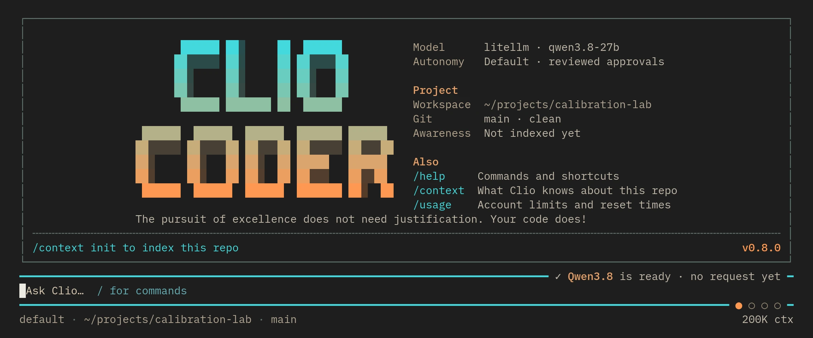
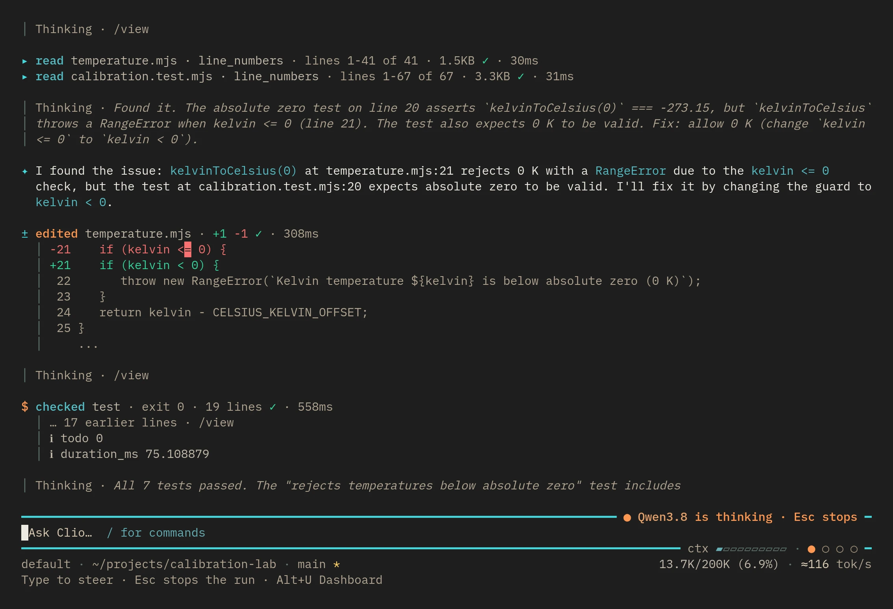

CLIO Coder has two interfaces to the same runtime. The terminal offers the primary workflow. The desktop alpha opens locally in your browser and gives you a visual workspace for projects and conversations.

## CLIO Coder in the terminal

Open your repository and launch CLIO Coder:

```sh
cd /path/to/your/project
clio-coder
```



The terminal combines the conversation, tool calls, permissions, and worker activity. Type `/help` to see available commands, or `/model` to choose a model.



Each tool call stays on its own line with its result, so you can see what ran before you read the answer. `/view` opens the recorded calls and their output.

During a turn, **Enter** queues a message that Clio reads at the next pause between tool calls, **Alt+S** sends it now, and **Escape** cancels the run.

On a permission card, **Enter** allows the call. **Esc** denies it, which skips that call and leaves the run going. **Alt+X** stops the turn.

## CLIO Coder on the desktop

From a terminal, run:

```sh
clio-coder gui --open
```

The command opens the local application with its access link. Open a workspace folder, describe a task, and choose a model and thinking level from the composer.

The rail on the left groups tasks by workspace. The Session column on the right shows the workspace's Git state, the model, context, usage, the plan, artifacts, changes, and run records as the task runs.

You can keep any number of tasks open in one window. Launching again brings that window forward under WSL, when the app is installed through Chrome or Edge, and on a Linux desktop with `wmctrl`, `xdotool` or sway when the background app is running. Otherwise it opens a new browser tab.

Up to four turns run at once by default, set by `interface.guiTurnCapacity` from 1 to 16, and later ones wait for a slot. A task nobody has looked at for five minutes is paused with its conversation kept; choose **Resume session** to continue it.

With the default **Ask first** setting, Clio reads, edits files in the workspace, and runs commands it recognizes, such as read-only inspection and the project's test runners, without stopping. An unrecognized shell command, a large dispatch plan, or anything that publishes outside the project waits for you. The approval names the call, what allowing it authorizes, and what it can affect.

The same control can be switched to **Run without asking** for one task after a second confirmation. The cards stop, and by default the sandbox, snapshots, and safety judge stay on. A turn that changed files ends with a card that opens the changes for review. Type `/` in the composer to list session commands.

A first run with no model connection opens on guided setup, which asks the same questions as `clio-coder configure`.

::: capture gui-home gui-task gui-approval gui-setup
The desktop from a new task to a finished one: the composer, the answer with its tool calls, a waiting approval, and guided setup.
:::

The desktop is in alpha and covers a subset of terminal workflows. Treat it as an optional way to use CLIO Coder, and keep the terminal available for commands that the desktop does not yet expose.

On Linux with a systemd user session, you can install the optional background application, which starts at login and appears in your app menu. The installer offers the same step, and `--gui` accepts it without asking:

```sh
clio-coder gui background install --open
```

For an optional Linux desktop entry, run `clio-coder gui launcher install`. The background service and launcher each have an `uninstall` command. The [desktop app guide](/docs/guide/gui.html) covers those options.

## Choose where to begin

Start in the terminal if you work mostly from a shell or need the primary set of CLIO Coder workflows. Start on the desktop if you prefer browsing projects and working with attachments in a visual interface.

Both launch commands use the installed CLIO Coder package. You do not need an account on this website. Your model connections use your own local server, institutional endpoint, or cloud provider.

Try [a temperature-calibration example with recorded checks](/tutorials/temperature-calibration.html), or follow [your first session](/tutorials/first-session.html) for a concrete task to try in either workspace.
